# Informe N.º 2 — Diseño de la Solución de Software

**Proyecto Integrado — Unidad 2**

| Campo | Detalle |
|---|---|
| Nombre del proyecto | SGP-Kotoduo: Sistema de Gestión y Seguimiento Productivo |
| Empresa / contraparte | Kotoduo — agencia publicitaria y taller de confección, Temuco, La Araucanía (kotoduo.cl) |
| Asignatura | Proyecto Integrado |
| Sección | 2026/P TIHI43/IEC-N4-C2/D Temuco IEC |
| Profesor | Manuel Alfredo Sanchez Carcamo |
| Estudiante | Carlos David Mac-Iver Reydet |
| Metodología | Scrum (Sprint 0 de diseño + 4 Sprints de construcción) |
| Fecha de entrega | 23 de octubre de 2026 |

## Guía de lectura

Los capítulos 1 a 9 explican las decisiones de diseño con sus diagramas y tablas de resumen. Los anexos (capítulo 12) reúnen las tablas largas de consulta, y cada resumen indica qué anexo lo detalla.

**Códigos usados en el informe**

| Código | Significado | Dónde se define |
|---|---|---|
| RF-nn / RNF-nn | Requerimiento funcional / no funcional | Sección 2.1 |
| HU-nn | Historia de usuario | Sección 2.1 |
| M1–M8 | Módulo de la solución | Capítulo 2 |
| OT | Orden de trabajo | Capítulo 2 |
| TE-nn | Habilitador técnico del backlog | Sección 3.1 (Tabla 3.1) |
| A00–A31 | Actividad del plan | Sección 3.1 y Anexo H |
| S0–S4 / Dnn | Sprint / día hábil relativo del proyecto | Sección 3.1 |
| CU-nn | Caso de uso | Sección 4.6 |
| P-nn / IK-n | Pantalla / interacción clave del prototipo | Sección 5.3 |
| FB-nn | Retroalimentación de usuarios | Sección 5.5 |
| R1–R8 | Regla de negocio implementada en la base de datos | Sección 6.2 |
| AM-nn | Amenaza del modelo de amenazas | Sección 7.4 y Anexo K |
| CP-nn | Caso de prueba | Capítulo 8 y Anexo L |

---

## 1. Introducción

Kotoduo es una agencia publicitaria de Temuco. Fabrica ropa deportiva, corporativa y escolar, letreros, souvenirs y papelería, con procesos de bordado, sublimación, impresión en gran formato, grabado e instalación. Sus clientes son colegios, clubes deportivos, municipalidades, fundaciones y empresas.

El diagnóstico de la Unidad 1 dejó un problema central, confirmado por la contraparte: **los trabajadores no saben con certeza en qué proceso va una fabricación ni a qué área le toca seguir**. Cuando faltan las personas a cargo (Bianca, Berny o René), la producción se detiene. El seguimiento vive en un Excel y en la memoria de la encargada de producción, y la información se repite entre el ERP, Softland, formularios, correo y WhatsApp. Además, los insumos se gestionan tarde: la falta de tinta o de papel de sublimación se descubre cuando el trabajo ya debía empezar.

Este informe convierte ese diagnóstico en un diseño que se puede verificar: planificación, arquitectura 4+1, tecnologías, interfaces con prototipo, modelo de datos, seguridad y plan de pruebas. Cada decisión se justifica con tres criterios que pidió el cliente:

1. **Autonomía:** el trabajador sabe qué hacer después sin depender de una encargada.
2. **Simplicidad:** un sistema "fácil, práctico y amigable", que se use desde el celular.
3. **Alcance acotado:** sin contactos de clientes, sin temas de dinero y sin un presupuesto definido.

La petición de "una app para el celular" se entiende como una necesidad de acceso y facilidad de uso, no como una tecnología obligada. Por eso la solución es una aplicación web progresiva (PWA) instalable (sección 4.7).

## 2. Síntesis de la solución propuesta

**SGP-Kotoduo** es una aplicación web progresiva que acompaña cada trabajo desde su ingreso hasta la entrega. Cada trabajo es una **orden de trabajo (OT)** con **etapas** que se generan desde una **plantilla de proceso** según el tipo de trabajo. Así, cada trabajador ve su siguiente actividad, el área y las instrucciones. El sistema también avisa antes de que falte un insumo y registra quién hizo cada cambio.

**Alcance de la versión 1.0:** registro y seguimiento de OT, plantillas de proceso, avance de etapas desde el celular, aprobación de diseño, insumos con alertas, panel de supervisión, bitácora de auditoría y control de acceso por roles. **Queda fuera,** por decisión del cliente o para acotar el proyecto: contactos de clientes, precios, pagos y facturación, integración con Softland o el ERP, compras automáticas y remuneraciones.

**Usuarios:** Administrador, Encargada de Producción, Vendedor, Diseñador y Operario. Estos cinco roles formalizan los perfiles "administrador" y "de respuesta" que mencionó la contraparte.

**Módulos:**

| Código | Módulo | Capacidad principal |
|---|---|---|
| M1 | Autenticación y Usuarios | Inicio de sesión, MFA, gestión de cuentas y roles |
| M2 | Plantillas de Proceso | Tipos de trabajo con etapas, áreas, instrucciones, tiempos e insumos |
| M3 | Órdenes de Trabajo | Registro de OT, generación de etapas y asignación de responsables |
| M4 | Mi Trabajo / Seguimiento de Etapas | Vista personal, iniciar/terminar/bloquear etapa y evidencias |
| M5 | Insumos y Alertas | Stock, kardex de movimientos, alertas automáticas y manuales |
| M6 | Aprobación de Diseño | Versiones de diseño y registro de la aceptación del cliente |
| M7 | Panel de Supervisión | Estado global, avance, órdenes atrasadas o en riesgo |
| M8 | Bitácora y Auditoría | Registro inmutable de eventos, consultable por orden y usuario |

### 2.1 Línea base de requerimientos (Informe N.º 1)

Estos son los requerimientos priorizados en la Unidad 1. La columna "Origen" separa lo **confirmado (C)** por la contraparte de lo que todavía es un **supuesto (S)**, que se valida en la actividad A01.

| ID | Requerimiento funcional | Origen | Prioridad (MoSCoW) |
|---|---|---|---|
| RF-01 | Autenticar usuarios y administrar cuentas con roles y permisos diferenciados | C | Must |
| RF-02 | Definir tipos de trabajo y plantillas con etapas ordenadas, área, instrucciones, duración e insumos | S | Must |
| RF-03 | Registrar órdenes de trabajo con datos de producción (medidas, cantidades, especificaciones), sin contactos ni montos | C | Must |
| RF-04 | Generar las etapas de la OT desde la plantilla y asignar o reasignar responsables | S | Must |
| RF-05 | Mostrar a cada trabajador sus etapas, el estado actual, la siguiente actividad, el área y las instrucciones | C | Must |
| RF-06 | Registrar inicio, término y bloqueo de etapas, habilitando y notificando la siguiente etapa | C | Must |
| RF-07 | Adjuntar evidencias (fotos, notas) a una etapa | S | Could |
| RF-08 | Registrar versiones de diseño y la aceptación o rechazo del cliente | C | Should |
| RF-09 | Mantener insumos con stock mínimo y registrar ingresos y consumos | S | Should |
| RF-10 | Generar alertas de insumo automáticas (bajo mínimo) y manuales (faltante reportado) | S | Should |
| RF-11 | Panel de supervisión con OT en curso, detenidas, atrasadas y fecha estimada de término | S | Should |
| RF-12 | Registrar bitácora de auditoría (usuario, fecha, acción, estado anterior y nuevo) | C | Must |

| ID | Requerimiento no funcional | Métrica de aceptación |
|---|---|---|
| RNF-01 | Usabilidad: interfaz en español, *mobile-first* | Tarea "ver siguiente actividad" en ≤ 3 toques; SUS ≥ 70 |
| RNF-02 | Portabilidad: acceso desde celular y PC sin tiendas de apps | PWA instalable en Android 10+ / iOS 16.4+ y navegadores modernos |
| RNF-03 | Rendimiento | p95 < 500 ms en lecturas con 40 usuarios concurrentes; LCP < 2,5 s en 4G |
| RNF-04 | Seguridad | Controles OWASP ASVS 4.0.3 nivel 2 en autenticación, sesión y control de acceso; TLS 1.2+ |
| RNF-05 | Trazabilidad | 100 % de cambios de estado registrados en la bitácora; retención de 24 meses |
| RNF-06 | Disponibilidad y respaldo | 99 % en horario laboral; RPO 24 h; RTO 4 h |
| RNF-07 | Mantenibilidad | TypeScript estricto, arquitectura en capas, cobertura ≥ 70 % en servicios |
| RNF-08 | Costo | Operación con servicios gestionados de bajo costo (≈ US$ 10/mes), sin licencias |
| RNF-09 | Privacidad (Ley 19.628 / 21.719) | Minimización: sin datos de contacto de clientes; datos personales de trabajadores limitados a lo operativo |

| ID | Historia de usuario | RF |
|---|---|---|
| HU-01 | Como **Operario** quiero ver mis etapas y la siguiente actividad con sus instrucciones para continuar sin esperar a la encargada | RF-05 |
| HU-02 | Como **Operario** quiero marcar una etapa como iniciada o terminada para que el trabajo avance a la siguiente área | RF-06 |
| HU-03 | Como **Operario** quiero reportar un insumo faltante desde la etapa para que se gestione su reposición | RF-10 |
| HU-04 | Como **Operario** quiero adjuntar una foto o nota a la etapa para dejar constancia del trabajo | RF-07 |
| HU-05 | Como **Vendedor** quiero registrar una orden eligiendo el tipo de trabajo para que producción reciba la información completa | RF-03, RF-04 |
| HU-06 | Como **Diseñador** quiero subir versiones del diseño y, como **Vendedor**, registrar la respuesta del cliente, para que producción no comience sin un diseño aprobado | RF-08 |
| HU-07 | Como **Encargada de Producción** quiero definir plantillas de proceso por tipo de trabajo para estandarizar las etapas | RF-02 |
| HU-08 | Como **Encargada de Producción** quiero asignar y reasignar responsables de etapas para distribuir la carga | RF-04 |
| HU-09 | Como **Encargada de Producción** quiero recibir alertas de insumos bajo el mínimo antes de que detengan la producción | RF-09, RF-10 |
| HU-10 | Como **Encargada / Administrador** quiero un panel con el estado y los atrasos de las órdenes para priorizar | RF-11 |
| HU-11 | Como **Administrador** quiero gestionar usuarios y roles para controlar el acceso | RF-01 |
| HU-12 | Como **Administrador** quiero consultar la bitácora para saber quién cambió qué y cuándo | RF-12 |

---

## 3. Planificación del proyecto

### 3.1 Actividades, fases, plazos y responsables

**Metodología: Scrum** (Schwaber & Sutherland, 2020). Parte de los requerimientos todavía son supuestos, y la contraparte debe validar flujos, roles y el alcance de los insumos. Iterar con revisiones frecuentes evita construir sobre supuestos equivocados. Kanban no se eligió como marco principal porque el curso tiene hitos fijos que piden compromisos por iteración; sí se usa su tablero para seguir cada Sprint Backlog.

**Supuesto de capacidad.** La construcción dura un mes (20 días hábiles) y el equipo usa asistentes de IA para generar código, migraciones, pruebas y documentación. Con eso, el cuello de botella deja de ser escribir código y pasa a ser **verificarlo**: revisar cada PR, ejecutar pruebas, validar con el cliente y probar con trabajadores reales. Por eso las duraciones del plan se estiman según el esfuerzo de verificación, y la Definition of Done no acepta código sin revisión humana, pruebas en verde y análisis de seguridad.

**Configuración del marco:**

| Elemento Scrum | Definición en el proyecto |
|---|---|
| Product Owner | Representante de Kotoduo (por validar: Koto o Bianca). **Integrante 2** actúa como PO proxy: mantiene y prioriza el backlog entre reuniones con el cliente |
| Scrum Master | **Integrante 1**: facilita los eventos, gestiona impedimentos y vigila el burndown |
| Equipo de desarrollo | Integrante 1 (back-end, datos, seguridad, infraestructura) e Integrante 2 (UX/UI, front-end, pruebas) |
| Duración del Sprint | Sprint 0: 10 días hábiles (diseño). Sprints 1–4: 5 días hábiles cada uno; la construcción dura 20 días hábiles (≈ 1 mes) |
| Capacidad | ≈ 4 h/día por integrante, dedicadas sobre todo a especificar, revisar y verificar; velocidad objetivo de 21–26 story points (SP) por Sprint |
| Plazos | Relativos, en días hábiles (D1…D30) desde el inicio del proyecto |
| Eventos | Planning (día 1 de cada Sprint, 2 h); Daily asíncrona (15 min por el canal del equipo); Review con el cliente y Retrospectiva (día 5) |
| Definition of Ready | HU con criterios de aceptación, maqueta asociada, dependencias resueltas y estimación en SP |
| Definition of Done | Código revisado por el otro integrante (PR), pruebas unitarias y de integración en verde en CI, sin hallazgos High en el análisis de seguridad, desplegado en staging y validado por el PO proxy |

**Responsables.** Cada actividad tiene un solo responsable principal, para que la responsabilidad no se diluya.

| Integrante | Rol | Capacidad considerada | Responsabilidad principal |
|---|---|---|---|
| Integrante 1 | Scrum Master / Arquitecto / Back-end | Modelado de datos, programación de servicios, seguridad e infraestructura cloud | A00, A03, A05, A07, A09–A12, A14, A16, A18, A20, A21, A24, A26, A27, A29 |
| Integrante 2 | PO proxy / UX-UI / Front-end / QA | Levantamiento con usuarios, diseño de interfaces, desarrollo web y diseño de pruebas | A01, A02, A04, A06, A08, A13, A15, A17, A19, A22, A23, A25, A28, A30, A31 |

**Tabla 3.1 — Product Backlog priorizado**

| Orden | Ítem | Descripción | SP | Prioridad | Sprint |
|---|---|---|---|---|---|
| 1 | TE-01 | Habilitador técnico: repositorio, CI, ambientes, migraciones | 5 | Alta | S1 |
| 2 | HU-11 | Gestionar usuarios y roles + inicio de sesión | 8 | Alta | S1 |
| 3 | HU-07 | Plantillas de proceso | 8 | Alta | S1 |
| 4 | HU-05 | Registrar orden de trabajo | 8 | Alta | S2 |
| 5 | HU-08 | Asignar responsables | 5 | Alta | S2 |
| 6 | HU-01 | Ver Mi Trabajo y siguiente actividad | 5 | Alta | S2 |
| 7 | HU-02 | Iniciar / terminar etapa y avanzar | 8 | Alta | S2 |
| 8 | HU-09 | Alertas de insumos | 8 | Media | S3 |
| 9 | HU-03 | Reportar faltante | 3 | Media | S3 |
| 10 | HU-06 | Aprobación de diseño | 5 | Media | S3 |
| 11 | HU-04 | Evidencias de etapa | 5 | Baja | S3 |
| 12 | HU-10 | Panel de supervisión | 8 | Media | S4 |
| 13 | HU-12 | Bitácora de auditoría | 5 | Media | S4 |
| 14 | TE-02 | Habilitador: pruebas no funcionales, endurecimiento y piloto | 8 | Alta | S4 |
| | | **Total** | **89** | | |

La Tabla 3.2 resume el cronograma de 30 días hábiles y reemplaza a la carta Gantt. El detalle de las 32 actividades (A00–A31), con entregable, responsable, inicio, término y duración, está en el Anexo H (Tabla H.1).

**Tabla 3.2 — Plan por Sprint**

| | Sprint 0 (D1–D10) | Sprint 1 (D11–D15) | Sprint 2 (D16–D20) | Sprint 3 (D21–D25) | Sprint 4 (D26–D30) |
|---|---|---|---|---|---|
| **Objetivo** | Diseño validado de la solución | Acceso seguro y plantillas operativas | Una OT recorre todas sus etapas | Insumos anticipados y diseño aprobado | Supervisión, calidad y puesta en marcha |
| **Actividades** | A00–A09 | A10–A15 | A16–A19 | A20–A23 | A24–A31 |
| **Ítems del backlog** | — | TE-01, HU-11, HU-07 | HU-05, HU-08, HU-01, HU-02 | HU-09, HU-03, HU-06, HU-04 | HU-10, HU-12, TE-02 |
| **SP comprometidos** | — | 21 | 26 | 21 | 21 |
| **Incremento** | Informe N.º 2 + prototipo | Login + MFA + plantillas | Flujo productivo completo | Alertas, aprobación y evidencias | Piloto en producción |
| **Review con cliente** | D10 (**Hito H1**) | D15 | D20 | D25 | D30 (**Hito H2**) |

Cada Sprint de construcción empieza con la Planning (D11, D16, D21 y D26). El día 5 queda para la Review y la Retrospectiva en la mañana, y para un buffer de contingencia en la tarde. En el Sprint 4, las pruebas (A26–A28) ocupan la mayor parte del tiempo, porque son el cuello de botella. El D30 concentra el despliegue y la capacitación en la mañana y la Review final en la tarde.

El burndown del release (Tabla 3.3) compara al cierre de cada Sprint los SP restantes reales con la línea ideal.

**Tabla 3.3 — Burndown ideal del release**

| Momento | SP restantes (ideal) |
|---|---|
| Inicio S1 (D11) | 89 |
| Fin S1 (D15) | 68 |
| Fin S2 (D20) | 42 |
| Fin S3 (D25) | 21 |
| Fin S4 (D30) | 0 |

El Sprint 2 lleva 26 SP, sobre la velocidad media, porque contiene el flujo central. Si se atrasa, HU-08 (5 SP) pasa al Sprint 3 sin bloquear HU-01 ni HU-02: mientras tanto, las etapas se asignan con datos semilla.

### 3.2 Dependencias y prioridades entre tareas

Se usan dos tipos de dependencia:

- **FC (fin-comienzo):** la sucesora empieza cuando termina la predecesora.
- **CC (comienzo-comienzo):** la sucesora puede empezar junto con la predecesora porque ambas comparten un contrato ya definido, como el OpenAPI de A03.

La prioridad depende del valor para el cliente, del riesgo técnico y de si la actividad está en la ruta crítica, no del orden cronológico. La Tabla 3.4 muestra las dependencias que más condicionan el plan; la matriz completa de las 32 actividades está en el Anexo H (Tabla H.2).

**Tabla 3.4 — Dependencias que condicionan la planificación**

| Actividad | Depende de | Por qué tiene prioridad | Efecto si se retrasa |
|---|---|---|---|
| A01 Validar la línea base con Kotoduo | — | Todo el diseño descansa en supuestos que el cliente debe validar | Cada día retrasa A02–A04; riesgo de diseñar flujos incorrectos |
| A03 Arquitectura y contrato OpenAPI | A00, A01 | Define módulos, contrato API y tecnología, de los que dependen datos, seguridad y pruebas; el contrato deja avanzar al front-end en paralelo (CC) | Ruta crítica: +n d desplaza H1 en n d |
| A12 API de autenticación y usuarios | A07, A11 | Toda la API exige identidad y permisos | Ruta crítica: +1 d consume el buffer D15 y desplaza S2 en medio día |
| A18 Avance de etapa transaccional | A16 | Es el corazón de RF-05/RF-06 | Ruta crítica; el problema principal del cliente queda sin resolver |
| A27 Pruebas de seguridad | A24, A23 | Deben cubrir toda la superficie antes de producción | No se autoriza pasar a producción (control de salida) |
| A29 Despliegue en producción | A26, A27, A28 | Solo se despliega lo que pasó las pruebas (DoD) | Desplaza H2 |

**Ruta crítica.** Sigue la cadena del back-end y no tiene holgura, salvo los buffers de cada Sprint:
A00 (2 d) → A03 (3 d) → A05 (2 d) → A07 (2 d) → A09 (1 d) → A10 (1 d) → A11 (0,5 d) → A12 (1,5 d) → A14 (1 d) → [Review y buffer D15] → A16 (2 d) → A18 (2 d) → [Review y buffer D20] → A20 (2 d) → A21 (2 d) → [Review y buffer D25] → A24 (1 d) → A26 (1 d) → A27 (2 d) → A29 (0,5 d) → A31 (0,5 d) = **30 días hábiles** (10 de diseño y 20 de construcción).

**Si hay retrasos:** el buffer del día 5 absorbe hasta medio día por Sprint. Si el retraso es mayor, el PO proxy mueve al Sprint siguiente el ítem de menor prioridad (HU-04 o HU-08). Así se protegen los hitos H1 y H2 sin relajar la DoD.

---

## 4. Arquitectura de la solución

### 4.1 Descripción general de la arquitectura 4+1

SGP-Kotoduo es un **monolito modular en capas con un cliente PWA** (Figura 4.1). El front-end es una aplicación estática. El back-end es una sola API REST dividida en los módulos M1–M8, y cada módulo tiene las capas *routes → controller → service → repository*. Los datos viven en dos bases: PostgreSQL guarda lo transaccional, con integridad referencial, y MongoDB guarda eventos, evidencias y notificaciones, que cambian de forma. Las dos se conectan con un **outbox transaccional** (sección 6.5).

Los microservicios no se justifican aquí. Con dos desarrolladores, unos 25 usuarios y cerca de 30 OT por semana, sumarían despliegues, monitoreo y coordinación sin aportar valor al cliente. Los límites entre módulos permiten separar alguno más adelante, por ejemplo M5 si se integra con proveedores.

Cada vista parte de un diagrama general y sigue con acercamientos por tema. Los elementos en gris (`«ref»`) se detallan en otra figura.

| Vista (Kruchten, 1995) | Pregunta que responde | Interesados | Diagramas | Figuras | Sección |
|---|---|---|---|---|---|
| Lógica | ¿Qué abstracciones y responsabilidades tiene el sistema? | Usuarios finales, analistas | Clases (dominio y servicios), estados | 4.2–4.8 | 4.2 |
| Desarrollo | ¿Cómo se organiza el código y sus dependencias? | Programadores, jefe de proyecto | Componentes, paquetes | 4.9–4.13 | 4.3 |
| Procesos | ¿Qué flujos, concurrencia y sincronización existen? | Integradores de sistemas | Actividades con carriles (BPMN), secuencia, tabla de procesos | 4.14–4.18 | 4.4 |
| Física | ¿Dónde se ejecuta cada elemento y cómo se comunica? | Infraestructura y administración | Despliegue | 4.19–4.20 | 4.5 |
| Escenarios (+1) | ¿Qué casos de uso validan y unen las cuatro vistas? | Todos, incluido el cliente | Casos de uso | 4.21–4.24 | 4.6 |

**Las cinco vistas describen la misma solución.** Basta seguir el caso de uso CU-06 "Actualizar avance de etapa":

- **Lógica:** la clase `EtapaOrden`, su máquina de estados y `EtapaService.terminar()` (Fig. 4.3, 4.6 y 4.7).
- **Desarrollo:** el componente M4 y el paquete `modules/etapas` (Fig. 4.11–4.13).
- **Procesos:** el bucle de producción (Fig. 4.14 y 4.16), una transacción (Fig. 4.17) y el trabajo asíncrono del relay (Fig. 4.18).
- **Física:** corre en el contenedor de Render y guarda en Neon y Atlas (Fig. 4.19).
- **Escenarios:** es el caso de uso central del taller (Fig. 4.23).

**Figura 4.1 — Vista general de capas.** Una petición entra desde la PWA por Cloudflare, pasa el middleware de seguridad y la resuelve un módulo contra PostgreSQL. Después, el relay publica los eventos en MongoDB y envía avisos push. Los archivos van directo de la PWA a R2.

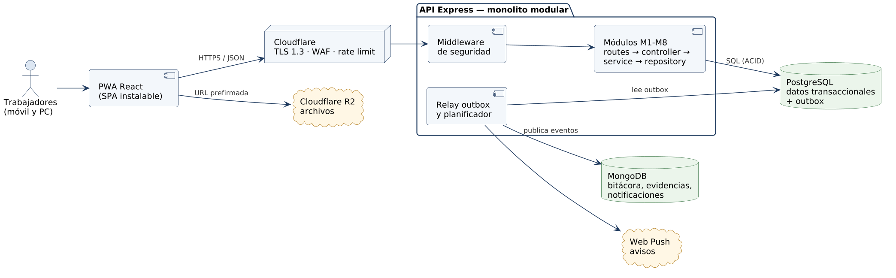

### 4.2 Vista lógica

La vista lógica tiene siete figuras: un mapa del dominio (Fig. 4.2), tres acercamientos (Fig. 4.3–4.5), los servicios (Fig. 4.6) y las máquinas de estados de la etapa y de la OT (Fig. 4.7 y 4.8).

**Figura 4.2 — Modelo de dominio: visión general.** Las 13 clases del dominio, sin atributos, en tres paquetes. Cada paquete indica la figura que lo detalla.

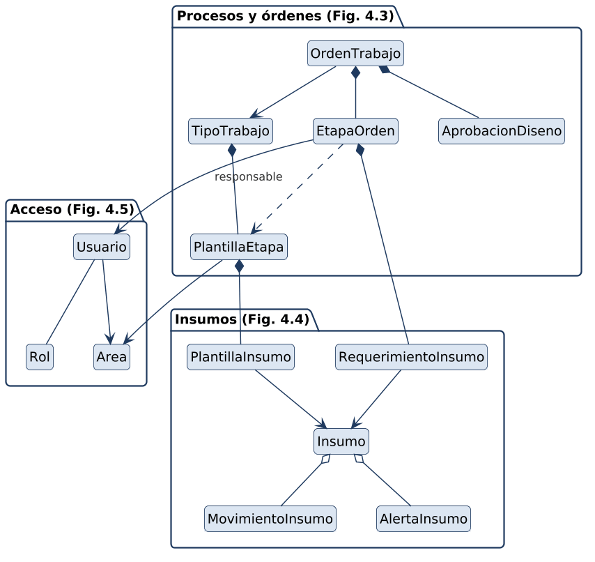

**Figura 4.3 — Dominio: procesos y órdenes de trabajo.** Es el núcleo del sistema. El tipo de trabajo define sus etapas estándar, y cada orden tiene sus propias etapas y versiones de diseño.

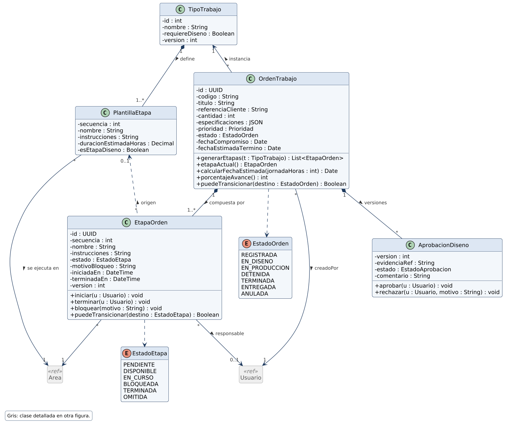

**Figura 4.4 — Dominio: insumos, consumo y alertas.** Separa el consumo estándar de la plantilla (`PlantillaInsumo`) de lo que necesita cada etapa concreta (`RequerimientoInsumo`). El stock resulta de sumar los movimientos del kardex.

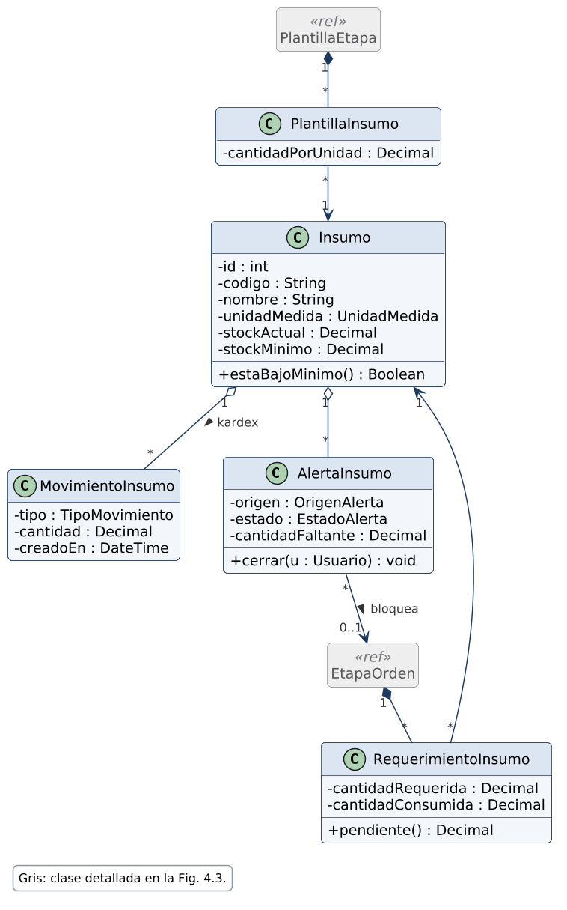

**Figura 4.5 — Dominio: usuarios, roles y áreas.** Un usuario puede tener varios roles y pertenece a un área. Los cinco roles son la base del control de acceso (sección 7.1).

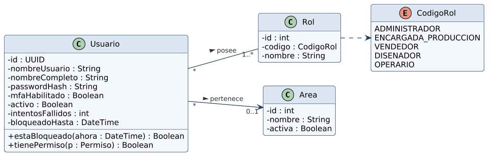

**Figura 4.6 — Servicios de aplicación.** Cada servicio coordina una entidad. `EtapaService` le pide a `InsumoService` que registre los consumos. Los servicios que cambian estado, y también `AuthService`, registran sus eventos en `AuditoriaService`, que los publica después mediante el outbox.

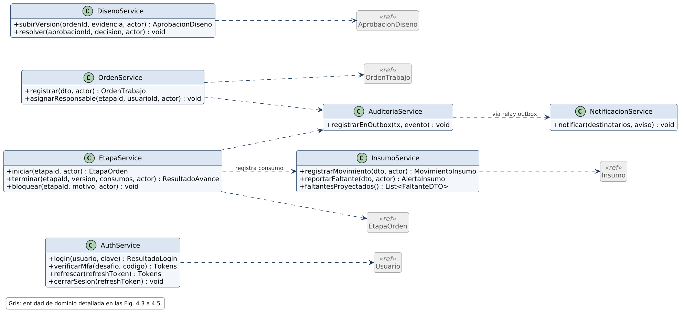

*Decisiones de diseño:*

1. **`TipoTrabajo` y `PlantillaEtapa` sacan el conocimiento de la cabeza de tres personas.** La secuencia, el área, las instrucciones y la duración pasan a ser datos editables (RF-02).
2. **`EtapaOrden` copia los datos de la plantilla al crear la OT.** Si alguien edita la plantilla, las órdenes en curso no cambian.
3. **Las reglas de transición viven en el dominio** (`puedeTransicionar()`) y se repiten en la base de datos como segunda barrera (trigger R2, sección 6.2).
4. **Ningún servicio espera a MongoDB.** `AuditoriaService` solo escribe en el outbox, dentro de la misma transacción.

**Figura 4.7 — Diagrama de estados de `EtapaOrden`.** El camino normal es PENDIENTE → DISPONIBLE → EN_CURSO → TERMINADA. Una etapa queda DISPONIBLE cuando la anterior se cierra, sea TERMINADA u OMITIDA, así que omitir una etapa no traba la secuencia. La etapa de diseño no se cierra con el botón **Terminar**, sino cuando el cliente aprueba el diseño. **Reportar problema** pide un motivo, avisa a la Encargada y detiene la OT; solo la Encargada puede desbloquear la etapa. Si la OT se anula, toda etapa abierta pasa a OMITIDA. El mismo grafo está en el dominio y en el trigger `trg_etapa_transicion`.

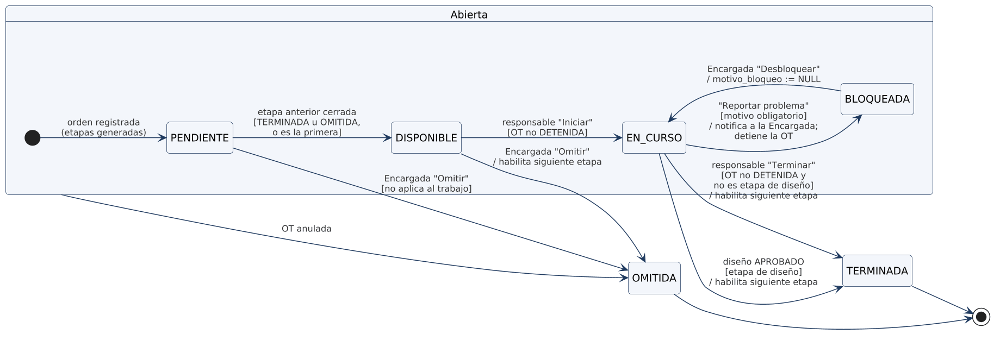

**Figura 4.8 — Diagrama de estados de `OrdenTrabajo`.** La OT nace REGISTRADA, o EN_DISENO si su tipo de trabajo requiere diseño. Pasa a EN_PRODUCCION cuando el cliente aprueba el diseño o se inicia la primera etapa, y a TERMINADA cuando todas sus etapas están cerradas. Queda **DETENIDA** si se bloquea una etapa o si la Encargada la detiene con un motivo. Solo la Encargada la reanuda, y únicamente si no quedan etapas bloqueadas; el estado de historia (H) la devuelve al subestado que tenía. Mientras está activa se puede anular con un motivo. Estas reglas se validan en el dominio y en el trigger `trg_orden_transicion`.

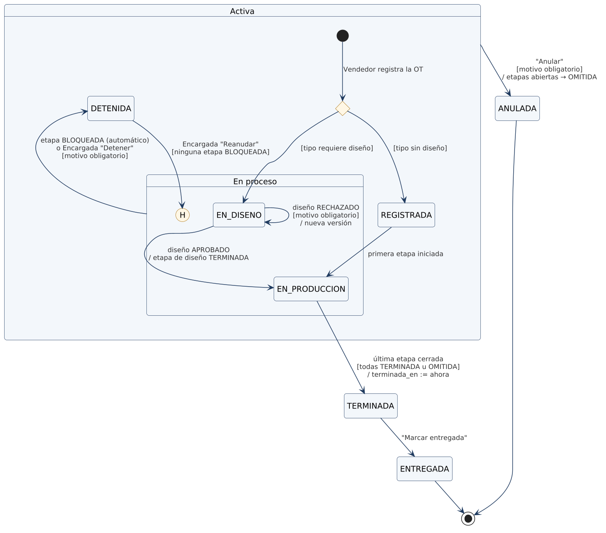

Las otras dos entidades con estado tienen ciclos lineales y no necesitan diagrama:

- **`AprobacionDiseno`:** PENDIENTE → APROBADO o RECHAZADO, ambos finales. Rechazar exige un comentario, y quien subió el diseño no puede resolverlo (R6). Una nueva propuesta es una nueva versión.
- **`AlertaInsumo`:** ABIERTA → EN_GESTION → CERRADA.

### 4.3 Vista de desarrollo o implementación

**Figura 4.9 — Componentes: visión general.** Los tres bloques del monorepo (PWA, `packages/shared` y API) y los servicios externos que usan.

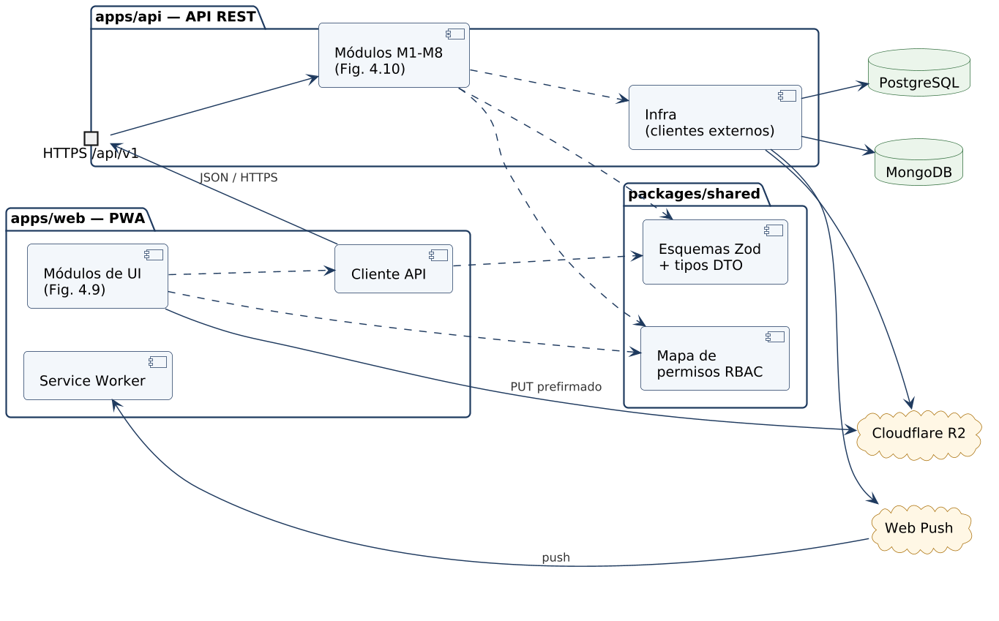

**Figura 4.10 — Componentes de la PWA.** El *shell* carga ocho módulos de pantalla, y todos llaman a la API a través de un único cliente.

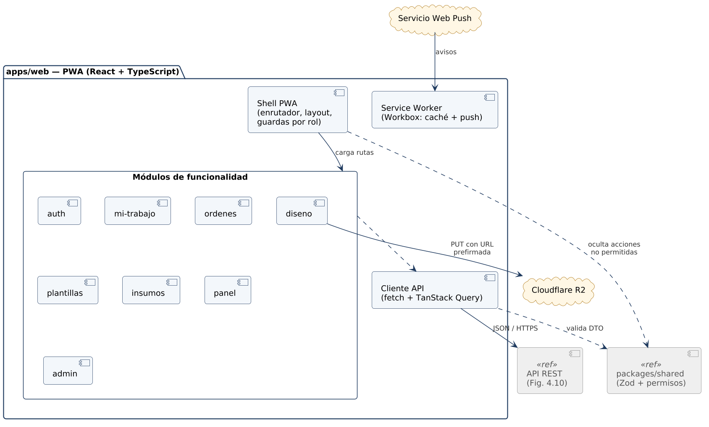

**Figura 4.11 — Componentes de la API.** Toda petición pasa por el middleware de seguridad antes de llegar a un módulo. Entre módulos hay solo tres dependencias (M3→M2, M4→M5 y M6→M4), y todos llegan a los servicios externos a través de *Infra*.

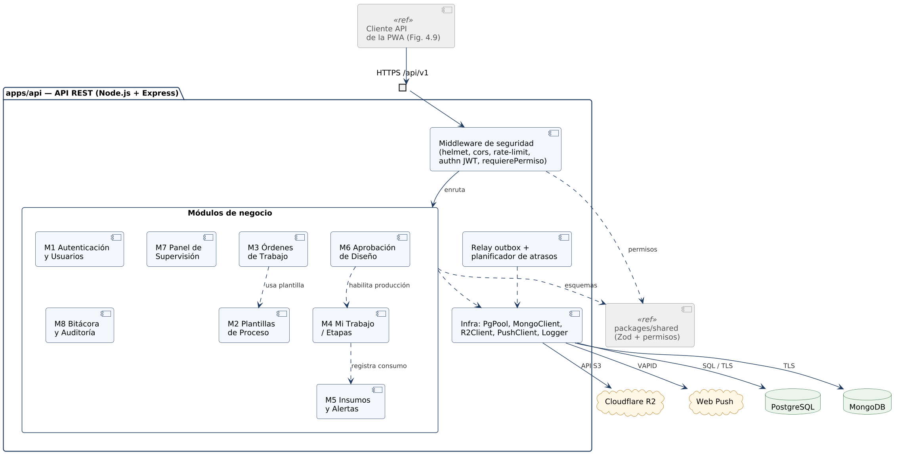

Tres decisiones ordenan el código:

- La PWA tiene un módulo de pantalla por cada módulo de negocio (`mi-trabajo` ↔ M4).
- `packages/shared` guarda los esquemas de validación (Zod) y el mapa de permisos que usan tanto la PWA como la API. Así las reglas no se desalinean entre capas.
- *Infra* encapsula los clientes de PostgreSQL, MongoDB, R2 y Web Push. Cambiar Neon por otro PostgreSQL solo cambia la configuración.

**Figura 4.12 — Paquetes del monorepo.** `apps/web`, `apps/api`, `packages/shared`, `db` (migraciones y semillas) y `tests` (unitarias, integración, E2E y rendimiento). La PWA y la API solo comparten código por `packages/shared`.

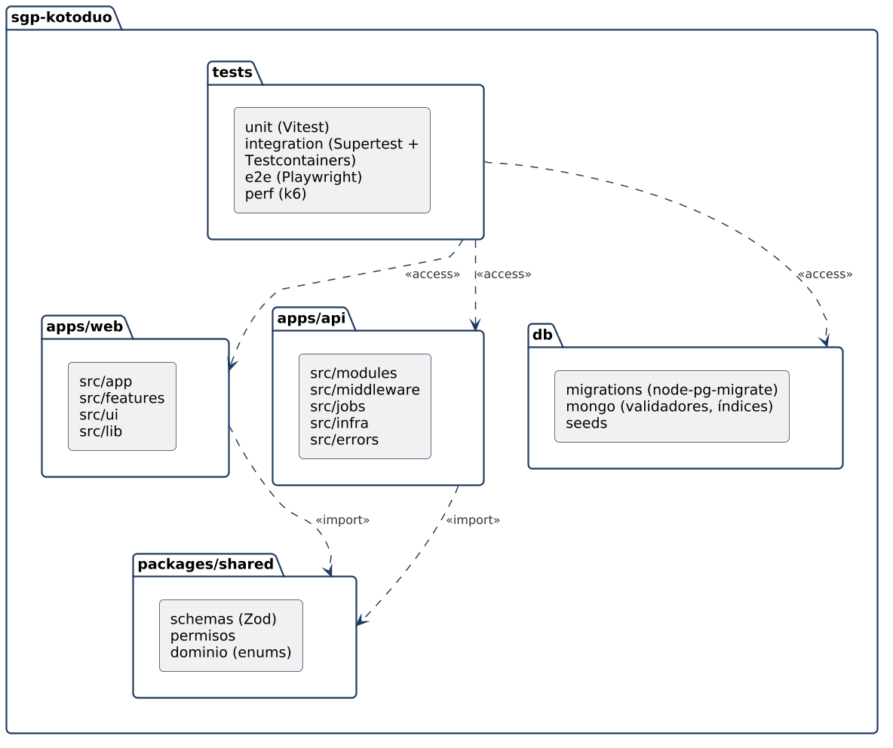

**Figura 4.13 — Regla de dependencias por capas.** Las dependencias van en un solo sentido: *routes → controller → service → repository → infra* en la API y *app → features → ui/lib* en la PWA. Así los servicios se prueban con repositorios simulados, y solo la capa *repository* ejecuta SQL, siempre parametrizado.

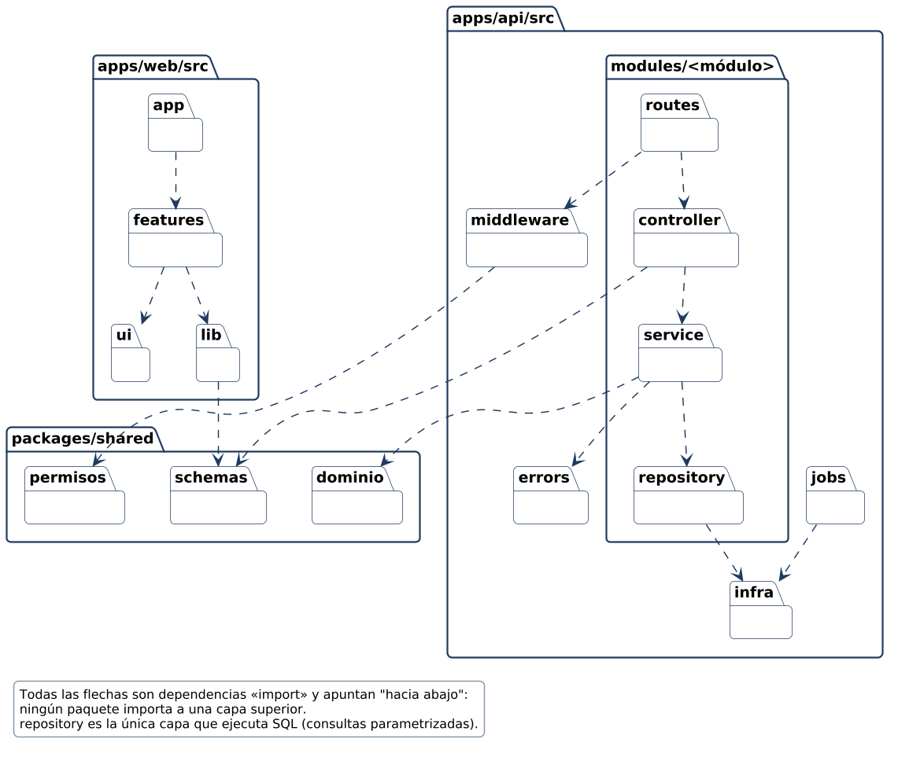

| Convención | Regla |
|---|---|
| Ramas | `main` protegida; `feature/HU-xx-descripcion`; *merge* solo por PR aprobado y CI en verde |
| Versionado | SemVer en *tags* (`v1.0.0`); migraciones numeradas e inmutables |
| Estilo | ESLint (con `eslint-plugin-security`) + Prettier; TypeScript `strict: true` |
| Configuración | Variables de entorno validadas con Zod al inicio; sin secretos en el repositorio |

### 4.4 Vista de procesos

Primero se muestra el flujo de negocio con diagramas de actividades por carriles, equivalentes a un BPMN (Fig. 4.14–4.16). Después, el caso crítico CU-06 en dos diagramas de secuencia: la parte síncrona y la asíncrona (Fig. 4.17 y 4.18).

**Figura 4.14 — Flujo productivo: visión general.** La orden de punta a punta: registro y diseño, asignación, ejecución de etapas, término y entrega.

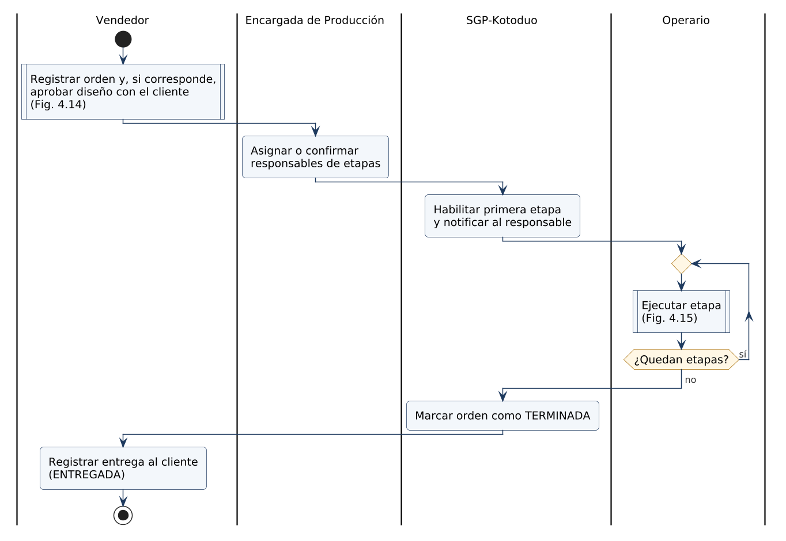

**Figura 4.15 — Subproceso: registro de la orden y aprobación de diseño.** El bucle entre Diseñador y Vendedor representa las rondas de aprobación con el cliente. Cada respuesta queda en la bitácora con la versión, quién respondió y el motivo.

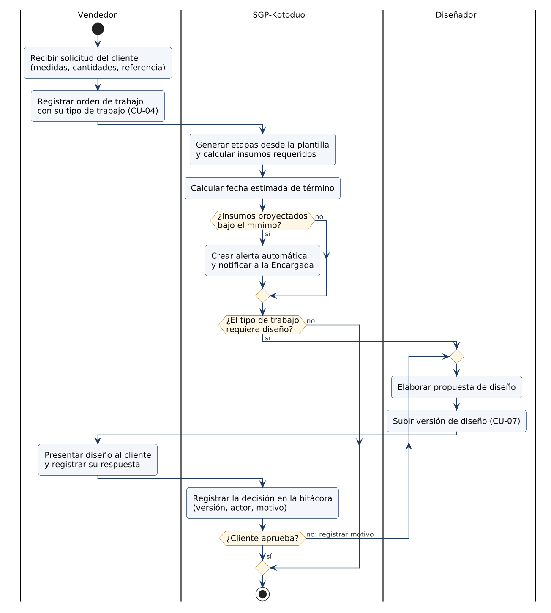

**Figura 4.16 — Subproceso: ejecución de una etapa.** Se repite por cada etapa. El consumo y la evidencia se pueden registrar en paralelo, y la siguiente etapa se habilita mientras se escribe la bitácora.

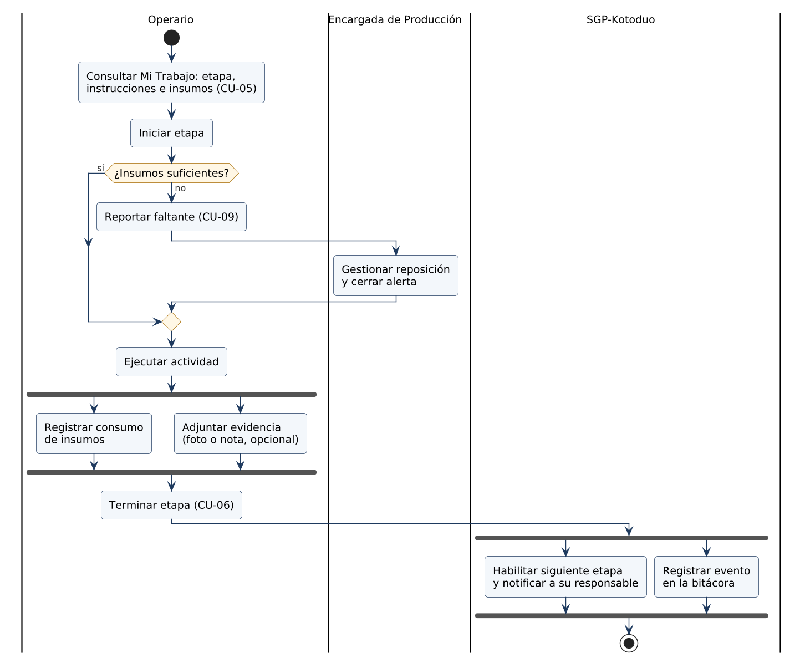

Tres decisiones del flujo atacan problemas del diagnóstico:

1. **La alerta de insumo se emite al registrar la OT,** antes de producir. Esto evita el caso de quedarse "sin tinta el lunes".
2. **Sin diseño aprobado no hay producción.** Formaliza la "aceptación del diseño" que mencionó el cliente.
3. **Si falta un insumo durante la etapa, el operario lo reporta desde el celular** y sigue cuando la Encargada lo resuelve, sin tener que ir a buscarla.

**Figura 4.17 — Secuencia CU-06 "Terminar etapa": tramo síncrono.** La API comprueba quién llama y si tiene permiso, y valida los datos. Luego bloquea la fila de la etapa, revisa que sea del operario (si no, responde 404 para no revelar que existe) y que nadie la haya cambiado antes (si cambió, responde 409). Todo se guarda en **una sola transacción**: la etapa terminada, los consumos (que pueden generar una alerta), la siguiente etapa disponible y el evento del outbox.

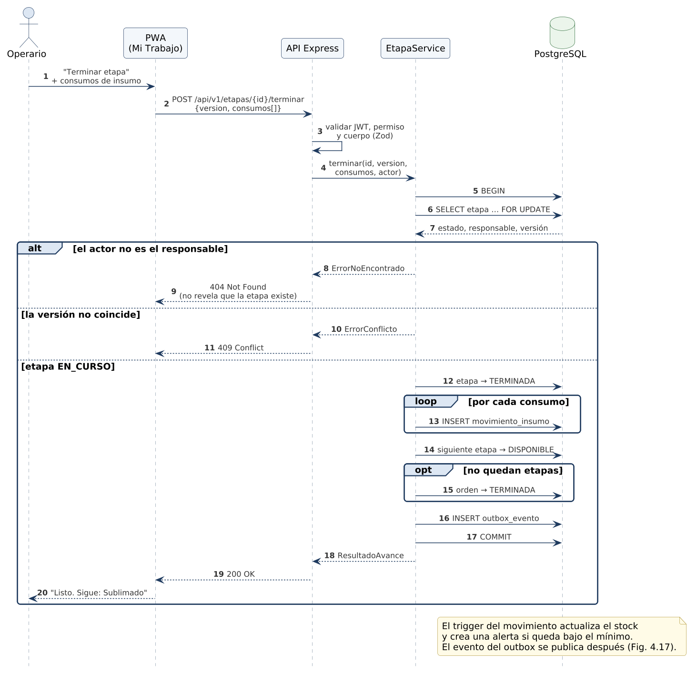

**Figura 4.18 — Secuencia del relay outbox: tramo asíncrono.** Cada 5 segundos, el relay toma los eventos pendientes, los publica en MongoDB y envía el aviso push. El operario no espera por esto. `FOR UPDATE SKIP LOCKED` y la escritura idempotente evitan duplicados si corren varias instancias.

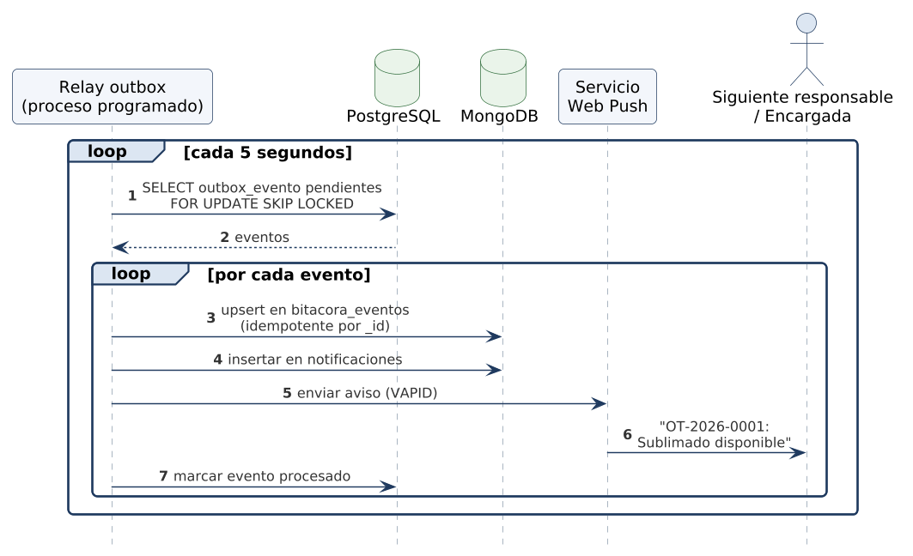

La Tabla 4.1 resume los procesos que corren en el sistema y cómo se sincronizan.

**Tabla 4.1 — Procesos de ejecución y concurrencia**

| Proceso / hilo | Dónde corre | Disparador | Concurrencia y sincronización |
|---|---|---|---|
| Atención de solicitudes HTTP | Contenedor API (event loop de Node.js) | Petición de la PWA | Asíncrono no bloqueante; pool PostgreSQL de 10 conexiones; transacciones con `FOR UPDATE` y versión optimista para evitar dobles avances |
| Relay outbox | Mismo contenedor, temporizador de 5 s | `outbox_evento` sin procesar | `FOR UPDATE SKIP LOCKED` permite varias instancias sin duplicar; escritura idempotente en Mongo (`_id = evt-n`) |
| Verificador de atrasos | Mismo contenedor, cada 15 min | Reloj | Recalcula `fecha_estimada_termino` y notifica OT en riesgo; operación idempotente |
| Triggers de base de datos | PostgreSQL | `UPDATE`/`INSERT` | Se ejecutan dentro de la transacción del llamador (atomicidad) |
| Service Worker | Dispositivo del usuario | Instalación, `fetch`, `push` | Caché *stale-while-revalidate* de lecturas; las escrituras requieren conexión (sin cola offline en la v1, para evitar conflictos) |
| Respaldo nocturno | GitHub Actions (cron 03:00 CLT) | Programación | `pg_dump` cifrado hacia R2; no bloquea la operación |

### 4.5 Vista física o de despliegue

**Figura 4.19 — Despliegue: topología de ejecución.** Dónde corre cada pieza en producción y cómo se comunican.

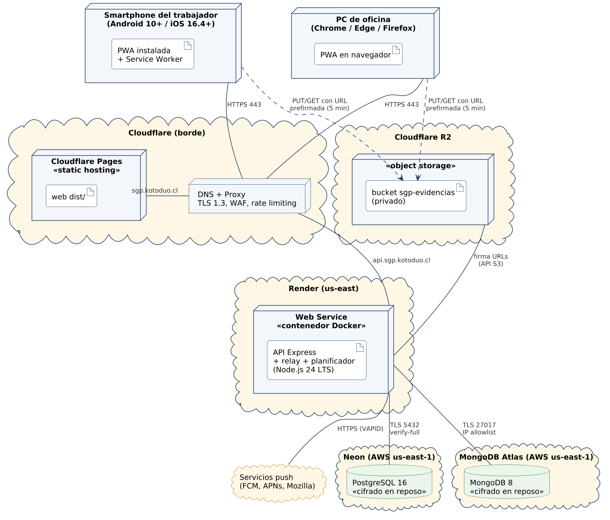

**Figura 4.20 — Despliegue: integración continua, entrega y respaldos.** Las rutas que no atienden usuarios: GitHub Actions despliega la web y la API, y hace el respaldo nocturno cifrado hacia R2.

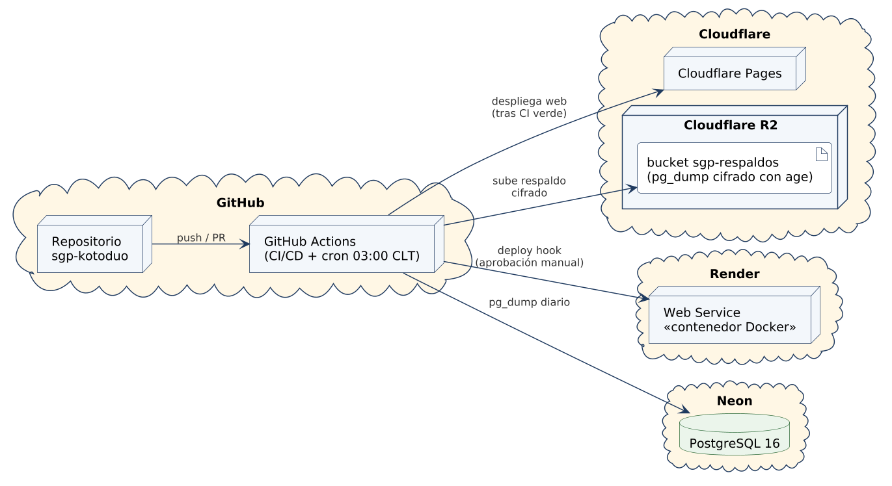

Así funciona la topología:

1. Los trabajadores usan la PWA instalada en su **celular**; en la oficina, la abren en el navegador del **PC**.
2. Todo el tráfico entra por **Cloudflare**, que aporta DNS, TLS 1.3, firewall de aplicaciones (WAF) y límite de peticiones. `sgp.kotoduo.cl` sirve la PWA desde **Cloudflare Pages** y `api.sgp.kotoduo.cl` lleva a la API, un contenedor Docker con Node.js 24 LTS en **Render**.
3. La API se conecta por TLS a **PostgreSQL 16 en Neon** y a **MongoDB 8 en Atlas**. Los tres servicios están en la misma región (este de EE. UU.) para bajar la latencia.
4. Los archivos se suben y se descargan **directo** entre el dispositivo y **Cloudflare R2**, con URL firmadas que duran 5 minutos. La API nunca recibe el archivo, lo que reduce su carga y su superficie de ataque.
5. **GitHub Actions** ejecuta la integración continua, los despliegues y el respaldo nocturno.
6. Los dos dominios comparten `kotoduo.cl`, lo que permite usar cookies `SameSite=Strict` (sección 7.2).

**Ambientes:** *local* (Docker Compose con PostgreSQL y MongoDB), *staging* (rama `staging` de Neon y servicio de *preview* en Render) y *producción*. Por el plazo, staging y producción se configuran desde los paneles de cada proveedor, y cada recurso queda anotado en un inventario del repositorio (servicio, plan, región y variables). Declararlos como infraestructura como código queda como mejora posterior (sección 4.7).

### 4.6 Vista de escenarios o casos de uso

Los catorce casos de uso se reparten en cuatro diagramas, uno por subsistema, para que cada interesado vea solo lo suyo. Los actores de cada diagrama coinciden con la matriz de permisos (Tabla 7.1).

**Figura 4.21 — Casos de uso: actores, acceso y administración.** Todos los roles heredan de "Usuario" y pueden iniciar sesión. El Administrador hereda lo que hace la Encargada. La Encargada consulta la bitácora solo por OT; el Administrador, completa.

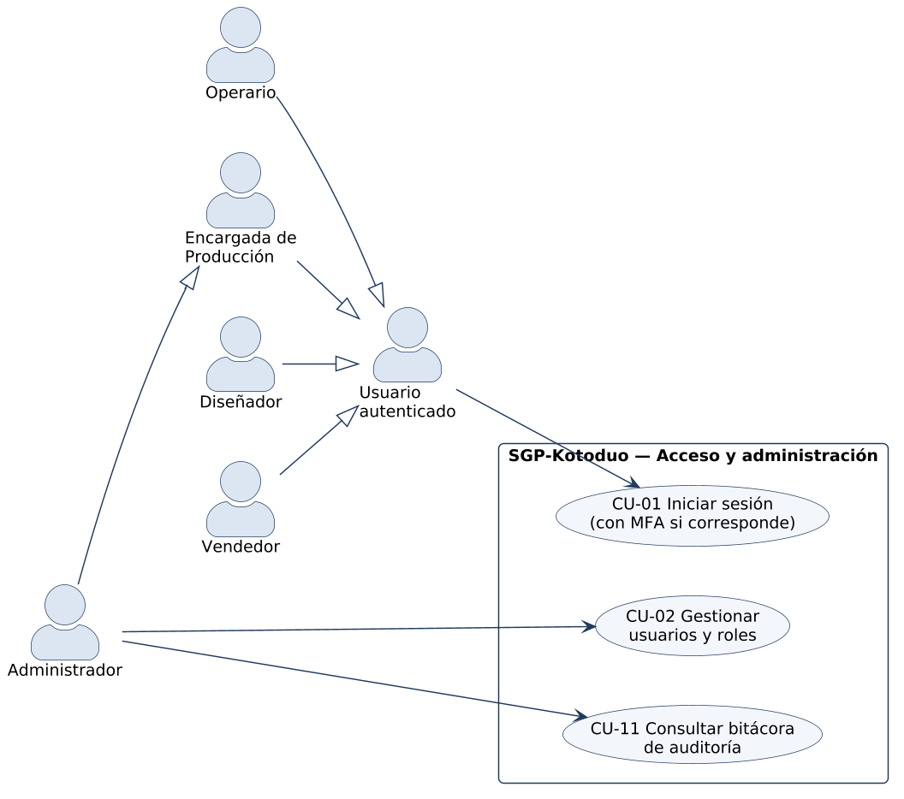

**Figura 4.22 — Casos de uso: gestión de órdenes, diseño e insumos.** Registrar una OT siempre genera sus etapas (`<<include>>`). El Diseñador sube las versiones y el Vendedor registra la respuesta del cliente; nunca la misma persona (R6).

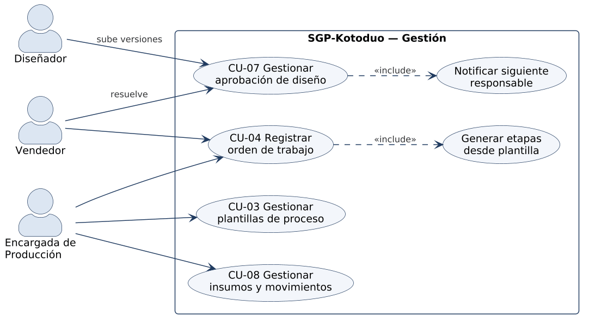

**Figura 4.23 — Casos de uso: ejecución en el taller.** Contiene el caso crítico CU-06. Adjuntar evidencia y reportar un faltante (CU-09) lo extienden de forma opcional (`<<extend>>`), y todo avance avisa al siguiente responsable (`<<include>>`).

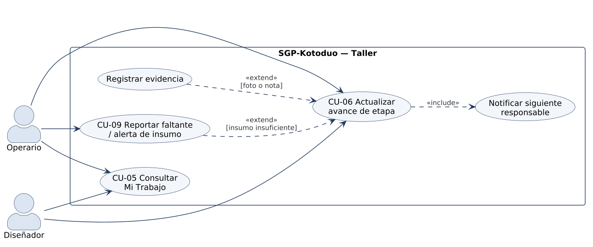

**Figura 4.24 — Casos de uso: supervisión y control de la producción.** Reúne las acciones de la Encargada que mueven las máquinas de estados (Fig. 4.7 y 4.8): gestionar etapas (CU-12) y controlar la OT (CU-13). El Vendedor solo consulta el panel y marca la OT como entregada. El "Verificador de atrasos" es el proceso programado que cada 15 minutos detecta OT en riesgo (CU-14).

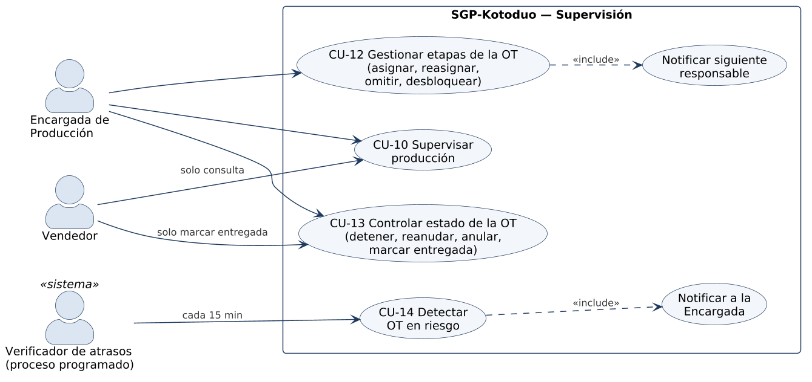

| CU | Nombre | Actores (el Administrador hereda los de la Encargada) | RF | HU | Figura |
|---|---|---|---|---|---|
| CU-01 | Iniciar sesión (con MFA si corresponde) | Todos | RF-01 | HU-11 | 4.21 |
| CU-02 | Gestionar usuarios y roles | Administrador | RF-01 | HU-11 | 4.21 |
| CU-03 | Gestionar plantillas de proceso | Encargada de Producción | RF-02 | HU-07 | 4.22 |
| CU-04 | Registrar orden de trabajo | Vendedor, Encargada de Producción | RF-03, RF-04 | HU-05 | 4.22 |
| CU-05 | Consultar Mi Trabajo | Operario, Diseñador | RF-05 | HU-01 | 4.23 |
| CU-06 | Actualizar avance de etapa | Operario, Diseñador | RF-06, RF-07 | HU-02, HU-04 | 4.23 |
| CU-07 | Gestionar aprobación de diseño | Diseñador (sube), Vendedor (resuelve) | RF-08 | HU-06 | 4.22 |
| CU-08 | Gestionar insumos y movimientos | Encargada de Producción | RF-09 | HU-09 | 4.22 |
| CU-09 | Reportar faltante / alerta de insumo | Operario, Diseñador | RF-10 | HU-03, HU-09 | 4.23 |
| CU-10 | Supervisar producción | Encargada de Producción; Vendedor (solo consulta) | RF-11 | HU-10 | 4.24 |
| CU-11 | Consultar bitácora de auditoría | Administrador; Encargada (solo por OT) | RF-12 | HU-12 | 4.21 |
| CU-12 | Gestionar etapas de la OT (asignar, reasignar, omitir, desbloquear) | Encargada de Producción | RF-04, RF-06 | HU-08 | 4.24 |
| CU-13 | Controlar estado de la OT (detener, reanudar, anular, marcar entregada) | Encargada de Producción; Vendedor (solo marcar entregada) | RF-06, RF-11 | HU-10 | 4.24 |
| CU-14 | Detectar OT en riesgo | Verificador de atrasos (`<<sistema>>`) | RF-11 | HU-10 | 4.24 |

**Especificación del caso de uso crítico CU-06 — Actualizar avance de etapa**

| Campo | Descripción |
|---|---|
| Actor | Operario (o Diseñador en etapas de diseño) |
| Precondiciones | Sesión activa; la etapa está asignada al actor y en estado DISPONIBLE o EN_CURSO; la OT no está DETENIDA |
| Flujo básico | 1. El actor abre *Mi Trabajo* y elige la OT. 2. El sistema muestra la etapa, las instrucciones, los insumos y la siguiente área. 3. El actor pulsa **Iniciar** y la etapa pasa a EN_CURSO. 4. Al terminar, pulsa **Terminar** e ingresa los consumos reales. 5. El sistema cierra la etapa, descuenta el stock, habilita la siguiente etapa y avisa a su responsable. 6. Muestra "Sigue: <etapa> en <área>". |
| Puntos de extensión | *Etapa en curso* (entre los pasos 3 y 4); *Registrar consumos* (paso 4) |
| Flujos alternativos | 3a. Hay un problema → **Reportar problema** con motivo; la etapa queda BLOQUEADA y la OT DETENIDA hasta que la Encargada las libere (CU-12, CU-13). 4a. Falta insumo → se reporta (CU-09). 4b. Adjuntar foto o nota. 5a. Era la última etapa → la OT pasa a TERMINADA. |
| Excepciones | E1. Otro usuario cambió la etapa → 409 "La etapa cambió; recarga". E2. La etapa no es del actor → 404, sin revelar que existe (AM-05). E3. Sin conexión → la PWA avisa y conserva el formulario. |
| Postcondiciones | La etapa y la OT quedan consistentes; el evento está en la bitácora; el siguiente responsable recibió el aviso |
| Reglas | Solo transiciones de la Fig. 4.7; el consumo no puede dejar stock negativo |

### 4.7 Tecnologías y herramientas de infraestructura

La Tabla 4.2 resume la tecnología por capa. El Anexo I (Tabla I.1) detalla cada herramienta con su uso, su justificación y la necesidad futura que cubre.

**Tabla 4.2 — Tecnologías por capa**

| Capa | Tecnologías | Justificación principal |
|---|---|---|
| Front-end y modalidad móvil | React 19 + TypeScript + Vite; **PWA** (Workbox); TanStack Query | Cumple la expectativa de "app para el celular" sin tiendas: una sola base de código para Android, iOS y PC, instalable y con notificaciones |
| Back-end | Node.js 24 LTS + Express 5 + TypeScript; Zod compartido (`packages/shared`); `pg` + `node-pg-migrate` | Mismo lenguaje en el front-end y la API para un equipo de dos personas; SQL explícito y parametrizado |
| Datos | **PostgreSQL 16** (Neon); **MongoDB 8** (Atlas); Cloudflare R2 | Dominio relacional que exige consistencia ACID; eventos y evidencias de estructura variable; archivos sin cargos por egreso |
| Seguridad | Argon2id, JWT EdDSA (`jose`) y TOTP (`otplib`); `helmet`, `cors`, `express-rate-limit` | Algoritmos recomendados por OWASP y NIST; mitigación de XSS, CSRF y fuerza bruta (sección 7.4) |
| Notificaciones | Web Push (VAPID) | Estándar W3C, sin depender de WhatsApp ni de SMS; funciona con la app cerrada |
| Hosting y red | Cloudflare Pages, DNS, proxy y WAF; Render (contenedor Docker) | TLS, CDN y WAF sin costo; plan básico de Render para evitar la suspensión por inactividad |
| Entrega y calidad | GitHub Actions + Environments; Docker y Docker Compose; `pino`, Sentry y UptimeRobot | CI con pruebas, SAST y aprobación manual a producción; ambiente local idéntico a producción; observabilidad gratuita |
| Gestión y documentación | GitHub Projects; PlantUML | Backlog, HU, PR y CI en una sola herramienta; diagramas versionables |
| Infraestructura como código (ideal) | OpenTofu + Trivy | Fuera del alcance comprometido; primera mejora tras el piloto |

**Costo mensual estimado** (valores de referencia, RNF-08): Render Starter ≈ US$ 7; Cloudflare Pages, R2 y WAF, Neon Free, Atlas M0, GitHub, Sentry y UptimeRobot, US$ 0. **Total inicial: ≈ US$ 7–10 al mes.** Si se superan las capas gratuitas, Neon Launch cuesta ≈ US$ 19 y Atlas M10 tiene costo propio. Con el crecimiento previsto (~1.500 OT y ~12.000 etapas al año), las capas iniciales alcanzan para al menos dos años.

**Necesidad futura: no quedar amarrado a un proveedor.** Kotoduo no tiene presupuesto definido, y los precios y capas gratuitas de la nube cambian. Lo ideal es declarar la infraestructura en archivos versionados con **OpenTofu**, la versión abierta de Terraform que mantiene la Linux Foundation. Así, cambiar de proveedor sería reemplazar un módulo y volver a desplegar. Como la construcción dura un mes, esto no entra en el alcance comprometido. Lo que sí se asegura desde ya es lo que lo hace posible: la API depende solo de interfaces estándar (Docker, PostgreSQL, MongoDB, S3 y variables de entorno) y existe el inventario de recursos de la sección 4.5. El Anexo I describe los principios de esa IaC y los proveedores intercambiables (Tabla I.2).

---

## 5. Diseño de interfaces de usuario

### 5.1 Perfiles y flujos principales de usuario

| Perfil | Contexto de uso | Necesidad principal | Flujo / interacción clave | Pantallas |
|---|---|---|---|---|
| Operario | Celular propio en el taller, manos ocupadas, conectividad 4G/Wi-Fi variable, alfabetización digital heterogénea | Saber qué hacer ahora y qué sigue, sin preguntar (HU-01, HU-02) | Login → Mi Trabajo → tarjeta de OT → **Iniciar** → **Terminar** (+ consumo) → mensaje "Sigue: …"; alternativo: **Reportar faltante** | P-01, P-02, P-03 |
| Diseñador | PC en oficina y celular | Subir versiones de diseño y ver sus etapas (HU-06) | Mi Trabajo → OT → Diseño → **Subir versión** | P-02, P-03, P-05 |
| Vendedor | PC de oficina | Registrar la OT completa una sola vez y registrar la respuesta del cliente al diseño (HU-05, HU-06) | Órdenes → **Nueva orden** → tipo de trabajo → datos → confirmar; Diseño → **Aprobar / Rechazar** con motivo | P-04, P-05 |
| Encargada de Producción | PC y celular; supervisa varias áreas | Ver el estado global, actuar sobre atrasos e insumos, estandarizar procesos (HU-07–HU-10) | Panel → filtro "Atrasadas" → OT → reasignar; Insumos → alerta → registrar ingreso → cerrar alerta; Plantillas → editar etapas | P-06, P-07, P-08 |
| Administrador | PC de oficina | Controlar accesos y auditar (HU-11, HU-12) | Admin → Usuarios → crear/asignar rol/restablecer clave; Bitácora → filtrar por OT | P-09, P-10 |

Tres principios valen para todos los perfiles: la pantalla de inicio muestra la tarea principal de cada rol, los botones usan el lenguaje del taller ("Terminar etapa", no "Actualizar estado") y las acciones toman un toque, con confirmación solo cuando no se pueden deshacer.

### 5.2 Navegación y organización de contenidos

El mapa de navegación es un árbol de rutas de la PWA. Se presenta en tres figuras: el nivel superior y dos acercamientos por grupo de perfiles.

**Figura 5.1 — Mapa de navegación: nivel superior.** Después del login, cada rol entra a su propia pantalla de inicio.

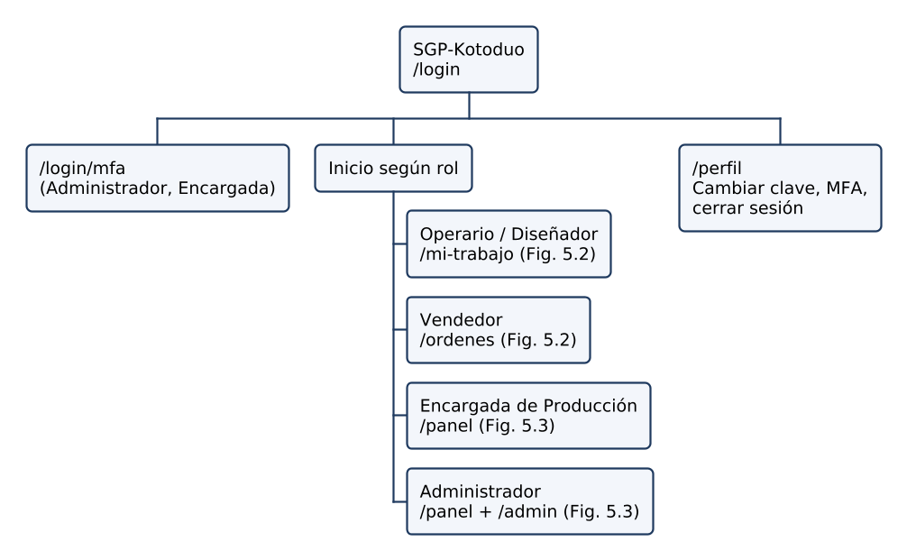

**Figura 5.2 — Mapa de navegación: perfiles de taller y ventas**

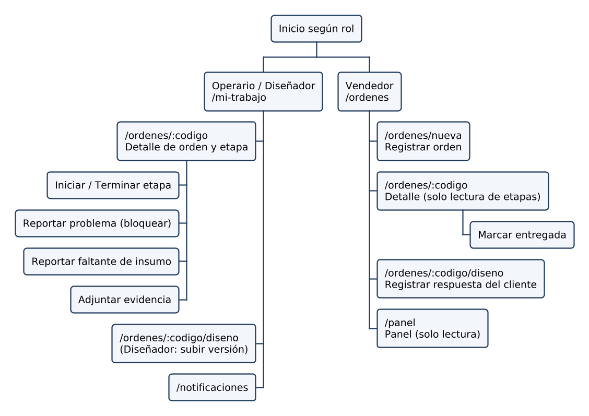

**Figura 5.3 — Mapa de navegación: perfiles de gestión**

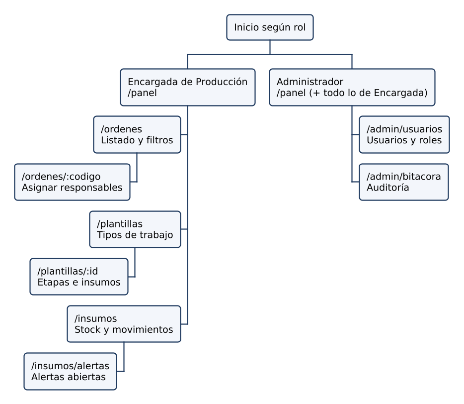

| Regla de navegación | Implementación |
|---|---|
| Inicio por rol | Tras el login: Operario/Diseñador → `/mi-trabajo`; Vendedor → `/ordenes`; Encargada/Administrador → `/panel` |
| Navegación principal | **Móvil:** barra inferior con 3–4 destinos según el rol (íconos + texto). **Escritorio:** barra lateral izquierda |
| Profundidad máxima | 3 niveles (p. ej., Panel → OT → Etapa); botón "Volver" siempre visible |
| Guardas de ruta | Las rutas no permitidas para el rol no aparecen en el menú y, si se abren por URL, muestran "No tienes acceso". La API aplica la autorización real (sección 7.3) |
| URL compartibles | `/ordenes/ot-2026-0001` se puede compartir por el canal interno sin exponer datos: requiere sesión |

### 5.3 Prototipo interactivo funcional

El prototipo es una maqueta navegable en HTML5 y CSS3, con *design tokens* y el mínimo de JavaScript (navegación por rol, diálogos y cambios de estado visual). No tiene back-end, usa datos ficticios y no nombra a la empresa, para poder publicarse. Se entrega como Anexo D. El login simula el acceso con un selector de rol, así que no requiere credenciales.

Demuestra once interacciones clave:

- **IK-1** Login, MFA para roles privilegiados y redirección por rol.
- **IK-2** Mi Trabajo → detalle de la OT.
- **IK-3** Iniciar y terminar una etapa, con el mensaje "Sigue: …". Reportar un problema deja la etapa bloqueada con motivo obligatorio.
- **IK-4** Reportar un faltante de insumo.
- **IK-5** Registrar una OT con vista previa de las etapas que se generan.
- **IK-6** Aprobar o rechazar un diseño, con motivo y separación de funciones (R6).
- **IK-7** Panel con indicadores que filtran atrasadas, en riesgo y bloqueadas.
- **IK-8** Plantilla de proceso con etapas ordenadas.
- **IK-9** Ciclo de una alerta de insumo (abierta → en gestión → cerrada) y registro de ingreso.
- **IK-10** Navegación por rol (barra inferior en móvil, lateral en escritorio) y guarda "No tienes acceso".
- **IK-11** Control de la OT: detener y anular con motivo, reanudar, marcar entregada y ver su historial.

**Tabla 5.1 — Pantallas del prototipo**

| ID | Pantalla | Perfil | HU / CU |
|---|---|---|---|
| P-01 | Inicio de sesión y verificación MFA | Todos (MFA: Encargada, Administrador) | HU-11 / CU-01 |
| P-02 | Mi Trabajo (incluye estados vacío, cargando y sin conexión) | Operario, Diseñador | HU-01 / CU-05 |
| P-03 | Detalle de orden y etapa | Operario y Diseñador (avanzan su etapa), Vendedor (lectura y marcar entregada), Encargada y Administrador (asignan, omiten, detienen, reanudan o anulan y ven el historial de la orden) | HU-02, HU-03, HU-04, HU-08, HU-10, HU-12 / CU-06, CU-09, CU-11, CU-12, CU-13 |
| P-04 | Órdenes y nueva orden de trabajo | Vendedor, Encargada, Administrador | HU-05 / CU-04 |
| P-05 | Aprobación de diseño | Vendedor (resuelve), Diseñador (sube versiones) | HU-06 / CU-07 |
| P-06 | Panel de supervisión | Encargada, Administrador; Vendedor (solo lectura) | HU-10 / CU-10, CU-14 |
| P-07 | Plantillas de proceso | Encargada, Administrador | HU-07 / CU-03 |
| P-08 | Insumos y alertas | Encargada (gestiona); demás roles (consulta) | HU-09 / CU-08, CU-09 |
| P-09 | Usuarios y roles | Administrador | HU-11 / CU-02 |
| P-10 | Bitácora | Administrador | HU-12 / CU-11 |
| P-11 | Avisos | Todos | HU-01 / CU-06 (notificar siguiente responsable) |
| P-12 | Mi perfil | Todos | HU-11 / CU-01 |

**La interacción crítica es IK-3, en P-03.** La tarjeta de la etapa muestra un chip de estado (Disponible → En curso → Terminada) y un solo botón principal, que cambia de "Iniciar etapa" a "Terminar etapa". Al terminar, un diálogo pide confirmar los consumos, que vienen prellenados. Luego aparece el mensaje **"Listo. Sigue: Sublimado — área Sublimación (responsable: …)"**, que responde directamente al problema de no saber qué sigue. Las acciones secundarias (reportar faltante o problema, adjuntar foto) quedan separadas del botón principal para evitar toques por error.

### 5.4 Consistencia visual y adaptabilidad

La guía de estilo está escrita como *design tokens* (variables CSS del prototipo) que reutilizará el front-end real. Kotoduo no tiene una identidad gráfica documentada, así que se propone un azul institucional con un acento naranja, que se ajustará a su logotipo en la validación A01.

**Tabla 5.2 — Paleta y contraste** (WCAG 2.2, criterio 1.4.3 AA: ≥ 4,5:1 para texto normal)

| Token | Hex | Uso | Contraste sobre blanco | Contraste sobre fondo `#F8FAFC` |
|---|---|---|---|---|
| `--color-primario` | `#1E40AF` | Botones primarios, enlaces, barra de navegación activa | 8,72:1 ✔ | 8,34:1 ✔ |
| `--color-acento` | `#C2410C` | Prioridad URGENTE, destacados | 5,18:1 ✔ | 4,95:1 ✔ |
| `--color-exito` | `#15803D` | Estado Terminada, confirmaciones | 5,02:1 ✔ | 4,79:1 ✔ |
| `--color-advertencia` | `#A16207` | Estado Bloqueada, OT en riesgo, stock bajo | 4,92:1 ✔ | 4,71:1 ✔ |
| `--color-peligro` | `#B91C1C` | Atrasada, alerta de insumo, errores | 6,47:1 ✔ | 6,18:1 ✔ |
| `--color-texto` | `#111827` | Texto principal | 17,74:1 ✔ | 16,96:1 ✔ |
| `--color-texto-2` | `#4B5563` | Texto secundario, metadatos | 7,56:1 ✔ | 7,22:1 ✔ |
| `--color-fondo` | `#F8FAFC` | Fondo de la aplicación | — | — |

El color nunca es la única señal (WCAG 1.4.1): cada estado combina color, ícono y texto, por ejemplo "⚠ Bloqueada".

| Aspecto | Regla / decisión | Evidencia |
|---|---|---|
| Tipografía y jerarquía | Fuente del sistema (`system-ui`: Roboto en Android, San Francisco en iOS, Segoe UI en Windows): no se descarga y es familiar. Escala: H1 1,5 rem/700, H2 1,25 rem/600, cuerpo 1 rem (16 px mínimo, evita el zoom automático en iOS), metadatos 0,875 rem. Interlineado 1,5 | Todas las pantallas del prototipo (tokens `--fs-*`) |
| Colores y contraste | Tabla 5.2; foco visible de 3 px con `--color-primario` (WCAG 2.4.7 / 2.4.11) | P-01 a P-08 |
| Componentes y consistencia | Biblioteca única: botón (primario, secundario, peligro), chip de estado, tarjeta de OT, tabla, diálogo, campo con etiqueta visible y mensaje de error asociado, franja de aviso. El mismo verbo hace la misma acción en todas las pantallas ("Terminar etapa") | Clases `.btn`, `.chip`, `.card` y `dialog` del prototipo |
| Estados del sistema | Vacío ("No tienes etapas pendientes"), cargando (esqueleto), error con acción ("Sin conexión" + "Reintentar"), éxito (franja verde) | P-02, P-03 |
| Áreas táctiles | Objetivos de al menos 48×48 px (sobre el mínimo de 24×24 px de WCAG 2.5.8); separación ≥ 8 px entre acciones | Botones de P-03 |
| Diseño adaptable | *Mobile-first* con CSS Grid/Flexbox y tres cortes: **< 600 px** (1 columna, barra inferior, tablas como tarjetas), **600–1023 px** (2 columnas), **≥ 1024 px** (barra lateral y contenido de hasta 1200 px). Sin desplazamiento horizontal a 320 px (WCAG 1.4.10) | Pruebas en 360×800, 390×844, 768×1024 y 1366×768; CP-34 |
| Idioma y redacción | `lang="es-CL"`, tuteo, frases cortas, fechas `dd-mm-aaaa`, sin anglicismos técnicos | Todas |

### 5.5 Retroalimentación de usuarios y mejoras aplicadas

La retroalimentación llega en dos rondas:

- **Ronda 0:** observaciones reales de Kotoduo en el documento de antecedentes complementarios. Ya cambiaron el diseño (Tabla 5.3).
- **Ronda 1 (actividad A06):** prueba de usabilidad del prototipo con al menos cinco personas (dos operarios, un vendedor, un diseñador y la encargada de producción). Cada una resuelve cuatro tareas mientras piensa en voz alta: T1 "¿Qué te toca hacer ahora y qué sigue?", T2 "Termina la etapa de impresión", T3 "Avisa que se acabó el papel" y T4 "Registra una orden de 30 camisetas". Se mide el tiempo, la tasa de éxito y el puntaje SUS (Brooke, 1996). Sus resultados se registran como FB-07 en adelante.

**Tabla 5.3 — Retroalimentación incorporada (ronda 0)**

| ID | Usuario / perfil | Observación | Decisión | Cambio realizado |
|---|---|---|---|---|
| FB-01 | Contraparte Kotoduo (gerencia) | "Sería crear una app para el celular, así es más práctica para los trabajadores" | Incorporar | Diseño *mobile-first* como PWA instalable; navegación inferior en móvil (secciones 4.7 y 5.4) |
| FB-02 | Contraparte Kotoduo | "Que sea un sistema fácil, práctico y amigable" | Incorporar | Inicio por rol con una sola tarea principal; botón primario único y contextual en P-03 (IK-3); lenguaje del taller |
| FB-03 | Contraparte Kotoduo | Excluir "los contactos de clientes" y "temas de dinero" | Incorporar | P-04 sin teléfono, correo, precio ni pago; `referencia_cliente` limitado al nombre de la institución (sección 6.2) |
| FB-04 | Contraparte Kotoduo | La aceptación del diseño es información relevante del proceso | Incorporar | Se agregan el módulo M6 y la pantalla P-05; sin diseño aprobado no hay producción (Fig. 4.15) |
| FB-05 | Contraparte Kotoduo | Trabajadores "sin quedar parados cuando no estén las personas a cargo" | Incorporar | El mensaje "Sigue: etapa — área — responsable" y las instrucciones visibles pasan a ser el centro de P-03 |
| FB-06 | Contraparte Kotoduo | Perfiles "administrador" y "de respuesta" | Incorporar con ajuste | Se refinan en 5 roles para respetar el mínimo privilegio; la equivalencia se valida en A01 (sección 7.1) |

**Cómo se decide en la ronda 1.** Una observación se incorpora si afecta una tarea crítica (T1–T3), si la repiten dos o más participantes o si impide completar una tarea. Las mejoras estéticas o de bajo impacto pasan al backlog. Lo que contradice el alcance acordado se descarta y se deja anotada la razón. Las capturas antes y después (v1 → v2) se agregan al Anexo D.

---

## 6. Diseño e implementación del modelo de datos

### 6.1 Modelo de datos: entidades y relaciones

El modelo usa la notación "pata de gallo". Los atributos con `*` son obligatorios, y `<<PK>>`, `<<FK>>` y `<<UK>>` marcan las claves primaria, foránea y única.

**Figura 6.1 — Modelo entidad-relación: visión general.** Las 16 tablas y todas sus relaciones, sin atributos. El color indica el grupo y la figura que lo detalla.

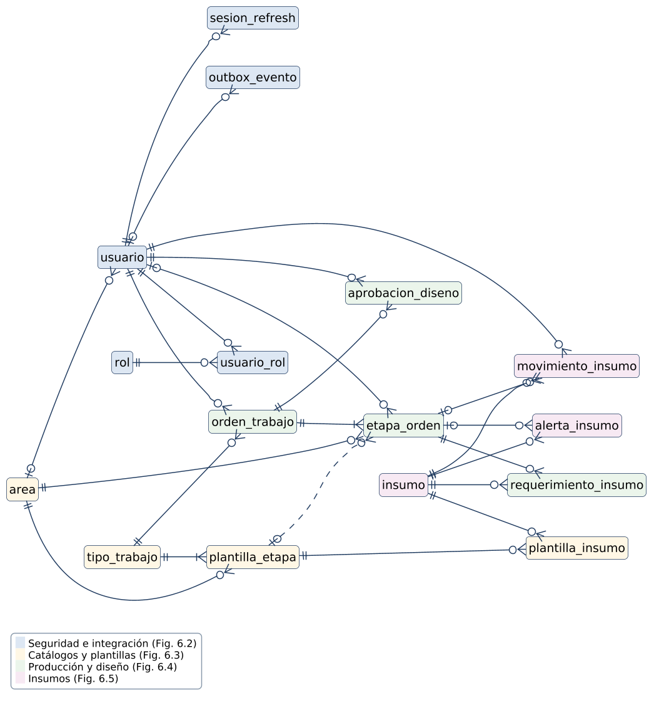

**Figura 6.2 — ER: seguridad e integración**

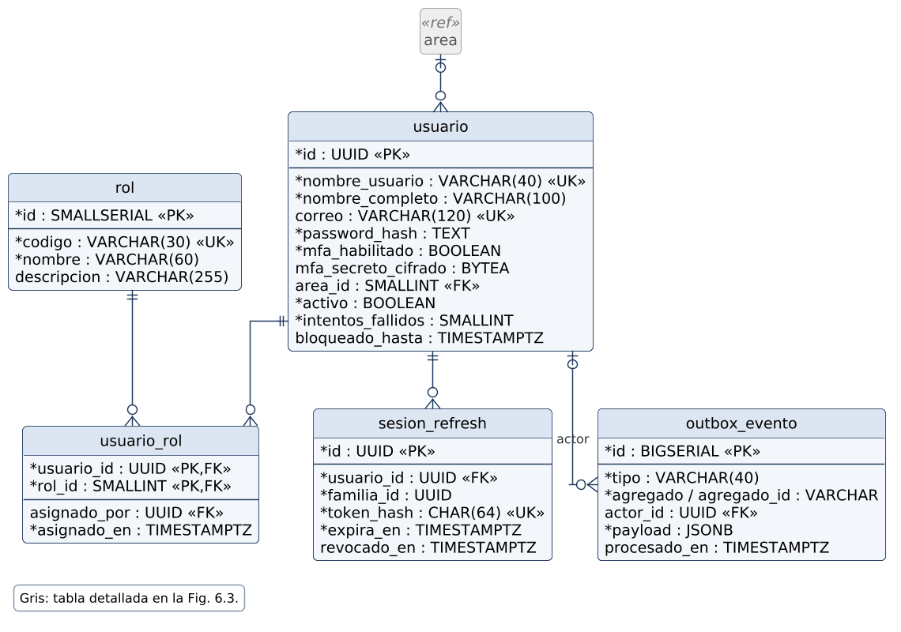

**Figura 6.3 — ER: catálogos y plantillas de proceso**

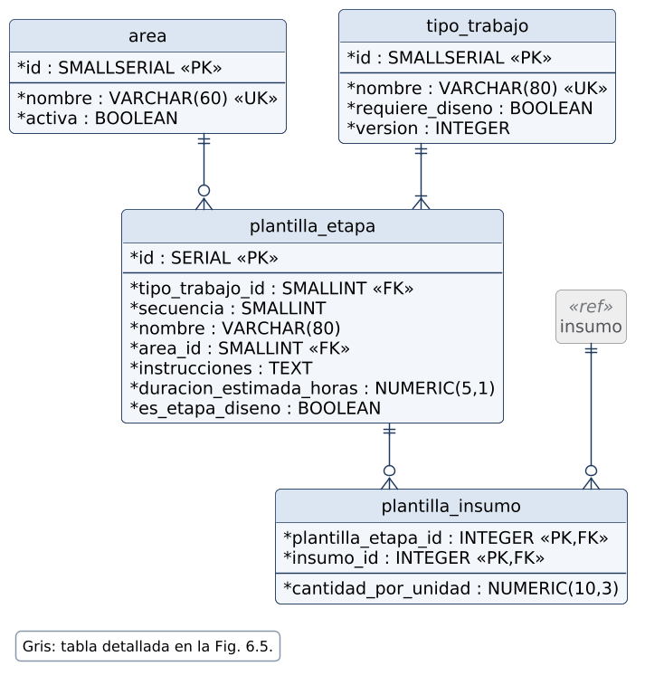

**Figura 6.4 — ER: producción y diseño**

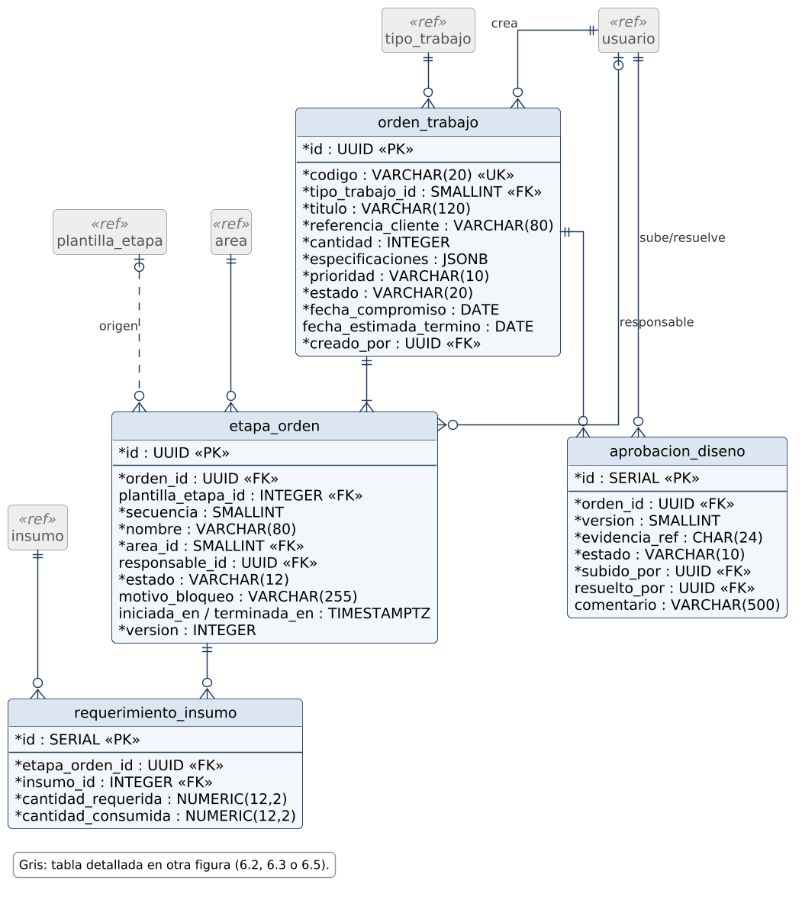

**Figura 6.5 — ER: insumos, kardex y alertas**

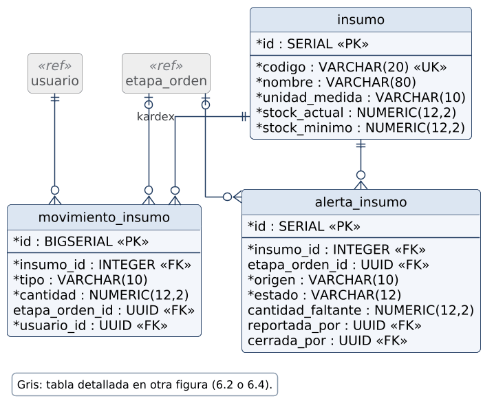

Las 16 tablas viven en el esquema `sgp` y se agrupan por módulo:

| Grupo | Tablas | Módulo |
|---|---|---|
| Seguridad | `rol`, `usuario`, `usuario_rol`, `sesion_refresh` | M1 |
| Catálogos | `area`, `tipo_trabajo`, `plantilla_etapa`, `insumo`, `plantilla_insumo` | M2, M5 |
| Producción | `orden_trabajo`, `etapa_orden`, `requerimiento_insumo` | M3, M4 |
| Insumos | `movimiento_insumo`, `alerta_insumo` | M5 |
| Diseño | `aprobacion_diseno` | M6 |
| Integración | `outbox_evento` | M8 |

**Relaciones y cardinalidades principales:**

| Relación | Cardinalidad | Regla de negocio que expresa |
|---|---|---|
| `usuario` — `rol` (vía `usuario_rol`) | N:M | Un usuario puede tener varios roles (p. ej., Encargada y Vendedor en temporada alta) |
| `tipo_trabajo` — `plantilla_etapa` | 1:N (1..*) | Un tipo de trabajo define al menos una etapa ordenada |
| `plantilla_etapa` — `insumo` (vía `plantilla_insumo`) | N:M con atributo | Cada etapa estándar consume insumos por unidad producida |
| `orden_trabajo` — `etapa_orden` | 1:N (1..*) identificadora | Una OT se compone de sus etapas; se eliminan en cascada |
| `etapa_orden` — `usuario` (responsable) | N:0..1 | Una etapa puede estar aún sin asignar |
| `etapa_orden` — `insumo` (vía `requerimiento_insumo`) | N:M con atributos | Cantidad requerida y consumida por etapa concreta |
| `insumo` — `movimiento_insumo` | 1:N | Kardex: el stock es la suma de movimientos |
| `orden_trabajo` — `aprobacion_diseno` | 1:N | Versiones sucesivas del diseño |

**Decisiones de optimización:**

1. **Tercera forma normal.** `requerimiento_insumo` no guarda `orden_id`, porque se obtiene desde `etapa_orden`. `rol` y `area` son catálogos y no textos repetidos.
2. **Dos redundancias controladas.** `etapa_orden` copia los datos de la plantilla como foto histórica, porque la plantilla puede cambiar. `insumo.stock_actual` guarda el resultado del kardex, mantenido por el trigger R3, para no sumar miles de movimientos en cada consulta.
3. **JSONB acotado.** `orden_trabajo.especificaciones` guarda tallas, medidas y colores, que cambian según el tipo de trabajo. Todo lo que se usa para filtrar (estado, fechas, tipo) es una columna indexada.
4. **Claves.** Las entidades que aparecen en URL o eventos usan UUID: no se pueden adivinar, lo que dificulta el acceso a datos ajenos (IDOR). Los catálogos internos usan `SERIAL`, y el código `OT-AAAA-NNNN` es una clave alternativa `UNIQUE`.
5. **Un índice por consulta frecuente:** `ix_etapa_responsable_estado` (Mi Trabajo), `ix_ot_estado_compromiso` (panel) e `ix_mov_insumo_fecha` (kardex). Los índices **parciales** `ux_alerta_auto_abierta`, `ux_aprobacion_pendiente` e `ix_outbox_pendiente` cubren solo las filas que importan y, en los dos primeros, garantizan que haya una sola fila abierta.

### 6.2 Diccionario y reglas de integridad

La Tabla 6.1 resume, por tabla, la clave primaria y las restricciones que sostienen las reglas de negocio. El diccionario completo, campo por campo, está en el Anexo J (Tabla J.1).

**Tabla 6.1 — Resumen del diccionario de datos** (PK = clave primaria, FK = clave foránea, UQ = única, CK = restricción CHECK)

| Tabla | PK | Restricciones destacadas |
|---|---|---|
| `rol` | SMALLSERIAL | Código UQ, limitado a los cinco roles del RBAC |
| `area` | SMALLSERIAL | Nombre UQ; baja lógica (`activa`) |
| `usuario` | UUID | `nombre_usuario` UQ con formato validado; hash Argon2id; secreto TOTP cifrado; control de intentos fallidos; se desactiva en vez de borrarse |
| `usuario_rol` | (usuario_id, rol_id) | FK a `usuario` en cascada y a `rol` con RESTRICT; registra quién asignó el rol |
| `sesion_refresh` | UUID | Solo guarda el hash SHA-256 del token (UQ); `familia_id` para detectar reutilización; CK la expiración es posterior a la emisión |
| `tipo_trabajo` | SMALLSERIAL | Nombre UQ; indica si requiere diseño |
| `plantilla_etapa` | SERIAL | UQ (tipo_trabajo_id, secuencia); duración CK > 0; marca la etapa de diseño |
| `insumo` | SERIAL | Código UQ; unidad de medida controlada; stock y mínimo CK ≥ 0 |
| `plantilla_insumo` | (plantilla_etapa_id, insumo_id) | Consumo por unidad CK > 0 |
| `orden_trabajo` | UUID | Código UQ `OT-AAAA-NNNN`; estado y prioridad controlados (trigger R2); sin datos de contacto del cliente |
| `etapa_orden` | UUID | UQ (orden_id, secuencia); estado controlado (trigger R2); motivo obligatorio si está bloqueada; `version` para concurrencia optimista |
| `requerimiento_insumo` | SERIAL | UQ (etapa, insumo); cantidad requerida > 0 y consumida ≥ 0 |
| `movimiento_insumo` | BIGSERIAL | Signo según el tipo (ingreso, consumo, ajuste); etapa obligatoria si es consumo; inmutable |
| `alerta_insumo` | SERIAL | Origen automático o manual; CERRADA ⇔ `cerrada_en`; faltante > 0 |
| `aprobacion_diseno` | SERIAL | UQ (orden_id, version); una sola versión PENDIENTE por OT; quien sube el diseño no lo resuelve (segregación) |
| `outbox_evento` | BIGSERIAL | `payload` JSONB obligatorio; índice parcial sobre los eventos pendientes |

**Integridad referencial (qué pasa al borrar):**

| Política | Dónde | Justificación |
|---|---|---|
| `CASCADE` | `orden_trabajo → etapa_orden → requerimiento_insumo`; `tipo_trabajo → plantilla_etapa → plantilla_insumo`; `usuario → sesion_refresh, usuario_rol` | Composición: las partes no tienen sentido sin el todo. En la práctica, las OT no se borran: se anulan |
| `RESTRICT` | Referencias a `insumo`, `area`, `tipo_trabajo`, `rol`; `orden_trabajo.creado_por`; `movimiento_insumo.usuario_id`; `aprobacion_diseno.subido_por` | Evita perder historia: no se borra un insumo con movimientos ni un usuario autor (se desactiva con `activo = FALSE`) |
| `SET NULL` | `etapa_orden.responsable_id`, `etapa_orden.plantilla_etapa_id`, `usuario.area_id`, referencias opcionales de alertas y outbox | La entidad sigue existiendo aunque desaparezca la referencia opcional |

**Reglas de negocio implementadas en la base de datos:**

| Regla | Mecanismo | Verificación |
|---|---|---|
| R1. `actualizado_en` siempre vigente | Trigger `fn_set_actualizado_en` | — |
| R2. Solo transiciones de estado válidas en `etapa_orden` (Fig. 4.7) y en `orden_trabajo` (Fig. 4.8): la OT termina solo con todas sus etapas cerradas, se reanuda solo sin etapas bloqueadas y, mientras está DETENIDA, ninguna etapa se inicia ni se termina; cada cambio de la etapa incrementa `version` | Triggers `trg_etapa_transicion` y `trg_orden_transicion` (lanzan `check_violation`) | CP-02 |
| R3. Cada movimiento actualiza el stock; si queda ≤ mínimo, se crea **una** alerta automática | Trigger `trg_movimiento_insumo` + índice único parcial + `ON CONFLICT DO NOTHING` | CP-14 |
| R4. Stock nunca negativo | `CHECK (stock_actual >= 0)` aborta la transacción completa | CP-14 |
| R5. Bloqueo con motivo; terminada con fecha | `ck_etapa_bloqueo`, `ck_etapa_terminada` | CP-01 |
| R6. Quien sube un diseño no puede aprobarlo | `ck_aprobacion_segregacion` | CP-16 |
| R7. Registros inmutables (kardex, outbox) | `REVOKE UPDATE, DELETE` al rol `sgp_app` | CP-32 (revisión de privilegios) |
| R8. Mínimo privilegio en la conexión | Roles `sgp_app` (DML) y `sgp_relay` (solo `procesado_en` del outbox); la aplicación no usa el superusuario | Checklist ASVS (CP-32) |

### 6.3 Bases de implementación de la base de datos estructurada

El esquema `sgp` se construye en PostgreSQL 16 como migraciones versionadas: parte en A11 (Sprint 1) y crece en cada Sprint junto al módulo que lo usa. El Anexo B trae un borrador del esquema (DDL y consultas de ejemplo) que sirve de punto de partida. La Tabla 6.2 fija los principios que sigue; la sintaxis se toma de la documentación oficial de PostgreSQL 16 (PostgreSQL Global Development Group, 2024).

**Tabla 6.2 — Principios de implementación en PostgreSQL**

| Principio | Qué se establece | Reglas del modelo que lo aplican |
|---|---|---|
| Integridad declarativa primero | Toda regla que se pueda escribir como restricción (`PRIMARY KEY`, `FOREIGN KEY`, `UNIQUE`, `CHECK`, `NOT NULL`) se declara en el esquema. La base rechaza un dato inválido venga de donde venga | R4, R5, R6 y las políticas `ON DELETE` (6.2) |
| Una transacción por caso de uso | Si un caso de uso toca varias tablas (p. ej., terminar una etapa), todo se guarda o nada. Se usa *Read Committed* con bloqueos explícitos donde hay competencia | CU-06, outbox (6.5) |
| Control de concurrencia | Se bloquea la fila que se modifica (`SELECT … FOR UPDATE`) y se compara la columna `version`. Si dos operarios actúan a la vez, ocurre una sola transición | R2, CP-19 |
| Triggers solo para invariantes críticas | Se usan para reglas que deben cumplirse ante cualquier cliente y que una restricción no alcanza a expresar. El resto de la lógica vive en la capa de servicio | R1, R2, R3 |
| Operaciones idempotentes | Las inserciones que se pueden repetir usan una restricción única con `ON CONFLICT`, así un reintento no duplica el registro | R3 |
| Índices diseñados por consulta | Cada índice responde a una consulta frecuente. Los parciales cubren solo las filas relevantes y garantizan unicidad condicional. Se revisan con `EXPLAIN` en A26 | Índices de 6.1 |
| JSONB acotado | Solo lo que varía por tipo de trabajo va en `JSONB`; lo que se filtra o relaciona es una columna con tipo | `orden_trabajo.especificaciones` |
| Mínimo privilegio | La aplicación se conecta con un rol sin permisos de administración ni de DDL, que no puede modificar ni borrar el kardex ni el outbox | R7, R8 |
| Esquema versionado | Todo cambio de estructura es una migración revisada en un PR y aplicada por el pipeline, primero en staging. Nunca se cambia a mano en producción | A10, A11 |
| Respaldo y recuperación | Recuperación a un punto en el tiempo (PITR) del proveedor y una restauración de prueba antes del piloto | RNF-06, A29 |

**Los borradores ya se probaron.** Para no esperar a la construcción, los borradores de los Anexos B y C se ejecutaron el 22-10-2026 sobre los motores reales, en contenedores Docker locales (PostgreSQL 16.13 y MongoDB 9.0.4). En local se usó MongoDB 9.0 porque la 8.0 no arranca en kernels Linux 6.19 o superiores (SERVER-121912); la 9.0 tiene la misma API, y el diseño sigue apuntando a MongoDB 8 en Atlas. Cada prueba corrió sobre una base recién creada (Tabla 6.3). Durante la construcción se repiten sobre staging y sus reportes van al Anexo F.

**Tabla 6.3 — Resultados de la verificación local de los borradores**

| Verificación | Regla | Resultado obtenido |
|---|---|---|
| Creación del esquema `sgp` deteniéndose ante el primer error | — | 16 tablas y 6 triggers creados sin errores |
| Consultas de ejemplo del Anexo B: registro de OT, Mi Trabajo, avance de etapa, panel y faltantes proyectados | — | Ejecutadas sin errores |
| Etapa PENDIENTE → TERMINADA | R2 | Rechazada: "Transición de etapa no permitida: PENDIENTE -> TERMINADA" |
| OT a TERMINADA con etapas abiertas y luego con todas cerradas | R2 | Rechazada: "La orden no puede terminar: tiene etapas abiertas"; aceptada con todas las etapas cerradas |
| OT TERMINADA → EN_PRODUCCION | R2 | Rechazada: "Transición de orden no permitida" |
| Iniciar una etapa con la OT DETENIDA | R2 | Rechazada: "La orden está DETENIDA" |
| Reanudar una OT con una etapa BLOQUEADA; luego desbloquear y reanudar | R2 | Rechazada: "tiene etapas bloqueadas"; aceptada después de desbloquear la etapa |
| Dos consumos que dejan el stock bajo el mínimo | R3 | Una sola alerta automática abierta |
| Consumo que dejaría el stock negativo | R4 | Rechazado; el kardex conserva sus 2 movimientos (transacción revertida) |
| Eliminar un insumo con movimientos | `RESTRICT` | Bloqueado por integridad referencial |
| Quien sube un diseño lo aprueba | R6 | Rechazado por `ck_aprobacion_segregacion` |
| El rol `sgp_app` modifica el kardex, borra el outbox o crea una tabla | R7, R8 | "permission denied" en los tres casos |
| Colecciones de MongoDB con validador e índices | 6.4 | 3 colecciones con validador en modo de rechazo; índices TTL de 24 meses (bitácora) y 90 días (notificaciones) |
| Documento con un tipo de evento inexistente | 6.4 | Rechazado (código 121, *Document failed validation*) |
| Reintento de la publicación de un evento ya procesado | 6.4, 6.5 | 0 documentos nuevos (*upsert* idempotente) |
| Consulta de la bandeja de notificaciones | 6.4 | Resuelta con el índice `ix_bandeja` |

### 6.4 Bases de implementación de la base de datos no estructurada

MongoDB (base `sgp_docs`) guarda lo que cambia de forma, se escribe mucho y no necesita *joins*: la bitácora, las evidencias y las notificaciones. El Anexo C trae un borrador de los validadores, los índices y el script de inicialización.

| Colección | Propósito | Clave / identificador | Índices | Retención |
|---|---|---|---|---|
| `bitacora_eventos` | Auditoría inmutable (RF-12) | Identificador determinista derivado del `id` de `outbox_evento` (idempotente) | Por orden y fecha; por actor y fecha; por tipo y fecha | TTL 24 meses (RNF-05) |
| `evidencias_etapa` | Fotos, notas y versiones de diseño con metadatos libres por tipo de trabajo (RF-07, RF-08) | `ObjectId` (referenciado por `aprobacion_diseno.evidencia_ref`) | Por orden y fecha; por etapa; por hash del archivo | Indefinida |
| `notificaciones` | Bandeja in-app y estado del push | Identificador determinista por evento y destinatario | Por destinatario, estado de lectura y fecha | TTL 90 días |

**Tabla 6.4 — Principios de implementación en MongoDB** (MongoDB, Inc., 2025)

| Principio | Qué se establece |
|---|---|
| Modelar según cómo se lee | Se **incrusta** lo que siempre se lee junto (el actor y los estados anterior y nuevo, dentro del evento) y se **referencia** lo que tiene vida propia (la OT y la etapa, que viven en PostgreSQL). Cada documento responde a una pantalla sin *joins* |
| Esquema flexible, pero validado | Cada colección tiene un validador `$jsonSchema` en modo de rechazo: el servidor controla los campos obligatorios, los tipos y los valores permitidos, y deja abiertos los metadatos variables |
| Índices por consulta | Cada índice compuesto responde a una consulta y sigue el orden igualdad, orden y rango (*Equality-Sort-Range*) |
| Retención automática | La bitácora y las notificaciones caducan con índices TTL, sin procesos de limpieza manuales |
| Escrituras idempotentes | El relay escribe con *upsert* sobre un identificador determinista: reintentar un evento no crea un duplicado |
| Durabilidad confirmada | La auditoría se escribe con *write concern* `majority`: el relay marca un evento como procesado solo cuando ya está replicado |
| Auditoría inmutable | Solo el usuario del relay puede escribir en `bitacora_eventos`; el de la API solo puede leerla. Nadie puede borrar |

La Tabla 6.3 muestra que el borrador del Anexo C ya cumple lo esperado: las tres colecciones tienen su validador e índices, el validador rechaza un tipo de evento inexistente, un reintento no duplica documentos y la bandeja usa su índice.

### 6.5 Integración entre datos estructurados y no estructurados

**Estrategia: outbox transaccional** (Richardson, 2018). Una transacción no puede abarcar PostgreSQL y MongoDB a la vez. Si la API escribiera en las dos por separado, una caída entre ambas escrituras perdería eventos. Por eso:

1. El servicio guarda el cambio de negocio **y** su evento en `outbox_evento` en la **misma transacción** de PostgreSQL: se guardan los dos o ninguno.
2. Cada 5 segundos, el **relay** lee los eventos pendientes con `FOR UPDATE SKIP LOCKED` y los publica en `bitacora_eventos` y `notificaciones` con un `_id` determinista (`evt-<id>`). Después marca el evento como procesado.
3. Si MongoDB no responde, el evento queda pendiente y se reintenta. Tras 10 intentos fallidos se genera una alerta en Sentry. El resultado es una entrega **al menos una vez**, y la idempotencia hace que el efecto sea **exactamente una vez**.

| Dato / proceso | Origen estructurado (PostgreSQL) | Origen no estructurado (MongoDB / R2) | Mecanismo de relación / integración |
|---|---|---|---|
| Auditoría de cambios de estado | `outbox_evento` (escrito en la transacción de negocio) | `bitacora_eventos` | Relay outbox; `_id = evt-<outbox_evento.id>`; `orden_id` y `agregado.id` = UUID de PostgreSQL |
| Versiones de diseño | `aprobacion_diseno` (estado, versión, quién aprueba) | `evidencias_etapa` (tipo DISENO) + archivo en R2 | `aprobacion_diseno.evidencia_ref` = `ObjectId` del documento; el documento guarda `object_key` y `sha256` del archivo |
| Evidencias de etapa | `etapa_orden.id` | `evidencias_etapa.etapa_orden_id` | Referencia lógica por UUID; la API valida que la etapa exista y pertenezca al actor antes de emitir la URL prefirmada |
| Notificaciones | Evento outbox (ETAPA_TERMINADA, ALERTA_INSUMO_CREADA) | `notificaciones` | El relay resuelve los destinatarios (responsable de la siguiente etapa o usuarios con rol Encargada) y crea un documento por destinatario |
| Vista "Detalle de orden" | OT, etapas y requerimientos (consulta SQL) | Historial y evidencias (consulta Mongo por `orden_id`) | La capa de servicio combina dos consultas ejecutadas en paralelo (*API composition*) |
| Analítica futura de tiempos | `etapa_orden.iniciada_en / terminada_en` | `bitacora_eventos` (eventos ETAPA_*) | Agregaciones en Mongo sin cargar la BD transaccional |

**Quién manda sobre el dato:** PostgreSQL es la única fuente de verdad del estado del negocio. MongoDB nunca decide una transición; solo registra lo que pasó y guarda contenido variable. Por eso, que el relay tarde hasta 5 segundos no afecta la operación.

---

## 7. Seguridad y estándares de programación segura

El sistema maneja sobre todo información operativa, pero si se cae o alguien lo manipula, la producción se detiene: justo el problema que se quiere resolver. También guarda datos personales de los trabajadores (nombre, usuario y actividad), protegidos por la Ley N.º 19.628, modificada por la Ley N.º 21.719, y por el Código del Trabajo (sección 7.7). Los controles técnicos siguen OWASP ASVS 4.0.3 nivel 2 en autenticación (V2), sesión (V3) y control de acceso (V4), y OWASP Top 10:2021.

### 7.1 Roles y perfiles de acceso

| Rol / perfil | Funciones permitidas | Información accesible | Restricciones |
|---|---|---|---|
| **Administrador** | Todo lo de la Encargada; crear, desactivar y restablecer usuarios; asignar roles; revocar sesiones; consultar la bitácora completa | Toda la información del sistema | MFA obligatorio; no puede eliminar registros de bitácora ni kardex; no puede quitarse el último rol Administrador (siempre existe al menos uno) |
| **Encargada de Producción** | Gestionar plantillas, tipos de trabajo e insumos; ver todas las OT; asignar/reasignar responsables; omitir o desbloquear etapas; detener, reanudar o anular OT; gestionar alertas; ver el panel; consultar la bitácora por OT; restablecer la clave de un operario | Todas las OT, etapas, insumos, alertas y panel; usuarios (solo nombre y área) | MFA obligatorio; sin gestión de usuarios ni roles (solo restablece claves de operarios) |
| **Vendedor** | Crear OT; editar sus OT en estado REGISTRADA; registrar la respuesta del cliente al diseño; marcar una OT como ENTREGADA | Todas las OT (lectura) y su avance; versiones de diseño | No avanza etapas de producción; no gestiona insumos ni plantillas |
| **Diseñador** | Ver y avanzar **sus** etapas de diseño; subir versiones de diseño; reportar faltantes | Sus etapas asignadas y las OT asociadas; stock (lectura) | No puede aprobar sus propios diseños (R6) |
| **Operario** | Ver y avanzar **sus** etapas; registrar consumo; reportar faltante o problema; adjuntar evidencia | Solo sus etapas asignadas y los datos de producción de esas OT; stock (lectura) | No ve el panel global, la bitácora ni etapas de otros; no edita OT |

El perfil "administrador" que mencionó el cliente equivale a Administrador más Encargada de Producción. El perfil "de respuesta" equivale a Operario y Diseñador. El Vendedor sale del proceso confirmado *vendedor → encargada de producción → operarios*.

### 7.2 Política de autenticación

| Control | Política | Fundamento |
|---|---|---|
| Identificador | `nombre_usuario` único (los operarios pueden no tener correo) | Usabilidad del taller |
| Contraseña | Mínimo **12 caracteres**, máximo 128; se permiten espacios y frases; **sin reglas de composición** ni expiración periódica; se rechazan las claves de una lista de 100.000 contraseñas comprometidas y las que contienen el nombre de usuario | ASVS V2.1.1, V2.1.7; NIST SP 800-63B |
| Almacenamiento | **Argon2id** (m = 19 MiB, t = 2, p = 1) con sal aleatoria por usuario; parámetros guardados en el hash (formato PHC) para recalibrar sin migración | OWASP Password Storage Cheat Sheet |
| MFA | **TOTP obligatorio** para Administrador y Encargada de Producción, opcional para el resto. Secreto cifrado con AES-256-GCM; 10 códigos de recuperación de un solo uso, guardados con hash | ASVS V2.8; privilegio elevado |
| Fuerza bruta | 5 intentos fallidos → bloqueo de 15 min (luego 30 y 60 min); límite de 10 solicitudes/min por IP en `/auth/*` y regla WAF en Cloudflare | ASVS V2.2.1 |
| Mensajes | Error genérico: "Usuario o contraseña incorrectos". Si el usuario no existe, se compara igual contra un hash ficticio, para que el tiempo de respuesta no revele qué cuentas existen | OWASP Authentication Cheat Sheet |
| Token de acceso | JWT firmado con **EdDSA (Ed25519)**, vigencia **10 min**, con `sub`, `roles` y `jti`; vive **solo en memoria** de la PWA (nunca en `localStorage`) y se envía en `Authorization: Bearer` | Limita el daño de un XSS |
| Token de refresco | Opaco de 256 bits, guardado con hash SHA-256 en `sesion_refresh`. Cookie `__Host-`, `HttpOnly; Secure; SameSite=Strict; Path=/`. **Rota en cada uso**; si alguien reutiliza uno ya rotado, se revoca toda la `familia_id` (posible robo) | OWASP Session Management; RFC 9700 |
| Duración de sesión | Inactividad: 2 h (operarios) / 30 min (Administrador, Encargada). Absoluta: 12 h, una jornada | ASVS V3.3 |
| Cierre de sesión | Revoca el refresh en el servidor; el Administrador puede cerrar todas las sesiones de un usuario (p. ej., si pierde el teléfono) | ASVS V3.3.1 |
| Recuperación | Operarios: la Encargada o el Administrador generan una **clave temporal de un solo uso** (24 h) que obliga a cambiarla. Usuarios con correo: enlace de un solo uso de 30 min, con token guardado como hash | ASVS V2.5 |
| Primer ingreso | Cambio de clave obligatorio y registro de MFA si el rol lo exige | — |
| Transporte | Solo HTTPS (TLS 1.2+, HSTS de 1 año con `preload`) | ASVS V9 |
| Registro | Cada inicio de sesión, exitoso o fallido, cada bloqueo y cada revocación queda en la bitácora (sin la contraseña) | ASVS V7 |

### 7.3 Política de autorización

El modelo es **RBAC con permisos atómicos**: cada acción tiene su propio permiso, y la lista vive como código en `packages/shared/permisos.ts`, revisada en cada PR. Se aplica en tres niveles:

1. **Rol, con denegación por defecto.** Cada ruta de la API declara su permiso. Si una ruta no tiene `requierePermiso()`, falla una prueba automática que revisa todas las rutas.
2. **Propiedad del recurso.** El servicio comprueba que el recurso sea del actor (`etapa.responsable_id = actor.id`). Además, el SQL de las consultas del Operario filtra por responsable, así que nunca carga datos ajenos. Esto previene el IDOR (OWASP A01).
3. **Estado del recurso.** Una acción solo procede si el estado lo permite: no se termina una etapa PENDIENTE ni se inicia una etapa de una OT DETENIDA.

La PWA oculta los botones no permitidos con el **mismo mapa** de permisos, pero eso es solo comodidad para el usuario: quien decide es siempre la API.

**Tabla 7.1 — Matriz de permisos (RBAC).** ✔ = permitido · ◐ = permitido con restricción de propiedad o estado · — = denegado

| Permiso | Administrador | Encargada de Producción | Vendedor | Diseñador | Operario |
|---|---|---|---|---|---|
| `usuarios.gestionar` (crear, desactivar, roles, restablecer) | ✔ | — | — | — | — |
| `usuarios.restablecer_operario` | ✔ | ✔ | — | — | — |
| `sesiones.revocar` | ✔ | — | — | — | — |
| `plantillas.gestionar` | ✔ | ✔ | — | — | — |
| `plantillas.ver` | ✔ | ✔ | ✔ | ✔ | — |
| `ordenes.crear` | ✔ | ✔ | ✔ | — | — |
| `ordenes.editar` | ✔ | ✔ | ◐ propias en REGISTRADA | — | — |
| `ordenes.ver_todas` | ✔ | ✔ | ✔ | — | — |
| `ordenes.ver_asignadas` | ✔ | ✔ | ✔ | ◐ | ◐ |
| `ordenes.anular` | ✔ | ✔ | — | — | — |
| `ordenes.detener` (detener y reanudar) | ✔ | ✔ | — | — | — |
| `ordenes.marcar_entregada` | ✔ | ✔ | ✔ | — | — |
| `etapas.asignar` / `etapas.omitir` / `etapas.desbloquear` | ✔ | ✔ | — | — | — |
| `etapas.avanzar_propias` (iniciar, terminar, bloquear) | ◐ | ◐ | — | ◐ | ◐ |
| `evidencias.adjuntar` | ✔ | ✔ | — | ◐ propias | ◐ propias |
| `diseno.subir` | ✔ | ✔ | — | ✔ | — |
| `diseno.resolver` (registrar respuesta del cliente) | ✔ | ✔ | ✔ | — (R6) | — |
| `insumos.ver` | ✔ | ✔ | ✔ | ✔ | ✔ |
| `insumos.gestionar` (catálogo, ingresos, ajustes) | ✔ | ✔ | — | — | — |
| `insumos.reportar_faltante` | ✔ | ✔ | — | ✔ | ✔ |
| `alertas.gestionar` | ✔ | ✔ | — | — | — |
| `panel.ver` | ✔ | ✔ | ✔ (solo lectura) | — | — |
| `bitacora.ver` | ✔ | ◐ por OT | — | — | — |

**Reglas complementarias:**

- **Separación de funciones:** quien sube un diseño no lo resuelve (R6). Lo validan la API y la base de datos.
- **Cambios de rol:** solo un Administrador asigna roles. El cambio rige en el siguiente refresco del token (≤ 10 min) y queda en la bitácora.
- **Cuentas desactivadas:** `activo = FALSE` cierra de inmediato sus sesiones.
- **Mínimo privilegio en la infraestructura:** el usuario de base de datos de la aplicación (`sgp_app`) no puede cambiar el esquema ni borrar el kardex o el outbox, y el usuario de Mongo de la aplicación solo puede leer `bitacora_eventos`.

### 7.4 Amenazas y medidas de mitigación

Las amenazas se identificaron con **STRIDE** (Shostack, 2014) sobre los flujos de la Fig. 4.19 y se cruzaron con las categorías de **OWASP Top 10:2021**. El riesgo es probabilidad × impacto (Alto, Medio o Bajo).

Se identificaron 16 amenazas, y ocho son de riesgo alto. La Tabla 7.2 las resume con su control principal y su prueba. La matriz completa, con activo, escenario, probabilidad, impacto y todas las medidas, está en el Anexo K (Tabla K.1).

**Tabla 7.2 — Resumen del modelo de amenazas**

| ID | Amenaza (STRIDE / OWASP) | Riesgo | Control principal | Verificación |
|---|---|---|---|---|
| AM-01 | Inyección SQL (T / A03) | **Alto** | Consultas 100 % parametrizadas en la capa *repository* | CP-24, SAST en CI |
| AM-02 | Inyección NoSQL (T / A03) | Medio | Zod exige tipos primitivos; `sanitizeFilter` del driver | CP-24 |
| AM-03 | XSS almacenado (T / A03) | **Alto** | Escape por defecto de React y CSP estricta `script-src 'self'` | CP-25 |
| AM-04 | CSRF (S / A01) | Medio | Acciones de negocio con *Bearer*; cookie `SameSite=Strict` y verificación de `Origin` | CP-26 |
| AM-05 | Acceso no autorizado horizontal / IDOR (E / A01) | **Alto** | Verificación de propiedad en el servicio; respuesta 404 para recursos ajenos | CP-27 |
| AM-06 | Escalada vertical de privilegios (E / A01) | **Alto** | `requierePermiso()` en cada ruta con denegación por defecto | CP-28 |
| AM-07 | Fuerza bruta / relleno de credenciales (S / A07) | **Alto** | Bloqueo progresivo, *rate limit* y MFA en cuentas privilegiadas | CP-29 |
| AM-08 | Robo o reutilización de sesión (S / A07) | **Alto** | Refresh `HttpOnly` con rotación y detección de reutilización | CP-30 |
| AM-09 | Subida de archivo malicioso (T / A04) | Medio | URL prefirmada con tipo y tamaño firmados; *bucket* privado | CP-31 |
| AM-10 | Exposición de secretos (I / A05) | **Alto** | Secretos solo en el gestor del proveedor; *secret scanning* y *push protection* | CP-32, revisión de PR |
| AM-11 | Configuración insegura / cabeceras (A05) | Medio | `helmet` con CSP, HSTS y `frame-ancestors 'none'` | CP-32 |
| AM-12 | Componentes vulnerables (A06) | **Alto** | `npm audit` y Dependabot en CI | CI (cada PR) |
| AM-13 | Repudio de acciones (R / A09) | Medio | Outbox en la misma transacción; bitácora inmutable | CP-11 |
| AM-14 | Denegación de servicio (D) | Medio | Protección DDoS de Cloudflare; paginación obligatoria y `statement_timeout` | CP-20, CP-23 |
| AM-15 | Pérdida de datos (D / integridad) | Medio | PITR de Neon y respaldo diario cifrado; restauración ensayada | Ensayo de restauración en A29 |
| AM-16 | Exposición de datos personales (I / Ley 19.628/21.719) | Bajo | Minimización y logs sin datos sensibles | Revisión de logs (CP-32) |

### 7.5 Estándares de codificación segura

Los estándares salen de OWASP Top 10:2021, ASVS 4.0.3 y la OWASP Cheat Sheet Series, y son **obligatorios por la Definition of Done**. Cada PR incluye la lista de cotejo de seguridad (Anexo E) y no se fusiona si el pipeline encuentra un hallazgo High.

| Área | Estándar / regla definida | Aplicación en el proyecto | Control automático |
|---|---|---|---|
| Validación de entradas | Toda entrada (body, params, query, headers) se valida con un esquema Zod `.strict()` con listas blancas, longitudes máximas y tipos; se rechaza lo desconocido (A03) | Middleware de validación en cada ruta; los mismos esquemas en el formulario de la PWA | Prueba que verifica que cada ruta declare un esquema |
| Codificación de salida | Prohibido `innerHTML`/`dangerouslySetInnerHTML`; el texto de usuario se muestra como texto; CSP sin `unsafe-inline` | React JSX; `helmet.contentSecurityPolicy` | ESLint `react/no-danger` = error |
| Autenticación y autorización | Ver 7.2–7.3; denegación por defecto; verificación de propiedad en el servicio | Middleware de permisos y capa de servicio (patrón 3 de 7.6) | Prueba de inventario de rutas; CP-27, CP-28 |
| Gestión de errores | Manejador centralizado; respuesta genérica con `request_id`; el detalle va solo al log; nunca se exponen *stack traces*, SQL ni versiones | Manejador de errores único de la API | CP-24 (sin fugas) |
| Logging y auditoría | Logs JSON estructurados; sin contraseñas, tokens ni cuerpos completos (`redact`); eventos de seguridad en la bitácora | `pino` + outbox | Revisión de PR |
| Cifrado | TLS 1.2+ de punta a punta (`sslmode=verify-full`); Argon2id para claves; AES-256-GCM para el secreto TOTP; SHA-256 para tokens de refresco y recuperación | `crypto` nativo de Node.js | Pruebas unitarias del módulo de cifrado |
| Secretos y configuración | Secretos solo en variables de entorno del proveedor; configuración validada con Zod al arrancar (la app no parte si falta un secreto); rotación semestral de las claves JWT (`kid`) | Módulo de configuración validado al arranque | GitHub *secret scanning* + *push protection* |
| Acceso a datos | Solo consultas parametrizadas; la capa *repository* es la única con SQL; transacciones explícitas; usuario de BD con mínimo privilegio; `statement_timeout` | Driver `pg` con parámetros posicionales | Regla Semgrep `no-sql-string-concat` |
| Dependencias | Versiones fijadas con lockfile; auditoría en cada PR; Dependabot semanal; imágenes base oficiales *slim* | `package-lock.json`, `Dockerfile` | `npm audit`, Dependabot |
| Archivos | Lista blanca de tipos y tamaños; *bucket* privado; URL prefirmadas de corta vida | Servicio de evidencias (patrón 8 de 7.6) | CP-31 |
| Revisión de código | Todo cambio pasa por un PR revisado por el otro integrante con la lista de cotejo de seguridad | Protección de rama `main` | Regla de GitHub |

### 7.6 Evidencia de aplicación de estándares seguros

Por ahora la evidencia es de diseño: cada estándar de 7.5 se traduce en un patrón obligatorio con la amenaza que mitiga y la prueba que demostrará que se aplicó (Tabla 7.3). Los patrones se implementan primero en los Sprints 1 y 2 (A12, A16 y A18), y desde ahí la DoD los exige en el resto de los módulos. El Anexo K (Tabla K.2) describe cada patrón y la documentación que se sigue, y el Anexo G trae un borrador en TypeScript de cada uno.

**Tabla 7.3 — Patrones de codificación segura**

| # | Patrón obligatorio | Amenaza que mitiga | Verificación |
|---|---|---|---|
| 1 | Consultas parametrizadas | Inyección SQL (A03); IDOR (A01) | Regla Semgrep contra la concatenación; CP-24 |
| 2 | Validación estricta de entradas | Inyección (A03); asignación masiva | Prueba de inventario: toda ruta declara un esquema; CP-06, CP-24 |
| 3 | Autorización en tres niveles: rol, propiedad y estado | Control de acceso roto (A01); IDOR; escalada de privilegios | CP-27, CP-28 |
| 4 | Almacenamiento de contraseñas y login uniforme | Robo de credenciales; enumeración de usuarios; fuerza bruta (A07) | CP-07, CP-29; Anexo E (ítems 1–3) |
| 5 | Sesión con dos tokens | Secuestro de sesión; XSS que roba tokens; reutilización de tokens | CP-09, CP-30 |
| 6 | Cabeceras, CORS, CSRF y límites de tasa | XSS (A03); CSRF; abuso y fuerza bruta; configuración insegura (A05) | CP-25, CP-26, CP-29, CP-32 |
| 7 | Manejo centralizado de errores | Fuga de información (A05, A09) | CP-24 (sin fugas); revisión de logs |
| 8 | Subida segura de archivos | Archivos maliciosos; IDOR; agotamiento de almacenamiento | CP-31 |

Durante la construcción, cada patrón deja tres evidencias: el PR que lo implementa, revisado con la lista de cotejo del Anexo E; el resultado de los controles automáticos (Semgrep, ESLint, `npm audit` y *secret scanning*); y el reporte de su caso de prueba en el Anexo F.

### 7.7 Marco normativo chileno y estándares de referencia

El SGP trata datos personales de los trabajadores: identificación, credenciales, área, asignaciones y registro de actividad. No trata datos sensibles (salud, biometría o afiliación sindical) ni contactos de clientes. **Kotoduo es el responsable de esos datos;** el equipo de desarrollo y los proveedores cloud los tratan por encargo suyo.

Las modificaciones de la Ley N.º 21.719 entran en vigencia el 1 de diciembre de 2026. Como el piloto (H2) operará con la ley ya modificada, el diseño se ajusta a ella desde ahora. Esta lectura es una interpretación técnica para orientar el diseño; Kotoduo debe validarla con asesoría jurídica antes de pasar a producción.

**Tabla 7.4 — Normativa chilena aplicable**

| Norma | Qué exige en este proyecto | Medida en el diseño |
|---|---|---|
| Constitución, art. 19 N.º 4 (Ley N.º 21.096) y Ley N.º 19.628 modificada por la Ley N.º 21.719 | Licitud, finalidad, proporcionalidad y seguridad; deber de informar; derechos de acceso, rectificación, supresión, oposición, portabilidad y bloqueo; notificar vulneraciones a la Agencia de Protección de Datos Personales; reglas para encargados y transferencias internacionales. Multas de hasta 20.000 UTM | Minimización (RNF-09), controles de 7.1–7.5 y decisiones D1–D7 |
| Código del Trabajo, arts. 5, 153, 154 y 154 bis | El control del empleador no puede pasar a llevar la intimidad ni la dignidad del trabajador; las medidas de control deben estar en el Reglamento Interno | El registro de actividad sirve para seguir la OT, no para vigilar personas (D1, D8) |
| Ley N.º 21.459, delitos informáticos | Sanciona el acceso a un sistema sin autorización | Pentest solo con autorización escrita y contra staging (D9) |
| Ley N.º 21.663, Ley Marco de Ciberseguridad | No obliga directamente a Kotoduo, que no presta servicios esenciales | Se adoptan de forma voluntaria sus principios de gestión de riesgos y reporte de incidentes |

**Decisiones de diseño derivadas de la normativa:**

1. **D1. Finalidad del registro.** La bitácora y los tiempos sirven para seguir la OT y analizar por tipo de trabajo. El panel agrupa por OT, no por persona, y no hay rankings de productividad individual.
2. **D2. Deber de información.** Un aviso de privacidad, accesible desde el login y el perfil, explica qué datos se tratan, para qué, por cuánto tiempo y cómo ejercer los derechos.
3. **D3. Derechos de los titulares.** Se atienden con funciones que ya existen: el perfil permite rectificar, la bitácora filtrada por usuario entrega el registro propio y la baja lógica de la cuenta implementa la supresión o el bloqueo.
4. **D4. Retención.** Bitácora: 24 meses. Notificaciones: 90 días. Después, los datos de usuarios desactivados se seudonimizan.
5. **D5. Encargados y transferencia internacional.** Antes de cargar datos reales se aceptan los acuerdos de tratamiento de datos (DPA) de los proveedores y se documenta la transferencia. A Sentry no se envían datos personales.
6. **D6. Vulneraciones.** Procedimiento en cinco pasos: detectar, contener, evaluar, notificar a la Agencia y a los titulares cuando corresponda, y registrar lo aprendido.
7. **D7. Datos de prueba.** Desarrollo y staging usan solo datos ficticios.
8. **D8. Fotos de evidencia.** Registran el trabajo, no a las personas.
9. **D9. Pentest autorizado.** Antes de A27 se firma con Kotoduo un acta con el alcance, el ambiente, las fechas y las técnicas permitidas.

La ley pide medidas de seguridad acordes al riesgo, pero no impone un estándar. Por eso se usan ISO/IEC 27001 y 27002, CIS Controls v8.1 y NIST CSF 2.0 como catálogo de controles verificables, sin buscar una certificación. El Anexo M relaciona cada estándar con la ley (Tabla M.1) y ubica las tareas normativas dentro del plan, sin agregar días al cronograma (Tabla M.2).

---

## 8. Plan de pruebas

### 8.1 Objetivo y alcance del plan de pruebas

**Objetivo:** demostrar con evidencia reproducible que SGP-Kotoduo cumple RF-01 a RF-12 y RNF-01 a RNF-09. Lo más importante es comprobar que un trabajador conoce y ejecuta su siguiente actividad sin ayuda de una encargada (el criterio de éxito del cliente), y que los controles del capítulo 7 frenan las amenazas AM-01 a AM-16.

| Aspecto | Definición |
|---|---|
| Incluido | Módulos M1–M8 de la API, PWA (P-01 a P-12), triggers y vista de PostgreSQL, validadores de MongoDB, relay outbox, URL prefirmadas, cabeceras y configuración de despliegue |
| Excluido | Infraestructura interna de los proveedores (Cloudflare, Render, Neon, Atlas), pruebas de estrés destructivas en producción, navegadores sin soporte de Service Worker, funciones fuera de alcance (precios, contactos, Softland) |
| Niveles | Unitarias → integración → sistema/E2E → aceptación (usabilidad con usuarios reales); no funcionales: rendimiento y seguridad |
| Ambientes | Unitarias: local y CI. Integración: CI con Testcontainers (PostgreSQL 16 + MongoDB). E2E, rendimiento y seguridad: **staging**, con datos sintéticos (nunca en producción) |
| Datos de prueba | Semillas del script DDL (Anexo B) + generador de 5.000 OT sintéticas para volumen; usuarios ficticios por rol |
| Criterios de inicio | HU en estado "Hecho" según la DoD del Sprint; build en verde; staging desplegado con la migración vigente |
| Criterios de término | 100 % de los CP ejecutados; 0 defectos críticos o altos abiertos; cobertura de líneas ≥ 70 % en `services`; umbrales de rendimiento cumplidos; ZAP sin alertas High/Medium; SUS ≥ 70 |
| Gestión de defectos | Issue en GitHub con severidad (Crítica / Alta / Media / Baja), CP asociado y evidencia; un defecto Crítico o Alto bloquea el *merge* y el despliegue |
| Responsables | Diseño y E2E/usabilidad: Integrante 2. Rendimiento y seguridad: Integrante 1. Unitarias: autor del código, revisadas por el otro integrante |

### 8.2 Trazabilidad entre requerimientos, casos de uso y casos de prueba

| HU / Req. | Caso de uso / escenario | Caso(s) de prueba | Tipo de prueba | Cobertura esperada |
|---|---|---|---|---|
| HU-11 / RF-01 | CU-01, CU-02 | CP-07, CP-08, CP-09, CP-10, CP-28, CP-29, CP-30 | Unitaria, integración, seguridad | Política de claves, login, MFA, bloqueo, sesión, permisos |
| HU-07 / RF-02 | CU-03 | CP-03, CP-28 | Unitaria, seguridad | Plantilla ordenada; solo Encargada/Admin la modifican |
| HU-05 / RF-03, RF-04 | CU-04 | CP-04, CP-06, CP-11 | Unitaria, integración | Validación, generación de etapas, fecha estimada, evento de bitácora |
| HU-08 / RF-04 | CU-12 | CP-01, CP-11, CP-12, CP-27 | Unitaria, integración, seguridad | Asignación, omisión y desbloqueo de etapas; aislamiento por responsable |
| HU-01 / RF-05 | CU-05 | CP-20, CP-33, CP-34 | Rendimiento, usabilidad, E2E | Mi Trabajo rápido, comprensible y adaptable |
| HU-02 / RF-06 | CU-06 | CP-01, CP-02, CP-12, CP-13, CP-19, CP-21, CP-27 | Unitaria, integración, rendimiento, seguridad | Máquina de estados, avance, cierre de OT, concurrencia, IDOR |
| HU-04 / RF-07 | CU-06 (extensión) | CP-17, CP-25, CP-31 | Integración, seguridad | Evidencia almacenada, XSS y archivos maliciosos |
| HU-06 / RF-08 | CU-07 | CP-16 | Integración | Aprobación, rechazo y segregación de funciones |
| HU-09 / RF-09, RF-10 | CU-08, CU-09 | CP-05, CP-14, CP-15 | Unitaria, integración | Umbral, alerta automática única, alerta manual |
| HU-03 / RF-10 | CU-09 | CP-15, CP-33 | Integración, usabilidad | Reporte desde la etapa |
| HU-10 / RF-11 | CU-10, CU-13, CU-14 | CP-01, CP-02, CP-18, CP-23 | Unitaria, integración, rendimiento | Atrasadas y en riesgo correctas; detener, reanudar y anular según la Fig. 4.8; panel con volumen |
| HU-12 / RF-12 | CU-11 | CP-11, CP-13 | Integración | 100 % de cambios en la bitácora |
| RNF-01 | — | CP-33, CP-35, CP-36 | Usabilidad, accesibilidad | ≤ 3 toques, SUS ≥ 70, WCAG AA |
| RNF-02 | — | CP-22, CP-34 | E2E | Instalable y responsive |
| RNF-03 | — | CP-20, CP-21, CP-22, CP-23 | Rendimiento | p95 y LCP dentro de los umbrales |
| RNF-04 | — | CP-24 a CP-32 | Seguridad | AM-01 a AM-12 verificadas |

### 8.3 Pruebas unitarias

Prueban la lógica del dominio y los servicios por separado, con repositorios simulados. Corren con **Vitest** en cada *commit* y en CI. La meta es una cobertura de al menos 70 % en los servicios y de 100 % en las funciones de transición y de permisos. Casos: CP-01 a CP-08 (Anexo L, Tabla L.1).

### 8.4 Pruebas de integración

Prueban la API completa (rutas → servicios → base real) con **Supertest**, contra contenedores temporales de PostgreSQL 16 y MongoDB creados por **Testcontainers**. Así se comprueban de verdad los triggers, las restricciones, el relay outbox y las URL firmadas (contra MinIO, un emulador de S3). Casos: CP-09 a CP-19 (Anexo L, Tabla L.2).

### 8.5 Pruebas de rendimiento

Usan **k6** en staging con 40 usuarios concurrentes, 1,6 veces la dotación de unos 25 trabajadores. Se mide la latencia p95 y p99, la tasa de error y el *throughput*. En la PWA, **Lighthouse** mide la carga con una red "4G lenta". Para volumen se carga una base con 5.000 OT y 30.000 etapas sintéticas, y `EXPLAIN ANALYZE` confirma el uso de índices. Si un umbral no se cumple, la ejecución de k6 falla sola. Casos: CP-20 a CP-23 (Anexo L, Tabla L.3).

### 8.6 Pruebas de seguridad

Salen directamente de la Tabla 7.2 y combinan cinco técnicas: análisis dinámico con OWASP ZAP (en cada despliegue a staging y antes de producción), análisis estático con Semgrep y ESLint en cada PR, auditoría de dependencias, pruebas manuales con Postman (IDOR, escalada, CSRF y reutilización de tokens) y la lista de cotejo ASVS nivel 2 (Anexo E). Casos: CP-24 a CP-32 (Anexo L, Tabla L.4).

### 8.7 Pruebas de usabilidad

Se hacen con al menos cinco trabajadores reales de Kotoduo, en sus propios teléfonos y sobre staging, con el protocolo de la sección 5.5. Se complementan con revisiones automáticas de accesibilidad (axe-core en Playwright) y capturas en cuatro tamaños de pantalla. El indicador clave es el **porcentaje de operarios que encuentran su siguiente actividad sin ayuda**, con una meta de al menos 80 %. Casos: CP-33 a CP-36 (Anexo L, Tabla L.5).

### 8.8 Diseño, ejecución y resultados de casos de prueba

Los 36 casos de prueba tienen el mismo formato: identificador, HU o amenaza que verifican, descripción, precondición, pasos y datos, resultado esperado, resultado obtenido y estado. La Tabla 8.1 los resume por tipo, y el Anexo L (Tablas L.1 a L.5) trae su especificación completa.

**Tabla 8.1 — Casos de prueba por tipo**

| Tipo | Casos | Qué verifican | Herramientas | Detalle |
|---|---|---|---|---|
| Unitarias | CP-01 a CP-08 (8) | Máquinas de estados, generación de etapas, fecha estimada, umbral de stock, validación de la OT, política de claves y mapa de permisos | Vitest | Tabla L.1 |
| Integración | CP-09 a CP-19 (11) | Login y MFA, registro de OT con su evento de bitácora, avance y cierre de etapas, alertas de insumo, aprobación de diseño, evidencias, panel y concurrencia | Supertest + Testcontainers | Tabla L.2 |
| Rendimiento | CP-20 a CP-23 (4) | Latencia de Mi Trabajo y del panel con volumen, escrituras concurrentes y carga inicial de la PWA | k6, Lighthouse | Tabla L.3 |
| Seguridad | CP-24 a CP-32 (9) | Inyección, XSS, CSRF, IDOR, escalada, fuerza bruta, reutilización de sesión, archivos y configuración (AM-01 a AM-12) | ZAP, Postman, Semgrep, lista de cotejo (Anexo E) | Tabla L.4 |
| Usabilidad y adaptabilidad | CP-33 a CP-36 (4) | Autonomía del operario, diseño responsive, satisfacción (SUS) y accesibilidad | Sesiones moderadas, Playwright, axe-core | Tabla L.5 |

**Estado de ejecución.** Las reglas de la base de datos ya se verificaron sobre los borradores (Tabla 6.3). Los 36 casos de prueba están pendientes: se ejecutan en sus Sprints (actividades A23, A26, A27 y A28), y sus reportes (Vitest, k6, ZAP, Lighthouse y Playwright) se adjuntan en el Anexo F. Si un resultado no coincide con el esperado, se abre una incidencia con su severidad y el caso queda "Rechazado" hasta corregirlo.

### 8.9 Herramientas manuales y automatizadas

Todo lo repetible se **automatiza**: corre en cada PR y no cuesta más ejecutarlo de nuevo. Las **pruebas manuales** quedan para lo que necesita criterio humano: entender al usuario real, explorar la seguridad con creatividad y validar el negocio. De los 36 casos, 27 se automatizan en CI y 9 son manuales o mixtos (CP-26 a CP-30 en su fase exploratoria, CP-32, CP-33 y CP-35).

| Herramienta / técnica | Manual / automatizada | Pruebas que apoya | Propósito | Evidencia |
|---|---|---|---|---|
| Vitest (+ cobertura v8) | Automatizada | Unitarias CP-01 a CP-08 | Verificar la lógica de dominio y los permisos en cada *commit* | Reporte JUnit y de cobertura en CI (Anexo F) |
| Supertest + Testcontainers | Automatizada | Integración CP-09 a CP-19; parte de CP-24, CP-27, CP-28 | API contra PostgreSQL y MongoDB reales y efímeros | Log de GitHub Actions |
| Playwright (+ axe-core) | Automatizada | E2E, CP-25, CP-34, CP-36 | Flujos en navegador real (Chromium, WebKit = Safari iOS), capturas responsive, accesibilidad | Traza HTML de Playwright y capturas |
| k6 | Automatizada | Rendimiento CP-20, CP-21, CP-23 | Carga con umbrales que hacen fallar la ejecución si no se cumplen | Resumen JSON/HTML de k6 |
| Lighthouse CI | Automatizada | CP-22 | Métricas web y PWA en cada despliegue a staging | Reporte Lighthouse |
| OWASP ZAP (*baseline* y escaneo activo) | Automatizada (DAST) | CP-24, CP-32 | Detectar inyecciones, cabeceras faltantes y configuración insegura | Reporte HTML de ZAP |
| Semgrep + ESLint (`eslint-plugin-security`, `react/no-danger`) | Automatizada (SAST) | AM-01, AM-03, AM-10 | Bloquear patrones inseguros antes del *merge* | Comentarios en el PR |
| `npm audit` + Dependabot + GitHub *secret scanning* | Automatizada | CP-32, AM-12, AM-10 | Dependencias vulnerables y secretos filtrados | Alertas de GitHub |
| Postman (colecciones por rol) | Manual (exploratoria) | CP-26 a CP-30; exploración de la API | Pruebas dirigidas de autorización, CSRF y sesión que requieren manipular tokens y orígenes | Colección exportada + capturas |
| Lista de cotejo OWASP ASVS L2 (Anexo E) | Manual | CP-32; revisión de PR | Verificar controles que las herramientas no detectan (política de sesión, recuperación, logs) | Lista de cotejo firmada por el revisor |
| Sesiones de usabilidad moderadas (pensamiento en voz alta) | Manual | CP-33, ronda 1 de 5.5 | Validar autonomía y comprensión con trabajadores reales | Registro de tareas, tiempos y observaciones |
| Cuestionario SUS | Manual | CP-35 | Medir la satisfacción con un instrumento estandarizado | Planilla de puntajes |
| Revisión de código por pares | Manual | Todas (preventiva) | Detectar defectos lógicos y de seguridad antes de la integración | Aprobación del PR en GitHub |
| Ensayo de restauración de respaldo | Manual | AM-15 | Verificar RPO/RTO restaurando el `pg_dump` en una rama de Neon | Acta con tiempos medidos |

---

## 9. Conclusiones

1. **El diseño responde al problema del diagnóstico.** Que los trabajadores no sepan qué sigue se resuelve con tres piezas: plantillas que sacan el proceso de la memoria de tres personas (M2), una máquina de estados que habilita y avisa la siguiente etapa (M4) y una vista móvil que contesta "qué hago ahora y qué sigue". Los faltantes de insumos se atacan en su origen, porque las alertas nacen al planificar y al consumir.
2. **La arquitectura es proporcional al problema.** Un monolito modular con PWA y dos bases de datos es simple de operar para dos personas, cuesta unos US$ 7–10 al mes y puede crecer. Las cinco vistas 4+1 usan los mismos nombres y se validan con los casos de uso CU-01 a CU-14.
3. **Las reglas críticas se protegen en dos capas.** Transiciones, stock no negativo, alertas únicas y separación de funciones se validan en el dominio y en PostgreSQL. El outbox evita perder eventos de auditoría sin transacciones distribuidas. Los borradores de las dos bases ya pasaron los 16 criterios verificables (Tabla 6.3).
4. **La seguridad parte del riesgo.** Cada una de las 16 amenazas, ocho de ellas altas, tiene una mitigación, un estándar exigido por la DoD y un caso de prueba.
5. **Queda pendiente para la construcción:** validar con Kotoduo los supuestos "S" (A01), en especial el detalle de insumos y quién registra la aceptación del diseño; confirmar que hay teléfonos y conectividad en el taller; hacer la ronda de usabilidad con trabajadores reales; ejecutar los 36 casos de prueba; y definir quién paga el hosting.

## 10. Referencias

Brooke, J. (1996). SUS: A "quick and dirty" usability scale. En P. W. Jordan, B. Thomas, B. A. Weerdmeester & I. L. McClelland (Eds.), *Usability evaluation in industry* (pp. 189–194). Taylor & Francis.

Biblioteca del Congreso Nacional de Chile. (1999). *Ley N.º 19.628 sobre protección de la vida privada*. https://www.bcn.cl/leychile/navegar?idNorma=141599

Biblioteca del Congreso Nacional de Chile. (2002). *Código del Trabajo (DFL N.º 1, de 2002, del Ministerio del Trabajo y Previsión Social, texto refundido)*. https://www.bcn.cl/leychile

Biblioteca del Congreso Nacional de Chile. (2018). *Ley N.º 21.096 que consagra el derecho a protección de los datos personales*. https://www.bcn.cl/leychile

Biblioteca del Congreso Nacional de Chile. (2022). *Ley N.º 21.459 que establece normas sobre delitos informáticos*. https://www.bcn.cl/leychile

Biblioteca del Congreso Nacional de Chile. (2024). *Ley N.º 21.663, Ley Marco de Ciberseguridad*. https://www.bcn.cl/leychile

Biblioteca del Congreso Nacional de Chile. (2024). *Ley N.º 21.719 que regula la protección y el tratamiento de los datos personales y crea la Agencia de Protección de Datos Personales*. https://www.bcn.cl/leychile

Center for Internet Security. (2024). *CIS Critical Security Controls* (versión 8.1). https://www.cisecurity.org/controls

International Organization for Standardization & International Electrotechnical Commission. (2011). *Information technology — Security techniques — Privacy framework* (ISO/IEC 29100:2011).

International Organization for Standardization & International Electrotechnical Commission. (2019). *Code of practice for protection of personally identifiable information (PII) in public clouds acting as PII processors* (ISO/IEC 27018:2019).

International Organization for Standardization & International Electrotechnical Commission. (2019). *Extension to ISO/IEC 27001 and ISO/IEC 27002 for privacy information management* (ISO/IEC 27701:2019).

International Organization for Standardization & International Electrotechnical Commission. (2022). *Information security management systems — Requirements* (ISO/IEC 27001:2022).

International Organization for Standardization & International Electrotechnical Commission. (2022). *Information security controls* (ISO/IEC 27002:2022).

International Organization for Standardization & International Electrotechnical Commission. (2023). *Information security incident management — Part 1: Principles and process* (ISO/IEC 27035-1:2023).

Kotoduo. (2026). *Antecedentes complementarios para definición del proyecto Kotoduo* [Documento no publicado]. Proyecto Integrado, INACAP.

Kruchten, P. B. (1995). The 4+1 view model of architecture. *IEEE Software, 12*(6), 42–50. https://doi.org/10.1109/52.469759

Lodderstedt, T., Bradley, J., Labunets, A., & Fett, D. (2025). *Best current practice for OAuth 2.0 security* (RFC 9700). Internet Engineering Task Force. https://www.rfc-editor.org/rfc/rfc9700

MongoDB, Inc. (2025). *MongoDB manual: Data modeling, schema validation, indexes and write concern*. https://www.mongodb.com/docs/manual/

Morris, K. (2020). *Infrastructure as code: Dynamic systems for the cloud age* (2.ª ed.). O'Reilly Media.

National Institute of Standards and Technology. (2008). *Technical guide to information security testing and assessment* (NIST SP 800-115). https://doi.org/10.6028/NIST.SP.800-115

National Institute of Standards and Technology. (2020). *NIST privacy framework: A tool for improving privacy through enterprise risk management* (versión 1.0). https://doi.org/10.6028/NIST.CSWP.01162020

National Institute of Standards and Technology. (2022). *Secure software development framework (SSDF) version 1.1* (NIST SP 800-218). https://doi.org/10.6028/NIST.SP.800-218

National Institute of Standards and Technology. (2024). *The NIST cybersecurity framework (CSF) 2.0* (NIST CSWP 29). https://doi.org/10.6028/NIST.CSWP.29

National Institute of Standards and Technology. (2025). *Digital identity guidelines: Authentication and authenticator management* (NIST SP 800-63B-4). https://doi.org/10.6028/NIST.SP.800-63B-4

National Institute of Standards and Technology. (2025). *Incident response recommendations and considerations for cybersecurity risk management* (NIST SP 800-61 Rev. 3). https://doi.org/10.6028/NIST.SP.800-61r3

OpenTofu. (s.f.). *OpenTofu documentation*. The Linux Foundation. https://opentofu.org/docs/

OWASP Foundation. (2021). *OWASP Top 10:2021*. https://owasp.org/Top10/

OWASP Foundation. (2021). *Application Security Verification Standard 4.0.3*. https://owasp.org/www-project-application-security-verification-standard/

OWASP Foundation. (s.f.). *OWASP Cheat Sheet Series: Password storage, session management, cross-site request forgery prevention, file upload*. https://cheatsheetseries.owasp.org/

PostgreSQL Global Development Group. (2024). *PostgreSQL 16 documentation*. https://www.postgresql.org/docs/16/

Richardson, C. (2018). *Microservices patterns: With examples in Java*. Manning.

Sánchez Cárcamo, M. (2026). *Planteamiento del problema: Caso Kotoduo* [Material de curso]. Proyecto Integrado, INACAP.

Schwaber, K., & Sutherland, J. (2020). *The Scrum guide*. https://scrumguides.org/scrum-guide.html

Shostack, A. (2014). *Threat modeling: Designing for security*. Wiley.

Wiggins, A. (2011). *The twelve-factor app*. https://12factor.net/

World Wide Web Consortium. (2023). *Web Content Accessibility Guidelines (WCAG) 2.2*. https://www.w3.org/TR/WCAG22/

---

## 11. Manifiesto de uso de inteligencia artificial

Este manifiesto declara cómo se usó la IA generativa en el informe y sus anexos, qué hizo directamente el estudiante y cómo se verificó lo producido con ayuda.

**Herramienta:** Claude Code (Anthropic), con el modelo Claude Opus, como asistente dentro del editor de código.

| Entregable | Uso de la IA | Intervención del estudiante |
|---|---|---|
| Texto del informe | Redacción de borradores, corrección de estilo y revisión de coherencia entre secciones | Definición del contenido, revisión y aprobación de cada cambio |
| Diagramas (Anexo A) | Escritura de las fuentes PlantUML a partir de las decisiones de arquitectura | Decisiones de arquitectura, revisión de las figuras renderizadas |
| Modelo de datos (Anexos B y C) | Borradores del DDL de PostgreSQL, de los validadores de MongoDB y de las consultas de ejemplo | Reglas de negocio e integridad, ejecución de la verificación (Tabla 6.3) |
| Prototipo (Anexo D) | Maquetación HTML/CSS de las pantallas | Flujos, perfiles y contenido de cada pantalla |
| Patrones seguros (Anexo G) | Fragmentos de código de referencia | Selección de controles y estándares (capítulo 7) |
| Presentación de disertación | Armado de las diapositivas a partir del informe | Revisión del contenido y preparación de la exposición |
| Versión LaTeX | Conversión del documento a la plantilla institucional | Revisión del documento compilado |

**Lo que no se delegó:** el diagnóstico de la Unidad 1, la información de la contraparte, el alcance, las decisiones de arquitectura, tecnología y priorización, y la aprobación final de cada cambio. La IA no tuvo contacto con Kotoduo ni con sus sistemas.

**Cómo se verificó:** los borradores de base de datos se ejecutaron sobre los motores reales (Tabla 6.3); los diagramas se renderizaron y se contrastaron con el texto y la matriz de permisos; las afirmaciones técnicas y normativas se revisaron contra las fuentes del capítulo 10; y se comprobó la coherencia entre el informe, los anexos y la presentación. Toda salida de la IA se trató como un borrador que podía tener errores. Al asistente solo se le entregó la información del diagnóstico de la Unidad 1, y el prototipo usa datos ficticios.

**Declaración.** Declaro que este manifiesto describe de forma completa y veraz el uso de inteligencia artificial, y que el contenido del informe refleja mi comprensión y mis decisiones sobre el proyecto. La responsabilidad por su contenido es exclusivamente mía.

Carlos David Mac-Iver Reydet — 23 de octubre de 2026

---

## 12. Anexos

Los anexos E y H a M forman parte de este documento y reúnen las tablas largas de consulta. Los demás son archivos que se entregan junto con el informe.

| Anexo | Contenido | Formato | Referenciado en |
|---|---|---|---|
| A | Fuentes PlantUML de todas las figuras y sus imágenes renderizadas | Archivos PlantUML y PNG | Caps. 4, 5 y 6 |
| B | Borrador referencial: script DDL de PostgreSQL y consultas de ejemplo | Scripts SQL | 6.1–6.3 |
| C | Borrador referencial: validadores, índices y documentos de MongoDB + script de inicialización | Esquemas JSON y script de MongoDB | 6.4–6.5 |
| D | Prototipo navegable y capturas v1 → v2 | Maqueta HTML/CSS | 5.3–5.5 |
| E | Lista de cotejo de seguridad para PR y pruebas (ASVS L2, extracto) | Este documento | 7.5, 8.6, 8.9 |
| F | Reportes de ejecución de pruebas (Vitest, k6, ZAP, Lighthouse, Playwright) | Reportes HTML/JSON, se agregan al ejecutar las pruebas | 8.8 |
| G | Borrador referencial: fragmentos de código de los patrones de codificación segura | Documento con código TypeScript | 7.6 |
| H | Plan detallado de actividades (A00–A31) y matriz de dependencias | Este documento | 3.1, 3.2 |
| I | Matriz de tecnologías e infraestructura como código | Este documento | 4.7 |
| J | Diccionario de datos completo | Este documento | 6.2 |
| K | Matriz de modelado de amenazas y patrones de codificación segura en detalle | Este documento | 7.4, 7.6 |
| L | Especificación de los casos de prueba CP-01 a CP-36 | Este documento | 8.3 a 8.8 |
| M | Estándares de referencia y tareas normativas del plan | Este documento | 7.7 |

### Anexo E — Lista de cotejo de seguridad (extracto ASVS 4.0.3 L2)

El revisor marca cada control en el PR o en la prueba correspondiente.

| # | Control | Ref. ASVS | Cumple | Evidencia |
|---|---|---|---|---|
| 1 | Las contraseñas tienen ≥ 12 caracteres, sin reglas de composición, y se comparan contra una lista de claves comprometidas | V2.1.1, V2.1.7 | ☐ | CP-07 |
| 2 | Las contraseñas se almacenan con Argon2id con parámetros iguales o superiores a los de OWASP | V2.4.1 | ☐ | Revisión del servicio de autenticación |
| 3 | El bloqueo y la limitación de tasa protegen el login | V2.2.1 | ☐ | CP-29 |
| 4 | Las cuentas privilegiadas exigen MFA | V2.8 / V4.3.1 | ☐ | CP-10 |
| 5 | Los tokens de sesión se generan con ≥ 128 bits de entropía y se guardan con hash | V3.2.2 | ☐ | Revisión del servicio de sesiones |
| 6 | Las cookies usan `__Host-`, `Secure`, `HttpOnly` y `SameSite` | V3.4.1–V3.4.5 | ☐ | CP-09 |
| 7 | Las sesiones expiran por inactividad y tiempo absoluto, y se revocan al cerrar sesión | V3.3.1–V3.3.4 | ☐ | CP-30 |
| 8 | El control de acceso deniega por defecto y se aplica en el servidor | V4.1.1, V4.1.5 | ☐ | CP-28 |
| 9 | Se verifica la autorización a nivel de objeto (IDOR) | V4.2.1 | ☐ | CP-27 |
| 10 | Toda entrada se valida con listas blancas | V5.1.3 | ☐ | CP-06, CP-24 |
| 11 | Las consultas a BD están parametrizadas | V5.3.4 | ☐ | Semgrep + CP-24 |
| 12 | Los errores no exponen información sensible | V7.4.1 | ☐ | CP-24 |
| 13 | Los logs no contienen credenciales ni tokens | V7.1.1 | ☐ | Revisión de logs |
| 14 | Las cabeceras CSP, HSTS y `nosniff` están presentes | V14.4 | ☐ | CP-32 |
| 15 | Los archivos subidos se validan por tipo y tamaño y se sirven sin ejecución | V12.1, V12.5 | ☐ | CP-31 |
| 16 | No hay secretos en el repositorio y se rotan | V2.10, V14.3 | ☐ | *Secret scanning* |
| 17 | Las dependencias no tienen vulnerabilidades altas conocidas | V14.2.1 | ☐ | `npm audit` |

### Anexo H — Plan detallado de actividades y matriz de dependencias

Detalla el resumen por Sprint de la sección 3.1 (Tabla 3.2) y las dependencias clave de la sección 3.2 (Tabla 3.4).

**Tabla H.1 — Plan detallado de actividades.** Duración en días hábiles; "D" indica el día relativo del proyecto.

| ID | Fase / Sprint | Actividad | Entregable | Responsable | Inicio | Término | Duración |
|---|---|---|---|---|---|---|---|
| A00 | S0 – Diseño | *Spike* técnico: PWA en iOS/Android, límites de capas gratuitas | Nota técnica de factibilidad | Integrante 1 | D1 | D2 | 2 d |
| A01 | S0 – Diseño | Validar con Kotoduo la línea base RF/RNF/HU y los supuestos | Acta de validación + backlog v1 | Integrante 2 | D1 | D1 | 1 d |
| A02 | S0 – Diseño | Priorizar backlog, estimar SP, definir DoR/DoD | Product Backlog priorizado (Tabla 3.1) | Integrante 2 | D2 | D2 | 1 d |
| A03 | S0 – Diseño | Arquitectura 4+1, contrato OpenAPI y selección tecnológica | Cap. 4 + `openapi.yaml` v0 | Integrante 1 | D3 | D5 | 3 d |
| A04 | S0 – Diseño | Prototipo navegable v1 y guía de estilo | Prototipo v1 (Anexo D) + sección 5.4 | Integrante 2 | D3 | D5 | 3 d |
| A05 | S0 – Diseño | Modelo de datos: ER, diccionario, DDL y esquemas MongoDB | Cap. 6 + Anexos B y C | Integrante 1 | D6 | D7 | 2 d |
| A06 | S0 – Diseño | Prueba de usabilidad del prototipo con trabajadores y rediseño v2 | Registro de feedback (5.5) + prototipo v2 | Integrante 2 | D6 | D7 | 2 d |
| A07 | S0 – Diseño | Diseño de seguridad: RBAC, autenticación, amenazas, estándares y marco normativo chileno | Cap. 7 (incluye matriz normativa 7.7) | Integrante 1 | D8 | D9 | 2 d |
| A08 | S0 – Diseño | Plan de pruebas y casos de prueba | Cap. 8 | Integrante 2 | D8 | D9 | 2 d |
| A09 | S0 – Diseño | Consolidación del Informe N.º 2, Sprint Review y Retro | **Hito H1: Informe N.º 2** | Integrante 1 | D10 | D10 | 1 d |
| A10 | S1 – Fundaciones | Monorepo, CI en GitHub Actions, Docker Compose, staging | Pipeline CI en verde | Integrante 1 | D11 | D11 | 1 d |
| A11 | S1 – Fundaciones | Migraciones y datos semilla (roles, áreas, tipos de trabajo) | Esquema `sgp` en staging | Integrante 1 | D12 | D12 | 0,5 d |
| A12 | S1 – Fundaciones | API M1: login, Argon2id, JWT/refresh, MFA, bloqueo, usuarios | Endpoints `/auth`, `/usuarios` + pruebas | Integrante 1 | D12 | D13 | 1,5 d |
| A13 | S1 – Fundaciones | Shell PWA, componentes de UI, pantalla de login | PWA instalable en staging | Integrante 2 | D11 | D12 | 2 d |
| A14 | S1 – Fundaciones | API M2: plantillas de proceso | Endpoints `/plantillas` + pruebas | Integrante 1 | D14 | D14 | 1 d |
| A15 | S1 – Fundaciones | UI de plantillas, administración de usuarios y perfil | Pantallas P-07, P-09 y P-12 | Integrante 2 | D13 | D14 | 2 d |
| A16 | S2 – Flujo central | API M3: registro de OT, generación de etapas, asignación | Endpoints `/ordenes` + pruebas | Integrante 1 | D16 | D17 | 2 d |
| A17 | S2 – Flujo central | UI de registro de OT y asignación | Pantalla P-04 | Integrante 2 | D16 | D17 | 2 d |
| A18 | S2 – Flujo central | API M4: avance de etapa transaccional, outbox, notificaciones | Endpoints `/etapas` + relay outbox | Integrante 1 | D18 | D19 | 2 d |
| A19 | S2 – Flujo central | UI Mi Trabajo, Detalle de orden y Avisos (*mobile-first*) | Pantallas P-02, P-03 y P-11 | Integrante 2 | D18 | D19 | 2 d |
| A20 | S3 – Insumos y diseño | API M5: insumos, movimientos, alertas, faltantes proyectados | Endpoints `/insumos`, `/alertas` | Integrante 1 | D21 | D22 | 2 d |
| A21 | S3 – Insumos y diseño | API M6 y evidencias: URL prefirmadas R2 + `evidencias_etapa` | Endpoints `/diseno`, `/evidencias` | Integrante 1 | D23 | D24 | 2 d |
| A22 | S3 – Insumos y diseño | UI de insumos, faltante, aprobación de diseño y evidencia | Pantallas P-05 y P-08 + diálogos | Integrante 2 | D21 | D22 | 2 d |
| A23 | S3 – Insumos y diseño | Suite de pruebas de integración (Supertest + Testcontainers) | CP-09 a CP-19 automatizados | Integrante 2 | D23 | D24 | 2 d |
| A24 | S4 – Supervisión y piloto | API M7 (vista panel) y M8 (consulta de bitácora) | Endpoints `/panel`, `/bitacora` | Integrante 1 | D26 | D26 | 1 d |
| A25 | S4 – Supervisión y piloto | UI de panel y bitácora | Pantallas P-06 y P-10 | Integrante 2 | D26 | D26 | 1 d |
| A26 | S4 – Supervisión y piloto | Pruebas de rendimiento (k6) y ajuste de índices | Informe CP-20 a CP-23 | Integrante 1 | D27 | D27 | 1 d |
| A27 | S4 – Supervisión y piloto | Pruebas de seguridad (ZAP, checklist ASVS) y correcciones | Informe CP-24 a CP-32 | Integrante 1 | D28 | D29 | 2 d |
| A28 | S4 – Supervisión y piloto | Pruebas E2E (Playwright) y usabilidad con usuarios reales | Informe CP-33 a CP-36 | Integrante 2 | D27 | D29 | 3 d |
| A29 | S4 – Supervisión y piloto | Despliegue en producción y carga inicial desde el Excel actual | Sistema en producción (piloto) | Integrante 1 | D30 | D30 | 0,5 d |
| A30 | S4 – Supervisión y piloto | Capacitación a trabajadores y guía rápida de uso | Guía rápida + registro de asistencia | Integrante 2 | D30 | D30 | 0,5 d |
| A31 | S4 – Supervisión y piloto | Sprint Review final con el cliente, retrospectiva y cierre | **Hito H2: piloto aceptado** | Integrante 2 | D30 | D30 | 0,5 d |

**Tabla H.2 — Matriz de dependencias y prioridades.** FC = fin-comienzo; CC = comienzo-comienzo (definiciones en la sección 3.2).

| Tarea | Depende de | Tipo | Prioridad | Justificación técnica del orden | Efecto si se retrasa |
|---|---|---|---|---|---|
| A00 | — | — | Media | Despeja el riesgo de soporte PWA/push en iOS antes de fijar la arquitectura | +1 d retrasa A03; riesgo de rediseño si iOS no soporta push |
| A01 | — | — | **Alta** | Todo el diseño descansa en supuestos que el cliente debe validar | Cada día retrasa A02–A04; riesgo de diseñar flujos incorrectos |
| A02 | A01 | FC | Alta | No se puede priorizar sin la línea base validada | Retrasa A04 y el compromiso del Sprint 1 |
| A03 | A00, A01 | FC | **Alta** | Define los módulos, el contrato API y la tecnología de los que dependen datos, seguridad y pruebas | Ruta crítica: +n d desplaza H1 en n d |
| A04 | A02 | FC | Alta | El prototipo debe reflejar las HU priorizadas | Retrasa A06; sin prototipo no hay feedback |
| A05 | A03 | FC | **Alta** | Las entidades derivan del modelo de clases (vista lógica) | Ruta crítica; bloquea A11 |
| A06 | A04 | FC | Alta | Se prueba un prototipo existente | Se pierde el ciclo de mejora de la UI |
| A07 | A03, A05 | FC | **Alta** | RBAC y amenazas requieren conocer componentes y datos sensibles | Ruta crítica; bloquea A12 |
| A08 | A03, A06 | FC | Media | Los casos de prueba trazan CU (A03) y usabilidad (A06) | Retrasa H1; no bloquea la construcción |
| A09 | A02–A08 | FC | Alta | Consolida todos los artefactos | Retrasa la entrega del Informe N.º 2 |
| A10 | A03 | FC | **Alta** | Sin CI ni ambientes no se cumple la DoD | Ruta crítica; bloquea A11 y A13 |
| A11 | A05, A10 | FC | **Alta** | Las migraciones implementan el DDL sobre el ambiente creado | Ruta crítica; bloquea A12 |
| A12 | A07, A11 | FC | **Alta** | Toda la API exige identidad y permisos | Ruta crítica: +1 d consume el buffer D15 y desplaza S2 en medio día |
| A13 | A06; A10 (CC) | FC/CC | Alta | Implementa el diseño v2; puede iniciar en paralelo con la creación del repositorio | Retrasa A15 y la demo del Sprint 1 |
| A14 | A12 | FC | **Alta** | Los endpoints de plantillas ya requieren autorización por rol | Ruta crítica; bloquea A16 |
| A15 | A13; A12 (CC) | FC/CC | Media | Usa el contrato OpenAPI, no la API terminada | Plantillas se cargan por script temporalmente |
| A16 | A14 | FC | **Alta** | La OT se genera a partir de la plantilla | Ruta crítica; bloquea A18 y A20 |
| A17 | A15; A16 (CC) | FC/CC | Alta | Consume el contrato de `/ordenes` | Retrasa A19 |
| A18 | A16 | FC | **Alta** | El avance de etapa requiere etapas generadas; es el corazón de RF-05/RF-06 | Ruta crítica; el problema principal del cliente queda sin resolver |
| A19 | A17; A18 (CC) | FC/CC | **Alta** | Pantalla más usada por operarios | Bloquea las pruebas de usabilidad de A28 |
| A20 | A16, A18 | FC | Media | Los requerimientos de insumo nacen de la OT y el consumo se registra al terminar la etapa | Ruta crítica (por recurso); +n d desplaza A21 |
| A21 | A18 | FC | Media | Evidencia y diseño se adjuntan a etapas existentes | Ruta crítica (por recurso) |
| A22 | A19; A20 (CC) | FC/CC | Media | Reutiliza el diálogo de etapa de A19 | Retrasa A23 |
| A23 | A20, A21 (CC), A22 | FC | Alta | Verifica la integración de M3–M6 antes del endurecimiento | Defectos de integración llegan a S4 |
| A24 | A18, A20 | FC | Media | El panel agrega estados de etapas e insumos | Ruta crítica; bloquea A26 y A27 |
| A25 | A22; A24 (CC) | FC/CC | Media | Consume la vista del panel | Retrasa A28 |
| A26 | A24 | FC | Alta | El rendimiento se mide con todas las consultas pesadas implementadas | Riesgo de no cumplir RNF-03 en el piloto |
| A27 | A24, A23 | FC | **Alta** | Las pruebas de seguridad deben cubrir la superficie completa | No se autoriza pasar a producción (control de salida) |
| A28 | A25 | FC | Alta | Las pruebas E2E y de usabilidad requieren la UI completa | Sin evidencia del criterio de éxito de autonomía |
| A29 | A26, A27, A28 | FC | **Alta** | Solo se despliega lo que pasó las pruebas (DoD) | Desplaza H2 |
| A30 | A28; A29 (CC) | FC/CC | Alta | Se capacita sobre la versión aprobada por las pruebas, el mismo día de su paso a producción | Baja adopción del sistema |
| A31 | A29, A30 | FC | Alta | Cierre formal con el cliente | Desplaza H2 |

### Anexo I — Matriz de tecnologías

Detalla la Tabla 4.2 de la sección 4.7.

**Tabla I.1 — Matriz de tecnologías**

| Componente | Tecnología / herramienta | Uso en la solución | Justificación técnica | Necesidad futura considerada |
|---|---|---|---|---|
| Front-end | React 19 + TypeScript + Vite | SPA de las pantallas P-01 a P-12 | Ecosistema maduro, tipado estático compartido con la API, *build* rápido; amplia oferta de desarrolladores en Chile para mantenimiento | Componentes reutilizables si se agrega un portal para clientes |
| Modalidad móvil | **PWA** (Web App Manifest + Service Worker con `vite-plugin-pwa`/Workbox) | Instalación en el teléfono, ícono propio, caché y notificaciones push | Cumple la expectativa de "app para el celular" sin publicar en tiendas (sin costo de cuentas de desarrollador ni revisiones), una sola base de código para Android, iOS y PC, y actualización inmediata. Push en iOS desde 16.4 con la PWA instalada (validado en A00) | Si se requiere hardware nativo, como un lector de códigos avanzado, la misma UI puede empaquetarse con Capacitor |
| Estado / datos en cliente | TanStack Query | Caché y revalidación de llamadas API | Reduce peticiones y da sensación de inmediatez en redes 4G inestables del taller | Base para el modo offline de lectura |
| Validación compartida | Zod (`packages/shared`) | Esquemas de DTO en el formulario y en la API | Una única fuente de verdad para las reglas de entrada (OWASP A03) | Generación de documentación OpenAPI desde los esquemas |
| Back-end | Node.js 24 LTS + Express 5 + TypeScript | API REST `/api/v1` (M1–M8), relay y planificador | Modelo de E/S asíncrono adecuado para muchas operaciones cortas; mismo lenguaje que el front-end (equipo de dos personas); soporte LTS hasta 2028 | Separable en servicios por módulo; *escalado horizontal* (el relay ya soporta varias instancias) |
| Acceso a datos SQL | `pg` (node-postgres) + `node-pg-migrate` | Repositorios con consultas parametrizadas; migraciones versionadas | Control explícito del SQL (bloqueos, vistas, CTE) y parametrización nativa contra SQLi; sin la "magia" de un ORM que oculte consultas N+1 | Réplicas de lectura para el panel si crece el volumen |
| BD estructurada | **PostgreSQL 16** (Neon, gestionado) | OT, etapas, plantillas, insumos, usuarios, outbox | ACID, integridad referencial, CHECK, triggers, índices parciales, JSONB y vistas: el dominio es relacional y exige consistencia (stock, estados). Neon ofrece *branching* para staging, PITR y capa gratuita | Particionar `movimiento_insumo` por año; Row-Level Security como defensa adicional |
| BD no estructurada | **MongoDB 8** (Atlas) | `bitacora_eventos`, `evidencias_etapa`, `notificaciones` | Eventos y evidencias con estructura variable por tipo de trabajo; escritura masiva *append-only*; índices TTL para retención automática (RNF-05) sin sobrecargar la BD transaccional | Analítica de tiempos de proceso con *aggregation pipeline* (cuellos de botella) |
| Almacenamiento de archivos | Cloudflare R2 (API S3) | Fotos de evidencia, diseños, respaldos | 10 GB sin costo y **sin cargos por egreso**; compatible con S3 (portabilidad); URL prefirmadas sin pasar binarios por la API | Ciclo de vida para archivar diseños antiguos |
| Autenticación | `argon2` (Argon2id), `jose` (JWT EdDSA), `otplib` (TOTP) | Hash de claves, tokens y MFA | Algoritmos recomendados por OWASP y NIST SP 800-63B; librerías mantenidas | Inicio de sesión con Google Workspace (OIDC) si Kotoduo lo adopta |
| Seguridad HTTP | `helmet`, `cors`, `express-rate-limit` | Cabeceras CSP/HSTS, origen permitido, límites de tasa | Mitigan XSS, *clickjacking*, CSRF entre orígenes y fuerza bruta (sección 7.4) | Limitación distribuida con Redis si hay varias instancias |
| Notificaciones | Web Push (VAPID) con la librería `web-push` | Aviso de etapa disponible, alertas de insumo | Estándar W3C, sin depender de WhatsApp ni de costos de SMS; funciona con la app cerrada | Canal adicional por correo para administración |
| Hosting front-end | Cloudflare Pages | PWA estática en `sgp.kotoduo.cl` | CDN global, TLS automático, costo cero, *deploy* desde GitHub | Previsualizaciones por PR |
| Hosting back-end | Render — Web Service (plan Starter) | Contenedor Docker de la API | Despliegue por imagen Docker (portable), TLS y *health checks*; plan pagado básico (≈ US$ 7/mes) para evitar la suspensión por inactividad de la capa gratuita, que dejaría a los operarios esperando | Autoescalado horizontal; migración a cualquier host de contenedores |
| Borde / red | Cloudflare DNS, proxy y WAF | TLS 1.3, reglas WAF administradas, *rate limiting* | Protección DDoS y WAF sin costo adicional; oculta el origen | Cloudflare Access para restringir `/admin` |
| CI/CD | GitHub Actions + GitHub Environments | Lint, pruebas, SAST, auditoría de dependencias, *build*, despliegue con aprobación manual a producción | Integrado al repositorio; 2.000 min/mes gratis en repositorios privados | Despliegues *blue-green* |
| Contenedores | Docker + Docker Compose | Ambiente local idéntico a producción; Testcontainers en CI | Elimina el "en mi máquina funciona"; pruebas de integración contra motores reales | Orquestación (Kubernetes) solo si la escala lo exige |
| Infraestructura como código (**ideal, fuera del alcance comprometido**) | **OpenTofu** (módulos en `infra/`) + Trivy (análisis de configuración) | DNS, WAF, hosting de la PWA, servicio de la API, bases de datos y *buckets* de *staging* y producción | Infraestructura reproducible y revisable en PR; los módulos por rol permiten cambiar de proveedor sin rediseñar (RNF-08); licencia abierta MPL 2.0, sin costo y compatible con los proveedores del ecosistema Terraform | Primera mejora tras el piloto; luego, cambio de proveedor módulo a módulo (Tabla 4.3) |
| Observabilidad | `pino` (logs JSON), Sentry (errores), UptimeRobot (disponibilidad) | Logs con `request_id`, alertas de error y caída | Planes gratuitos; diagnósticos sin exponer datos sensibles en logs | Métricas de negocio (tiempo por etapa) en un tablero |
| Gestión del proyecto | GitHub Projects (tablero Scrum) | Backlog, Sprints, tablero y burndown | Vincula HU ↔ PR ↔ CI en una sola herramienta | — |
| Diagramas | PlantUML | Todas las figuras del informe | Diagramas como texto, versionables y revisables en PR | — |

**Infraestructura como código (práctica ideal, fuera del alcance comprometido)**

La sección 4.7 la plantea como la primera mejora después del piloto (Morris, 2020). Si se adopta, sigue cinco principios:

1. **Módulos por función, no por proveedor.** Seis módulos: borde y DNS, front-end, cómputo de la API, base de datos estructurada, base de datos no estructurada y archivos. Cada módulo entrega las mismas salidas, sin importar el proveedor: URL de la API, cadenas de conexión y nombre del *bucket*. Cambiar de proveedor es reemplazar un módulo.
2. **La aplicación depende solo de interfaces estándar.** La API conoce una imagen Docker, los protocolos de PostgreSQL y MongoDB, la API de S3 y su configuración por variables de entorno (Wiggins, 2011). Sin esto, cambiar de proveedor obligaría a reescribir código. Este principio ya forma parte del diseño.
3. **Los mismos módulos para cada ambiente.** Staging y producción salen de los mismos módulos, con distinto tamaño. Así staging se parece de verdad a producción y las pruebas de integración y rendimiento son válidas.
4. **Los cambios se revisan como el código.** Cada PR que toca `infra/` valida la sintaxis, busca configuraciones inseguras con Trivy y muestra un *plan* con lo que se creará, cambiará o destruirá. Aplicarlo en producción pide la misma aprobación manual que el despliegue de la API.
5. **Estado remoto y cifrado.** El estado de OpenTofu puede contener secretos, así que se guarda cifrado en un *bucket* privado. Los tokens de los proveedores viven en los secretos de GitHub Environments, nunca en el repositorio.

**Tabla I.2 — Módulos de infraestructura y proveedores intercambiables**

| Módulo | Proveedor inicial | Alternativa en AWS | Alternativa en Google Cloud | Proveedor de OpenTofu inicial |
|---|---|---|---|---|
| Borde y DNS | Cloudflare DNS, proxy y WAF | Route 53 + CloudFront + AWS WAF | Cloud DNS + Cloud Load Balancing + Cloud Armor | `cloudflare/cloudflare` (oficial) |
| Front-end (PWA estática) | Cloudflare Pages | S3 + CloudFront o Amplify Hosting | Firebase Hosting | `cloudflare/cloudflare` (oficial) |
| Cómputo de la API (contenedor) | Render Web Service | ECS Fargate o Lightsail Containers | Cloud Run | `render-oss/render` (oficial) |
| BD estructurada (PostgreSQL 16) | Neon | RDS for PostgreSQL | Cloud SQL for PostgreSQL | `kislerdm/neon` (comunitario, patrocinado por Neon) |
| BD no estructurada (MongoDB 8) | MongoDB Atlas | MongoDB Atlas desplegado en AWS | MongoDB Atlas desplegado en Google Cloud | `mongodb/mongodbatlas` (oficial) |
| Archivos (API S3) | Cloudflare R2 | Amazon S3 | Cloud Storage (API XML interoperable con S3) | `cloudflare/cloudflare` (oficial) |

MongoDB se mantiene en Atlas con cualquier nube, porque Atlas también corre sobre AWS, Google Cloud y Azure. Amazon DocumentDB se descartó: es compatible con MongoDB solo en parte, y el diseño de la sección 6.4 usa índices TTL y el *aggregation pipeline*.

**Límites de la portabilidad.** La IaC reproduce la infraestructura, pero no mueve los datos ni borra las diferencias entre servicios. Una migración real también exige trasladar los datos con las herramientas de respaldo de cada motor, actualizar el DNS y adaptar lo que no tiene equivalente directo, como el *branching* de Neon o las reglas del WAF. Además, el proveedor de OpenTofu para Neon es comunitario y el de Render es reciente: si alguno se abandona, se reemplaza solo su módulo.

### Anexo J — Diccionario de datos

Detalla la Tabla 6.1 de la sección 6.2.

**Tabla J.1 — Diccionario de datos** (PK = clave primaria, FK = clave foránea, UQ = única, NN = no nulo, CK = restricción CHECK, DF = valor por defecto)

| Tabla | Campo | Tipo | Clave / restricción | Descripción |
|---|---|---|---|---|
| rol | id | SMALLSERIAL | PK | Identificador |
| rol | codigo | VARCHAR(30) | NN, UQ, CK ∈ {ADMINISTRADOR, ENCARGADA_PRODUCCION, VENDEDOR, DISENADOR, OPERARIO} | Código usado por el mapa de permisos |
| rol | nombre / descripcion | VARCHAR(60) / VARCHAR(255) | nombre NN | Texto para la UI |
| area | id | SMALLSERIAL | PK | Identificador |
| area | nombre | VARCHAR(60) | NN, UQ | Ventas, Diseño, Corte, Confección, Bordado, Sublimación, Impresión gran formato, Grabado, Instalación, Control y despacho |
| area | activa | BOOLEAN | NN, DF TRUE | Baja lógica |
| usuario | id | UUID | PK, DF `gen_random_uuid()` | Identificador no enumerable |
| usuario | nombre_usuario | VARCHAR(40) | NN, UQ (insensible a mayúsculas), CK `^[a-z0-9._-]{3,40}$` | Credencial de acceso (los operarios pueden no tener correo) |
| usuario | nombre_completo | VARCHAR(100) | NN | Nombre visible |
| usuario | correo | VARCHAR(120) | UQ parcial, CK formato | Opcional; requerido para recuperación por enlace |
| usuario | password_hash | TEXT | NN | Hash Argon2id en formato PHC (incluye sal y parámetros) |
| usuario | debe_cambiar_clave | BOOLEAN | NN, DF TRUE | Fuerza el cambio tras alta o restablecimiento |
| usuario | mfa_habilitado / mfa_secreto_cifrado | BOOLEAN / BYTEA | CK `mfa_habilitado → secreto NOT NULL` | Secreto TOTP cifrado con AES-256-GCM (clave en el gestor de secretos) |
| usuario | area_id | SMALLINT | FK → area(id) ON DELETE SET NULL | Área principal del trabajador |
| usuario | activo | BOOLEAN | NN, DF TRUE | Desactivar en vez de borrar (conserva la trazabilidad) |
| usuario | intentos_fallidos / bloqueado_hasta | SMALLINT / TIMESTAMPTZ | CK ≥ 0 | Control de fuerza bruta |
| usuario | ultimo_acceso, creado_en, actualizado_en | TIMESTAMPTZ | NN (creado/actualizado), DF now() | Auditoría básica; `actualizado_en` lo mantiene el trigger R1 |
| usuario_rol | usuario_id, rol_id | UUID, SMALLINT | PK compuesta; FK → usuario ON DELETE CASCADE; FK → rol ON DELETE RESTRICT | Asignación de roles |
| usuario_rol | asignado_por, asignado_en | UUID, TIMESTAMPTZ | FK → usuario ON DELETE SET NULL | Quién otorgó el rol |
| sesion_refresh | id | UUID | PK | Sesión |
| sesion_refresh | usuario_id | UUID | NN, FK → usuario ON DELETE CASCADE | Titular |
| sesion_refresh | familia_id | UUID | NN | Agrupa rotaciones para detectar reutilización |
| sesion_refresh | token_hash | CHAR(64) | NN, UQ | SHA-256 del token opaco (el token nunca se almacena) |
| sesion_refresh | emitido_en, expira_en, revocado_en | TIMESTAMPTZ | CK expira_en > emitido_en | Ciclo de vida |
| sesion_refresh | ip, user_agent | INET, VARCHAR(255) | — | Contexto para la revocación y la auditoría |
| tipo_trabajo | id | SMALLSERIAL | PK | Identificador |
| tipo_trabajo | nombre | VARCHAR(80) | NN, UQ | P. ej., "Uniforme deportivo sublimado" |
| tipo_trabajo | requiere_diseno, activo, version | BOOLEAN, BOOLEAN, INTEGER | NN; CK version > 0 | Configuración de la plantilla |
| plantilla_etapa | id | SERIAL | PK | Identificador |
| plantilla_etapa | tipo_trabajo_id | SMALLINT | NN, FK → tipo_trabajo ON DELETE CASCADE | Plantilla a la que pertenece |
| plantilla_etapa | secuencia | SMALLINT | NN, CK > 0, UQ (tipo_trabajo_id, secuencia) | Orden de ejecución sin duplicados |
| plantilla_etapa | nombre, instrucciones | VARCHAR(80), TEXT | NN | Conocimiento operativo estandarizado |
| plantilla_etapa | area_id | SMALLINT | NN, FK → area ON DELETE RESTRICT | Área que ejecuta |
| plantilla_etapa | duracion_estimada_horas | NUMERIC(5,1) | NN, CK > 0 | Base para la fecha estimada |
| plantilla_etapa | es_etapa_diseno | BOOLEAN | NN, DF FALSE | Marca la etapa que requiere aprobación |
| insumo | id | SERIAL | PK | Identificador |
| insumo | codigo | VARCHAR(20) | NN, UQ | Código interno (p. ej., `TIN-PLT-K`) |
| insumo | nombre | VARCHAR(80) | NN | Descripción |
| insumo | unidad_medida | VARCHAR(10) | NN, CK ∈ {UNIDAD, METRO, M2, LITRO, ML, KG, PLIEGO, ROLLO} | Unidad controlada |
| insumo | stock_actual, stock_minimo | NUMERIC(12,2) | NN, CK ≥ 0 | Disponibilidad y umbral de alerta |
| insumo | activo, actualizado_en | BOOLEAN, TIMESTAMPTZ | NN | Baja lógica y trazabilidad |
| plantilla_insumo | plantilla_etapa_id, insumo_id | INTEGER, INTEGER | PK compuesta; FK → plantilla_etapa CASCADE; FK → insumo RESTRICT | Insumo estándar por etapa |
| plantilla_insumo | cantidad_por_unidad | NUMERIC(10,3) | NN, CK > 0 | Consumo por unidad producida |
| orden_trabajo | id | UUID | PK | Identificador |
| orden_trabajo | codigo | VARCHAR(20) | NN, UQ, CK `^OT-[0-9]{4}-[0-9]{4,6}$` | Código de negocio |
| orden_trabajo | tipo_trabajo_id | SMALLINT | NN, FK → tipo_trabajo ON DELETE RESTRICT | Plantilla usada |
| orden_trabajo | titulo, referencia_cliente | VARCHAR(120), VARCHAR(80) | NN | Referencia = solo nombre de la institución (**sin datos de contacto**, FB-03) |
| orden_trabajo | descripcion | TEXT | — | Detalle libre |
| orden_trabajo | cantidad | INTEGER | NN, CK > 0 | Unidades a producir |
| orden_trabajo | especificaciones | JSONB | NN, DF '{}', CK objeto | Tallas, medidas, colores |
| orden_trabajo | prioridad | VARCHAR(10) | NN, CK ∈ {BAJA, NORMAL, ALTA, URGENTE} | Priorización en el panel |
| orden_trabajo | estado | VARCHAR(20) | NN, CK ∈ {REGISTRADA, EN_DISENO, EN_PRODUCCION, DETENIDA, TERMINADA, ENTREGADA, ANULADA}; trigger R2 | Ciclo de vida de la OT (Fig. 4.8) |
| orden_trabajo | fecha_compromiso, fecha_estimada_termino | DATE | compromiso NN | Comprometida y calculada |
| orden_trabajo | creado_por | UUID | NN, FK → usuario ON DELETE RESTRICT | Autor (trazabilidad) |
| orden_trabajo | terminada_en | TIMESTAMPTZ | CK presente ⇔ estado ∈ {TERMINADA, ENTREGADA} | Cierre |
| etapa_orden | id | UUID | PK | Identificador |
| etapa_orden | orden_id | UUID | NN, FK → orden_trabajo ON DELETE CASCADE | OT a la que pertenece |
| etapa_orden | plantilla_etapa_id | INTEGER | FK → plantilla_etapa ON DELETE SET NULL | Origen (nulo si es una etapa *ad hoc*) |
| etapa_orden | secuencia | SMALLINT | NN, CK > 0, UQ (orden_id, secuencia) | Orden dentro de la OT |
| etapa_orden | nombre, instrucciones, duracion_estimada_horas, es_etapa_diseno | — | NN | Instantánea de la plantilla |
| etapa_orden | area_id | SMALLINT | NN, FK → area RESTRICT | Área responsable |
| etapa_orden | responsable_id | UUID | FK → usuario ON DELETE SET NULL | Trabajador asignado |
| etapa_orden | estado | VARCHAR(12) | NN, CK ∈ {PENDIENTE, DISPONIBLE, EN_CURSO, BLOQUEADA, TERMINADA, OMITIDA}; trigger R2 | Estado de la máquina (Fig. 4.7) |
| etapa_orden | motivo_bloqueo | VARCHAR(255) | CK presente ⇔ estado = BLOQUEADA | Causa del bloqueo |
| etapa_orden | iniciada_en, terminada_en | TIMESTAMPTZ | CK terminada ≥ iniciada; terminada ⇔ TERMINADA | Tiempos reales (análisis futuro) |
| etapa_orden | version | INTEGER | NN, DF 1 (incrementa el trigger R2) | Concurrencia optimista |
| requerimiento_insumo | id | SERIAL | PK | Identificador |
| requerimiento_insumo | etapa_orden_id, insumo_id | UUID, INTEGER | NN; FK CASCADE / RESTRICT; UQ (etapa, insumo) | Insumo por etapa concreta |
| requerimiento_insumo | cantidad_requerida, cantidad_consumida | NUMERIC(12,2) | NN; CK > 0 / ≥ 0 | Plan contra consumo real |
| movimiento_insumo | id | BIGSERIAL | PK | Identificador (alto volumen) |
| movimiento_insumo | insumo_id | INTEGER | NN, FK → insumo RESTRICT | Insumo afectado |
| movimiento_insumo | tipo, cantidad | VARCHAR(10), NUMERIC(12,2) | CK tipo ∈ {INGRESO, CONSUMO, AJUSTE}; CK signo (ingreso > 0, consumo < 0, ≠ 0) | Movimiento con signo |
| movimiento_insumo | etapa_orden_id | UUID | FK SET NULL; CK obligatorio si es CONSUMO | Trazabilidad del consumo |
| movimiento_insumo | usuario_id, comentario, creado_en | UUID, VARCHAR, TIMESTAMPTZ | usuario NN FK RESTRICT | Autor; **inmutable** (sin UPDATE/DELETE para la aplicación) |
| alerta_insumo | id | SERIAL | PK | Identificador |
| alerta_insumo | insumo_id, etapa_orden_id | INTEGER, UUID | insumo NN FK RESTRICT; etapa FK SET NULL | Insumo y etapa afectada |
| alerta_insumo | origen | VARCHAR(10) | NN, CK ∈ {AUTOMATICA, MANUAL}; CK MANUAL ⇒ reportada_por NN | Trigger o reporte del operario |
| alerta_insumo | estado | VARCHAR(12) | NN, CK ∈ {ABIERTA, EN_GESTION, CERRADA}; CK CERRADA ⇔ cerrada_en | Gestión de la reposición |
| alerta_insumo | cantidad_faltante, comentario | NUMERIC, VARCHAR | CK > 0 | Detalle |
| alerta_insumo | reportada_por, cerrada_por, creada_en, cerrada_en | UUID, UUID, TIMESTAMPTZ | FK → usuario SET NULL | Responsables |
| aprobacion_diseno | id | SERIAL | PK | Identificador |
| aprobacion_diseno | orden_id, version | UUID, SMALLINT | NN; FK CASCADE; UQ (orden_id, version); UQ parcial: una PENDIENTE por OT | Versionado |
| aprobacion_diseno | evidencia_ref | CHAR(24) | NN | `_id` del documento en `evidencias_etapa` (MongoDB) |
| aprobacion_diseno | estado | VARCHAR(10) | NN, CK ∈ {PENDIENTE, APROBADO, RECHAZADO}; RECHAZADO ⇒ comentario NN | Resultado |
| aprobacion_diseno | subido_por, resuelto_por, resuelto_en | UUID, UUID, TIMESTAMPTZ | FK RESTRICT; CK resuelto_por ≠ subido_por; PENDIENTE ⇔ sin resolución | **Segregación de funciones** |
| outbox_evento | id | BIGSERIAL | PK | Orden de publicación |
| outbox_evento | tipo, agregado, agregado_id | VARCHAR | NN | Qué ocurrió y sobre qué entidad |
| outbox_evento | actor_id | UUID | FK → usuario SET NULL | Quién lo hizo |
| outbox_evento | payload | JSONB | NN | Estado anterior/nuevo y datos del evento |
| outbox_evento | creado_en, procesado_en, intentos | TIMESTAMPTZ, TIMESTAMPTZ, SMALLINT | índice parcial sobre pendientes | Control del relay |

### Anexo K — Modelo de amenazas y patrones de codificación segura

Detalla las Tablas 7.2 y 7.3 del capítulo 7. El riesgo se calcula como probabilidad × impacto (sección 7.4).

**Tabla K.1 — Matriz de modelado de amenazas**

| ID | Amenaza (STRIDE / OWASP) | Activo / componente | Escenario de riesgo | Prob. | Impacto | Riesgo | Medida de mitigación | Verificación |
|---|---|---|---|---|---|---|---|---|
| AM-01 | Inyección SQL (T / A03) | PostgreSQL vía repositorios | Un parámetro manipulado (`?estado=' OR 1=1--`) altera la consulta y expone o modifica OT | Media | Alto | **Alto** | Consultas 100 % parametrizadas (`$1…$n`) en la capa *repository*; validación Zod con listas blancas; usuario de BD sin DDL; regla ESLint/Semgrep que prohíbe SQL concatenado | CP-24, SAST en CI |
| AM-02 | Inyección NoSQL (T / A03) | MongoDB | Un objeto `{"$ne": null}` en lugar de un *string* evade un filtro | Baja | Medio | Medio | Zod exige tipos primitivos (`z.string().uuid()`); `sanitizeFilter` del driver; los filtros nunca se construyen directamente desde `req.body` | CP-24 |
| AM-03 | XSS almacenado (T / A03) | PWA: notas de evidencia, motivos, instrucciones | Un usuario guarda `<script>` en una nota que roba el token al visualizarla la Encargada | Media | Alto | **Alto** | React escapa por defecto; prohibido `dangerouslySetInnerHTML` (regla ESLint); CSP estricta `script-src 'self'`; token de acceso solo en memoria; refresh `HttpOnly` | CP-25 |
| AM-04 | CSRF (S / A01) | Endpoint `/auth/refresh` (único que usa cookie) | Un sitio externo fuerza un refresco o una acción con la cookie de la víctima | Baja | Medio | Medio | Las acciones de negocio usan *Bearer* (no son vulnerables a CSRF); cookie `SameSite=Strict`; verificación del encabezado `Origin` contra una lista permitida; encabezado personalizado `X-Requested-With` obligatorio; CORS restringido a `https://sgp.kotoduo.cl` | CP-26 |
| AM-05 | Acceso no autorizado horizontal / IDOR (E / A01) | Etapas, evidencias | El Operario A cambia el UUID en `/etapas/{id}/terminar` y avanza la etapa del Operario B | Media | Alto | **Alto** | Verificación de propiedad en el servicio y filtro SQL por `responsable_id`; UUID no secuenciales; respuesta 404 para recursos ajenos (no revela su existencia) | CP-27 |
| AM-06 | Escalada vertical de privilegios (E / A01) | API de plantillas, usuarios | Un Operario invoca `POST /plantillas` o `PATCH /usuarios/{id}/roles` | Media | Alto | **Alto** | `requierePermiso()` en cada ruta con denegación por defecto; prueba automatizada de inventario de rutas; roles solo modificables por Administrador con MFA | CP-28 |
| AM-07 | Fuerza bruta / relleno de credenciales (S / A07) | `/auth/login` | Un bot prueba contraseñas filtradas contra cuentas de operarios | Alta | Medio | **Alto** | Bloqueo progresivo; *rate limit* por IP y por cuenta; WAF de Cloudflare; lista de contraseñas comprometidas; MFA en cuentas privilegiadas | CP-29 |
| AM-08 | Robo o reutilización de sesión (S / A07) | Tokens | Robo del refresh desde un teléfono compartido o perdido | Media | Alto | **Alto** | Refresh `HttpOnly`, rotación y detección de reutilización; acceso de 10 min; revocación remota por el Administrador; expiración por inactividad | CP-30 |
| AM-09 | Subida de archivo malicioso (T / A04) | R2, PWA | Se sube un `.html`/`.svg` con script, o un archivo de 2 GB | Media | Medio | Medio | URL prefirmada con `Content-Type` y `Content-Length` firmados; lista blanca (jpg, png, webp, pdf) ≤ 10 MB; *bucket* privado; descarga con `Content-Disposition: attachment` y `X-Content-Type-Options: nosniff`; el SHA-256 se registra | CP-31 |
| AM-10 | Exposición de secretos (I / A05) | Credenciales de BD, claves JWT y VAPID | Se publica un `.env` en GitHub o se filtra un *stack trace* | Media | Alto | **Alto** | Secretos solo en el gestor de Render/GitHub; `.env` en `.gitignore` + *secret scanning* y *push protection* de GitHub; manejador de errores sin detalles internos; rotación documentada | CP-32, revisión de PR |
| AM-11 | Configuración insegura / cabeceras (A05) | API, Pages | Falta de HSTS, CSP o `frame-ancestors` permite *clickjacking* o degradación | Media | Medio | Medio | `helmet` con CSP, HSTS, `frame-ancestors 'none'`, `Referrer-Policy`; TLS mínimo 1.2 en Cloudflare | CP-32 |
| AM-12 | Componentes vulnerables (A06) | Dependencias npm, imagen Docker | Una librería con CVE crítico explotable | Media | Alto | **Alto** | `npm audit --audit-level=high` y Dependabot en CI; imagen base `node:24-slim` actualizada; `package-lock` con integridad | CI (cada PR) |
| AM-13 | Repudio de acciones (R / A09) | Bitácora | Un usuario niega haber terminado una etapa o aprobado un diseño | Media | Medio | Medio | Outbox en la misma transacción; bitácora inmutable (solo `insert`); eventos con actor, IP, `request_id` y marca de tiempo del servidor | CP-11 |
| AM-14 | Denegación de servicio (D) | API, BD | Una ráfaga de solicitudes o consultas costosas del panel dejan sin servicio al taller | Baja | Alto | Medio | Protección DDoS y *rate limiting* de Cloudflare; límites por usuario en la API; paginación obligatoria (máx. 50); índices y `statement_timeout = 5s` | CP-20, CP-23 |
| AM-15 | Pérdida de datos (D / integridad) | PostgreSQL, MongoDB | Borrado accidental, error de migración o caída del proveedor | Baja | Alto | Medio | PITR de Neon + `pg_dump` cifrado diario en R2 (RPO 24 h); copias de Atlas; migraciones probadas en staging; restauración ensayada trimestralmente (RTO 4 h) | Ensayo de restauración en A29 |
| AM-16 | Exposición de datos personales (I / Ley 19.628/21.719) | BD, logs | Se registran datos personales innecesarios o en logs | Baja | Medio | Bajo | Minimización: sin contactos de clientes; logs sin cuerpos de solicitud ni tokens (redacción en `pino`); cifrado en reposo de los proveedores | Revisión de logs (CP-32) |

**Tabla K.2 — Patrones de codificación segura y su verificación**

| # | Patrón obligatorio | Amenaza que mitiga | Documentación de referencia | Verificación |
|---|---|---|---|---|
| 1 | **Consultas parametrizadas.** Los valores viajan separados del texto SQL y nunca se concatenan. Solo la capa *repository* accede a la base de datos. Las lecturas del operario filtran por responsable en la propia consulta | Inyección SQL (A03); IDOR (A01) | OWASP *Query Parameterization Cheat Sheet*: https://cheatsheetseries.owasp.org/cheatsheets/Query_Parameterization_Cheat_Sheet.html; node-postgres, *Queries*: https://node-postgres.com/features/queries | Regla Semgrep contra la concatenación; CP-24 |
| 2 | **Validación estricta de entradas.** Cada ruta declara un esquema de lista blanca (tipos, rangos y longitudes) que rechaza campos no declarados. El mismo esquema se comparte con los formularios de la PWA, y los controladores solo reciben datos ya validados | Inyección (A03); asignación masiva | OWASP *Input Validation Cheat Sheet*: https://cheatsheetseries.owasp.org/cheatsheets/Input_Validation_Cheat_Sheet.html; *Mass Assignment Cheat Sheet*: https://cheatsheetseries.owasp.org/cheatsheets/Mass_Assignment_Cheat_Sheet.html; Zod: https://zod.dev | Prueba de inventario: toda ruta declara un esquema; CP-06, CP-24 |
| 3 | **Autorización en tres niveles.** (a) Permiso por rol desde un mapa único compartido por la API y la PWA, con denegación por defecto; (b) verificación de **propiedad** del recurso en el servicio, usando la identidad del token y nunca la del cuerpo de la solicitud; (c) validación del **estado** del recurso. Si el recurso no pertenece al actor, se responde 404 para no revelar su existencia | Control de acceso roto (A01); IDOR; escalada de privilegios | OWASP *Authorization Cheat Sheet*: https://cheatsheetseries.owasp.org/cheatsheets/Authorization_Cheat_Sheet.html; *IDOR Prevention Cheat Sheet*: https://cheatsheetseries.owasp.org/cheatsheets/Insecure_Direct_Object_Reference_Prevention_Cheat_Sheet.html | CP-27, CP-28 |
| 4 | **Almacenamiento de contraseñas y login uniforme.** Hash Argon2id con los parámetros mínimos recomendados por OWASP. El login responde con el mismo mensaje y un tiempo similar exista o no el usuario, y aplica bloqueo progresivo tras intentos fallidos | Robo de credenciales; enumeración de usuarios; fuerza bruta (A07) | OWASP *Password Storage Cheat Sheet*: https://cheatsheetseries.owasp.org/cheatsheets/Password_Storage_Cheat_Sheet.html; *Authentication Cheat Sheet*: https://cheatsheetseries.owasp.org/cheatsheets/Authentication_Cheat_Sheet.html; NIST SP 800-63B-4 | CP-07, CP-29; revisión con Anexo E (ítems 1–3) |
| 5 | **Sesión con dos tokens.** Token de acceso de vida corta guardado solo en memoria. Token de refresco opaco, aleatorio, almacenado con hash y enviado en una cookie `__Host-` con `HttpOnly`, `Secure` y `SameSite=Strict`. El refresco rota el token en cada uso y, si detecta la reutilización de uno ya rotado, revoca toda la familia | Secuestro de sesión; XSS que roba tokens; reutilización de tokens | OWASP *Session Management Cheat Sheet*: https://cheatsheetseries.owasp.org/cheatsheets/Session_Management_Cheat_Sheet.html; IETF *OAuth 2.0 Security Best Current Practice* (RFC 9700), sección sobre rotación de *refresh tokens*: https://www.rfc-editor.org/rfc/rfc9700 | CP-09, CP-30 |
| 6 | **Cabeceras, CORS, CSRF y límites de tasa.** CSP restrictiva sin `unsafe-inline`, HSTS, `nosniff` y política de *referrer*; CORS limitado al dominio de la PWA; tamaño máximo del cuerpo; límites de tasa más estrictos en autenticación. El único endpoint que usa cookie exige un `Origin` válido y un encabezado personalizado | XSS (A03); CSRF; abuso y fuerza bruta; configuración insegura (A05) | OWASP *HTTP Headers Cheat Sheet*: https://cheatsheetseries.owasp.org/cheatsheets/HTTP_Headers_Cheat_Sheet.html; *Content Security Policy Cheat Sheet*: https://cheatsheetseries.owasp.org/cheatsheets/Content_Security_Policy_Cheat_Sheet.html; *CSRF Prevention Cheat Sheet*: https://cheatsheetseries.owasp.org/cheatsheets/Cross-Site_Request_Forgery_Prevention_Cheat_Sheet.html; Helmet: https://helmetjs.github.io | CP-25, CP-26, CP-29, CP-32 |
| 7 | **Manejo centralizado de errores.** Un único manejador traduce los errores esperados a respuestas tipadas y los inesperados a un mensaje genérico con un identificador de solicitud. El detalle técnico (traza, SQL, versiones) va solo al log, con redacción de datos sensibles | Fuga de información (A05, A09) | OWASP *Error Handling Cheat Sheet*: https://cheatsheetseries.owasp.org/cheatsheets/Error_Handling_Cheat_Sheet.html; *Logging Cheat Sheet*: https://cheatsheetseries.owasp.org/cheatsheets/Logging_Cheat_Sheet.html | CP-24 (sin fugas); revisión de logs |
| 8 | **Subida segura de archivos.** El cliente sube directamente al almacenamiento mediante una URL prefirmada de corta vida que emite la API tras verificar la propiedad de la etapa. Se valida una lista blanca de tipos y un tamaño máximo; el servidor genera el nombre del archivo; el *bucket* es privado | Archivos maliciosos; IDOR; agotamiento de almacenamiento | OWASP *File Upload Cheat Sheet*: https://cheatsheetseries.owasp.org/cheatsheets/File_Upload_Cheat_Sheet.html; Cloudflare R2, *Presigned URLs*: https://developers.cloudflare.com/r2/api/s3/presigned-urls/ | CP-31 |

### Anexo L — Especificación de los casos de prueba

Detalla la Tabla 8.1 del capítulo 8. La columna "Resultado obtenido" se llena al ejecutar cada caso en su Sprint (sección 8.8); mientras tanto muestra "—".

**Tabla L.1 — Pruebas unitarias (Vitest)**

| ID | HU / CU | Descripción | Precondición | Pasos / datos | Resultado esperado | Resultado obtenido | Estado |
|---|---|---|---|---|---|---|---|
| CP-01 | HU-02 / CU-06 | Transiciones válidas de la etapa | — | `EtapaOrden.puedeTransicionar` para DISPONIBLE→EN_CURSO, EN_CURSO→TERMINADA, EN_CURSO→BLOQUEADA, BLOQUEADA→EN_CURSO, DISPONIBLE→OMITIDA; `OrdenTrabajo.puedeTransicionar` para EN_PRODUCCION→DETENIDA, DETENIDA→EN_DISENO | `true` en los 7 casos | — | Pendiente |
| CP-02 | HU-02 / CU-06 | Transiciones inválidas rechazadas | — | Etapa: PENDIENTE→TERMINADA, TERMINADA→EN_CURSO, DISPONIBLE→TERMINADA, EN_CURSO→OMITIDA con la OT activa, DISPONIBLE→EN_CURSO con la OT DETENIDA; OT: TERMINADA→EN_PRODUCCION, DETENIDA→TERMINADA, EN_PRODUCCION→TERMINADA con etapas abiertas, DETENIDA→EN_PRODUCCION con una etapa BLOQUEADA | `false`; en BD, el trigger lanza `check_violation` | — | Pendiente |
| CP-03 | HU-07 / CU-04 | Generación de etapas desde la plantilla | Plantilla "Uniforme" con 6 etapas | `generarEtapas(tipo, cantidad=30)` | 6 etapas con secuencia 1..6; la primera DISPONIBLE y el resto PENDIENTE; requerimientos = cantidad × cantidad_por_unidad (p. ej., tela 36 m) | — | Pendiente |
| CP-04 | HU-05 / CU-04 | Fecha estimada de término | Etapas con 23 h totales; registro el lunes 09:00 | `calcularFechaEstimada(jornada=8)` | Miércoles de la misma semana (3 jornadas hábiles); omite sábado y domingo | — | Pendiente |
| CP-05 | HU-09 / CU-08 | Umbral de stock mínimo | — | `estaBajoMinimo` con stock 2/mín 2; 2,01/2; 0/0 | `true`, `false`, `true` (la regla es ≤) | — | Pendiente |
| CP-06 | HU-05 / CU-04 | Validación de la OT | — | `NuevaOrdenSchema` con cantidad 0; título de 200 caracteres; campo extra `precio`; caso válido | Error en los 3 primeros (incluido el campo no permitido); éxito en el válido | — | Pendiente |
| CP-07 | HU-11 / CU-01 | Política de contraseñas | Lista de claves comprometidas cargada | `validarPoliticaClave`: "abc12345678" (11), "contraseña123" (comprometida), "tinta plotter azul 2026" | Rechaza, rechaza, acepta | — | Pendiente |
| CP-08 | HU-11 / CU-02 | Mapa de permisos | — | Verificar `PERMISOS_POR_ROL` contra la Tabla 7.1 (prueba tabular de 25 permisos × 5 roles) | 125 aserciones coinciden; Operario sin `ordenes.crear`; Diseñador sin `diseno.resolver` | — | Pendiente |

**Tabla L.2 — Pruebas de integración (Supertest + Testcontainers)**

| ID | HU / CU | Descripción | Precondición | Pasos / datos | Resultado esperado | Resultado obtenido | Estado |
|---|---|---|---|---|---|---|---|
| CP-09 | HU-11 / CU-01 | Login correcto de operario | Usuario `operario.sub` activo | `POST /api/v1/auth/login` con credenciales válidas | 200 con `accessToken` (JWT, `exp` = 10 min); cookie `__Host-sgp_rt` con `HttpOnly`, `Secure`, `SameSite=Strict`; evento LOGIN_EXITOSO en la bitácora | — | Pendiente |
| CP-10 | HU-11 / CU-01 | MFA obligatorio para la Encargada | `encargada.prod` con MFA | Login → `POST /auth/mfa` con código TOTP válido y luego inválido | Primer paso: 200 `{mfaRequerido: true}` sin tokens; código válido: 200 con tokens; inválido: 401 | — | Pendiente |
| CP-11 | HU-05, HU-12 / CU-04 | Registro de OT end-to-end en datos | Vendedor autenticado | `POST /api/v1/ordenes` (tipo 1, cantidad 30) | 201 con `codigo` OT-AAAA-NNNN; 6 etapas en PostgreSQL; ≤ 5 s después, documento ORDEN_REGISTRADA en `bitacora_eventos` con `_id = evt-n` | — | Pendiente |
| CP-12 | HU-02 / CU-06 | Terminar etapa habilita la siguiente | Etapa 2 EN_CURSO asignada al operario | `POST /api/v1/etapas/{id}/terminar` `{version, consumos:[{insumoId:3, cantidad:0.6}]}` | 200 `{siguienteEtapa:"Sublimado", area:"Sublimación"}`; etapa 3 DISPONIBLE; stock descontado; notificación ETAPA_DISPONIBLE para el responsable de la etapa 3; variante con la etapa 3 OMITIDA: se habilita la etapa 4 | — | Pendiente |
| CP-13 | HU-02 / CU-06 | Terminar la última etapa cierra la OT | Etapa 6 EN_CURSO | Terminar la etapa 6 | OT en estado TERMINADA con `terminada_en`; evento ORDEN_ESTADO_CAMBIADO | — | Pendiente |
| CP-14 | HU-09 / CU-08 | Alerta automática única | Papel: stock 4, mínimo 2 | Dos consumos: −2,5 y −0,5; luego un consumo de −2 | Una sola alerta AUTOMATICA abierta; el tercer consumo (stock negativo) devuelve 409 y revierte la transacción completa | — | Pendiente |
| CP-15 | HU-03 / CU-09 | Reporte manual de faltante | Operario con etapa EN_CURSO | `POST /api/v1/alertas` `{insumoId, etapaId, comentario}` | 201; alerta MANUAL con `reportada_por`; notificación ALERTA_INSUMO a los usuarios Encargada | — | Pendiente |
| CP-16 | HU-06 / CU-07 | Aprobación de diseño y segregación | Diseño v1 PENDIENTE subido por el Diseñador | (a) El Vendedor rechaza sin comentario; (b) rechaza con comentario; (c) el Diseñador intenta aprobar su v2; (d) el Vendedor aprueba la v2 | (a) 400; (b) 200, RECHAZADO; (c) 403; (d) 200, APROBADO y la primera etapa de producción pasa a DISPONIBLE | — | Pendiente |
| CP-17 | HU-04 / CU-06 | Evidencia con URL prefirmada | Etapa propia; emulador S3 activo | Solicitar URL (image/jpeg, 300 KB) → PUT al emulador → `POST /evidencias` con metadatos | URL con expiración de 300 s; documento en `evidencias_etapa` con `object_key` y `sha256` válidos | — | Pendiente |
| CP-18 | HU-10 / CU-10, CU-14 | Panel identifica atrasadas y en riesgo | 4 OT: compromiso ayer (activa), mañana, ayer (TERMINADA) y una activa con fecha estimada posterior al compromiso | `GET /api/v1/panel/ordenes?filtro=atrasadas`; luego ejecutar dos veces el Verificador de atrasos | Atrasadas: solo la primera, con `porcentaje_avance` correcto; la cuarta queda `en_riesgo` y la Encargada recibe una sola notificación (operación idempotente) | — | Pendiente |
| CP-19 | HU-02 / CU-06 | Concurrencia sobre la misma etapa | Etapa EN_CURSO, version = 3 | Dos `POST /terminar` simultáneos (`Promise.all`) con version 3 | Una respuesta 200 y otra 409; la siguiente etapa se habilita una sola vez | — | Pendiente |

**Tabla L.3 — Pruebas de rendimiento (k6 / Lighthouse)**

| ID | HU / CU | Descripción | Precondición | Pasos / datos | Resultado esperado | Resultado obtenido | Estado |
|---|---|---|---|---|---|---|---|
| CP-20 | HU-01 / CU-05 | Carga de Mi Trabajo | Staging con 5.000 OT; 40 usuarios de prueba | k6: rampa 0→40 VU en 1 min, 5 min sostenido, `GET /mi-trabajo` cada 3 s por VU | p95 < 500 ms, p99 < 1 s, errores < 1 % | — | Pendiente |
| CP-21 | HU-02 / CU-06 | Escrituras concurrentes de avance | 20 VU, cada uno con etapas propias | k6: 20 VU × 3 min, iniciar + terminar etapa | p95 < 800 ms; 0 errores 5xx; outbox drenado en < 30 s tras la prueba | — | Pendiente |
| CP-22 | RNF-02, RNF-03 | Carga inicial de la PWA en el móvil | Build de producción en staging | Lighthouse móvil, "Slow 4G", 3 ejecuciones (mediana) | LCP < 2,5 s; TBT < 200 ms; PWA instalable (manifest y SW válidos) | — | Pendiente |
| CP-23 | HU-10 / CU-10 | Panel con volumen | 5.000 OT, 30.000 etapas | `EXPLAIN ANALYZE` de `v_panel_ordenes` paginada (50) + k6 a 10 VU | Uso de `ix_ot_estado_compromiso`; p95 < 300 ms | — | Pendiente |

**Tabla L.4 — Pruebas de seguridad (ZAP, Postman, Semgrep, lista de cotejo)**

| ID | Amenaza | Descripción | Precondición | Pasos / datos | Resultado esperado | Resultado obtenido | Estado |
|---|---|---|---|---|---|---|---|
| CP-24 | AM-01, AM-02 | Inyección SQL / NoSQL | Token de Encargada | `GET /ordenes?estado=' OR 1=1--`; `GET /ordenes/{id}` con `id = 1;DROP TABLE x`; body `{"insumoId": {"$ne": null}}`; escaneo activo de ZAP | 400 por validación en todos; sin errores SQL ni *stack traces* en la respuesta; ZAP sin alertas de inyección | — | Pendiente |
| CP-25 | AM-03 | XSS almacenado | Operario autenticado | Guardar la nota `` en una evidencia; abrirla como Encargada (Playwright) | El texto se muestra literal; no se ejecuta ningún script; la CSP bloquea la ejecución en línea (sin diálogo) | — | Pendiente |
| CP-26 | AM-04 | CSRF en el refresh | Sesión válida en el navegador | Página en `https://evil.test` que hace `fetch(.../auth/refresh, {credentials:'include'})`; petición sin `X-Requested-With` | 403 por origen no permitido o encabezado ausente; la cookie no viaja (SameSite=Strict) | — | Pendiente |
| CP-27 | AM-05 | IDOR horizontal | Operarios A y B con etapas propias | A envía `POST /etapas/{idDeB}/terminar` y `GET /evidencias?etapa={idDeB}` | 404 en ambas; la etapa de B no cambia; evento de seguridad registrado | — | Pendiente |
| CP-28 | AM-06 | Escalada vertical | Token de Operario | `POST /plantillas`, `PATCH /usuarios/{id}/roles`, `GET /bitacora` | 403 en los tres; prueba de inventario: 0 rutas sin permiso declarado | — | Pendiente |
| CP-29 | AM-07 | Fuerza bruta | Usuario activo | 6 logins fallidos seguidos; luego uno correcto; 11 solicitudes en 60 s desde la misma IP | Desde el 5.º fallo: bloqueo de 15 min (el login correcto también falla con mensaje genérico); la solicitud 11.ª recibe 429 | — | Pendiente |
| CP-30 | AM-08 | Reutilización de un refresh rotado | Sesión con refresh R1 | Refrescar con R1 (obtiene R2); volver a usar R1; luego usar R2 | Uso de R1 repetido: 401 y revocación de la familia; R2 también 401; evento SESIONES_REVOCADAS | — | Pendiente |
| CP-31 | AM-09 | Archivo no permitido | Etapa propia | Solicitar URL para `text/html`; para jpeg de 20 MB; PUT con `Content-Type` distinto al firmado | 400, 400 y 403 (firma inválida en R2) | — | Pendiente |
| CP-32 | AM-10, AM-11, AM-12 | Configuración, cabeceras y dependencias | Staging desplegado | ZAP *baseline*; `npm audit --audit-level=high`; revisión con la lista de cotejo ASVS (Anexo E); revisión de logs sin secretos; con el rol `sgp_app`, intentar modificar `movimiento_insumo`, borrar `outbox_evento` y crear una tabla | ZAP sin High/Medium; CSP, HSTS, `X-Content-Type-Options`, `frame-ancestors` presentes; 0 vulnerabilidades altas; ítems ASVS L2 seleccionados cumplidos; los tres intentos con `sgp_app` fallan por falta de privilegios (R7, R8) | — | Pendiente |

**Tabla L.5 — Pruebas de usabilidad y adaptabilidad**

| ID | HU / CU | Descripción | Precondición | Pasos / datos | Resultado esperado | Resultado obtenido | Estado |
|---|---|---|---|---|---|---|---|
| CP-33 | HU-01, HU-02, HU-03 / CU-05, CU-06, CU-09 | Autonomía del operario (criterio de éxito) | 5 participantes; staging con OT asignadas | Tareas T1–T3 sin ayuda, en el propio teléfono, cronometradas | ≥ 80 % de éxito sin ayuda; T1 en ≤ 3 toques y < 30 s | — | Pendiente |
| CP-34 | RNF-02 | Diseño responsive | Build en staging | Playwright: capturas de P-01 a P-12 en 360×800, 390×844, 768×1024 y 1366×768; aserción de ausencia de *scroll* horizontal | 0 desbordes horizontales; navegación inferior en < 600 px y lateral en ≥ 1024 px | — | Pendiente |
| CP-35 | RNF-01 | Satisfacción percibida | Tras CP-33 | Cuestionario SUS (10 ítems) | Puntaje SUS promedio ≥ 70 | — | Pendiente |
| CP-36 | RNF-01 | Accesibilidad automatizada | Build en staging | `@axe-core/playwright` en P-01 a P-12 (reglas WCAG 2.2 A/AA) | 0 violaciones *serious* o *critical* | — | Pendiente |

### Anexo M — Estándares de referencia y tareas normativas

Detalla la sección 7.7. La Tabla M.1 relaciona cada estándar con la normativa chilena y con el diseño del SGP.

**Tabla M.1 — Estándares de referencia y su relación con la normativa chilena**

| Estándar | Uso en el proyecto | Relación con la normativa chilena | Aplicación en el SGP |
|---|---|---|---|
| ISO/IEC 27001:2022 (NCh-ISO 27001) | Marco de gestión de la seguridad de la información y del riesgo | Medidas de seguridad apropiadas al riesgo; principio de responsabilidad | Modelo de amenazas con probabilidad e impacto (7.4); controles exigidos por la DoD |
| ISO/IEC 27002:2022 | Catálogo de controles | Seguridad y confidencialidad de los datos personales | 5.15 control de acceso (7.1–7.3); 5.34 privacidad (D1–D5); 8.5 autenticación segura (7.2); 8.13 respaldo (AM-15); 8.15 registro de eventos (bitácora); 8.25 y 8.28 desarrollo y codificación seguros (7.5); 8.29 pruebas de seguridad (A27); 8.33 información de prueba (D7) |
| ISO/IEC 27701 | Extensión de privacidad de ISO/IEC 27001 para responsables y encargados | Deber de información, derechos de los titulares y obligaciones del encargado | D2, D3 y D5 |
| ISO/IEC 29100:2011 | Marco de principios de privacidad | Equivale a los principios de finalidad, proporcionalidad y transparencia de la ley | RNF-09 y D1 |
| ISO/IEC 27018:2019 | Protección de datos personales en nubes públicas que actúan como encargadas | Selección de encargados y transferencia internacional | Criterio para evaluar a los proveedores (D5) |
| ISO/IEC 27035-1:2023 | Gestión de incidentes de seguridad | Notificación de vulneraciones a la Agencia y a los titulares | Procedimiento D6 |
| CIS Critical Security Controls v8.1 (IG1 + control 16) | Salvaguardas priorizadas para organizaciones pequeñas sin equipo de TI | Convierte las "medidas apropiadas" en acciones verificables para una pyme | 3 protección de datos (D4); 5 y 6 cuentas y accesos con MFA (7.2); 8 registros de auditoría (bitácora); 11 recuperación de datos (AM-15); 14 concientización (A30); 16 seguridad del software (7.5, 8.6); 17 respuesta a incidentes (D6) |
| NIST Cybersecurity Framework 2.0 | Estructura de cumplimiento en seis funciones | La función Gobernar (GV.OC-03) exige conocer y gestionar los requisitos legales, incluidos los de privacidad | Gobernar: sección 7.7; Proteger: 7.1–7.5; Detectar: Sentry y UptimeRobot; Responder: D6; Recuperar: PITR y respaldos |
| NIST Privacy Framework 1.0 | Gestión del riesgo de privacidad | Derechos de los titulares, transparencia y minimización | D1–D4 |
| NIST SP 800-218 (SSDF) 1.1 | Prácticas de desarrollo seguro | Medidas de seguridad desde el diseño | DoD, SAST, revisión de PR (incluido el código generado con IA) |
| NIST SP 800-115 | Metodología de pruebas técnicas y pentest | Pruebas autorizadas (Ley N.º 21.459) | Planificación, ejecución e informe de A27 |
| NIST SP 800-61 Rev. 3 | Respuesta a incidentes alineada con CSF 2.0 | Notificación de vulneraciones | Procedimiento D6 |

**Tabla M.2 — Tareas normativas dentro del plan.** Se integran en actividades que ya existen (Anexo H, Tabla H.1), sin agregar días al cronograma.

| Actividad | Tarea normativa | Entregable |
|---|---|---|
| A01 (D1) | Validar con Kotoduo su rol de responsable, la finalidad del registro de actividad (D1) y si incluirá las medidas de control en su Reglamento Interno | Acta de validación |
| A07 (D8–D9) | Elaborar la matriz normativa y el registro de actividades de tratamiento | Sección 7.7 |
| A11 (D12) | Cargar solo datos semilla ficticios en desarrollo y staging (D7) | Script de semillas |
| A12, A15 (Sprint 1) | Construir el aviso de privacidad en el login y el perfil (D2) | Pantallas P-01 y P-12 |
| A27 (D28–D29) | Firmar el acta de autorización del pentest (D9); aplicar NIST SP 800-115; verificar que los logs no contengan datos personales | Acta + informe CP-24 a CP-32 |
| A29 (D30) | Aceptar los DPA de los proveedores antes de cargar datos reales; cargar desde el Excel solo las columnas necesarias (D5, D7) | Registro de transferencias |
| A30 (D30) | Informar a los trabajadores sobre el tratamiento de sus datos y las reglas para las fotografías de evidencia (D2, D8) | Guía rápida + registro de asistencia |
| A31 (D30) | Entregar a Kotoduo los procedimientos de incidentes (D6), de atención de derechos (D3) y de retención (D4) | Anexo de procedimientos |
